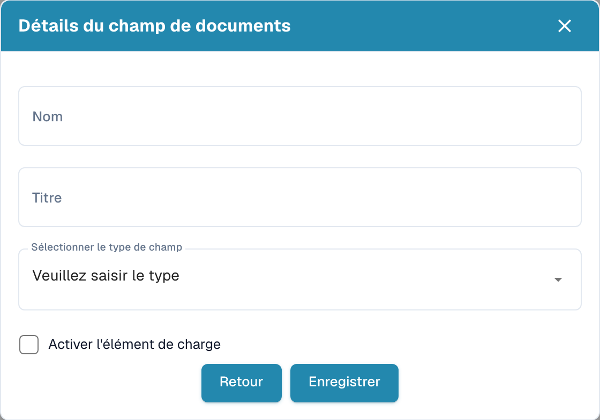
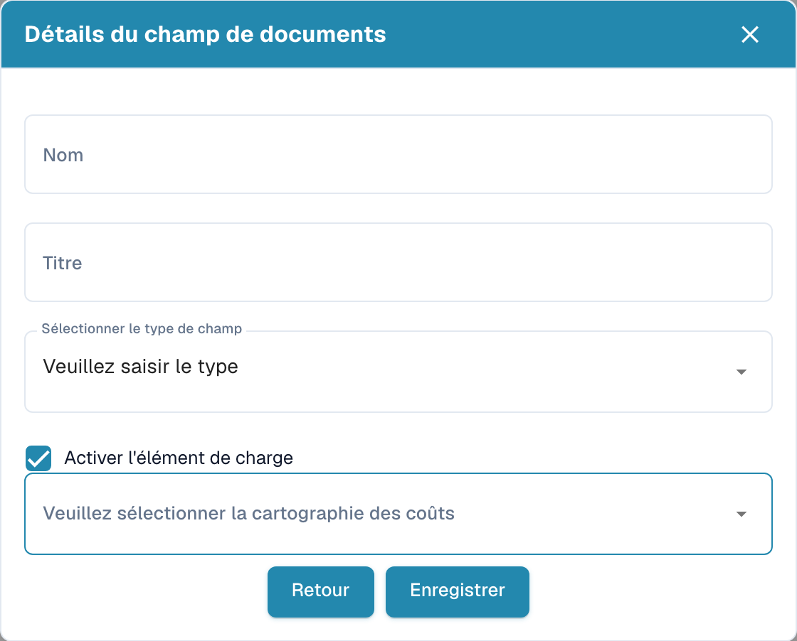

# Créer des champs avec des frais supplémentaires

Dans les paramètres, ouvrez le type de document puis ses champs. Dans le groupe prévu, choisissez la création d’un champ.

<figure><figcaption>
Détails du champ avant la création d’un nouveau champ.
</figcaption></figure>

1. Saisissez un nom technique et un titre lisible.
2. Sélectionnez le type de donnée.
3. Activez l’option des frais supplémentaires pour afficher la sélection de correspondance des coûts.
4. Choisissez la correspondance prévue pour ces frais. Les options dépendent de la configuration de votre organisation.

<figure><figcaption>
Brouillon de champ avec l’option de frais supplémentaires activée.
</figcaption></figure>

L’exemple est un brouillon non enregistré. L’enregistrement crée le champ ; revenez en arrière si vous ne souhaitez pas le créer. Vérifiez ensuite séparément l’obligation, la validation forcée, l’OCR et Match Score dans la liste des champs.
