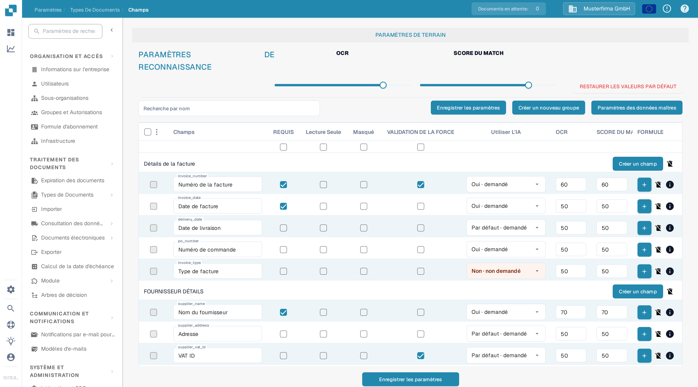
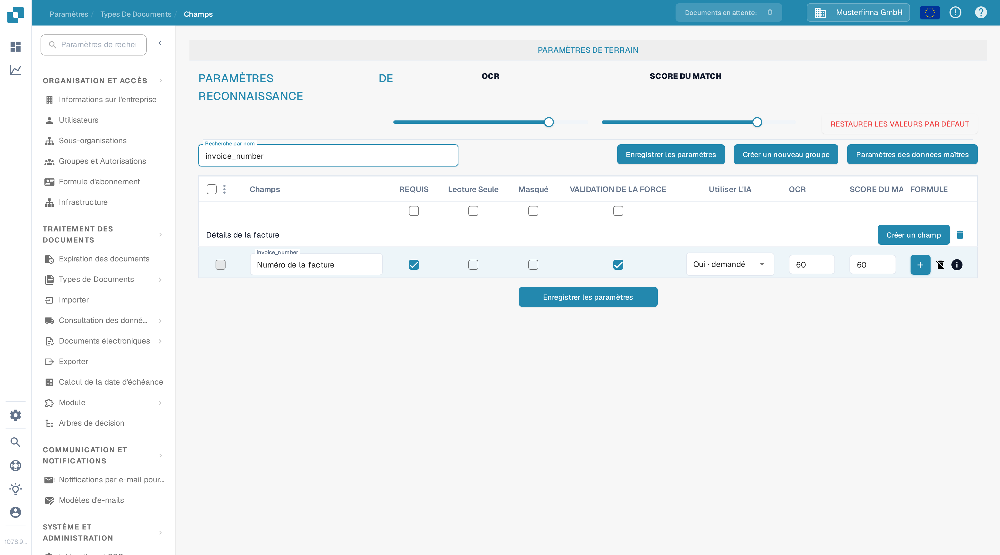

# Paramétrage de la validation et du score de correspondance

Dans **Champs**, vous pouvez définir les seuils de validation et de reconnaissance d'un type de document. Cette page utilise **Facture** dans une organisation de test de la documentation. Elle explique la case à cocher **VALIDATION DE LA FORCE** et les contrôles **SCORE DU MATCH** actuels.

## Ouvrir les paramètres des champs

1. Allez dans **Paramètres → Types De Documents → Facture → Champs**.
2. Utilisez **Recherche par nom** pour trouver un champ, par exemple `invoice_number` (affiché comme **Numéro de la facture**).
3. Vérifiez la ligne du champ avant de modifier un paramètre. **REQUIS**, **Lecture Seule**, **Masqué** et **VALIDATION DE LA FORCE** sont des cases à cocher indépendantes.

<figure><figcaption>
Les contrôles de reconnaissance apparaissent au-dessus de la liste des champs.
</figcaption></figure>

## VALIDATION DE LA FORCE (Force Validation)

Cochez **VALIDATION DE LA FORCE** dans la ligne du champ pour appliquer une validation plus stricte à ce champ. La case à cocher est indépendante de **REQUIS** : marquer un champ comme requis ne coche pas VALIDATION DE LA FORCE automatiquement. La case à cocher peut être indisponible lorsque un champ est masqué ou en lecture seule. Cliquez sur **Enregistrer les paramètres** après avoir modifié la configuration du champ.

Les anciennes instructions suggéraient de saisir ici des limites numériques ou des expressions régulières. La table des Champs actuelle n'affiche pas d'éditeur de règles dans la cellule VALIDATION DE LA FORCE. Pour les règles spécifiques à un champ, consultez [Configuration des propriétés de champ](configuring-field-properties-1.md).

## SCORE DU MATCH (Match Score)

**SCORE DU MATCH** est un seuil numérique, pas une valeur de référence fixe. Le curseur **SCORE DU MATCH** dans **PARAMÈTRES DE RECONNAISSANCE** applique sa valeur aux lignes de champs du type de document ; utilisez le champ **SCORE DU MATCH** d'une ligne pour une valeur individuelle. Dans l'organisation de test, le curseur affiche **80** et la ligne `invoice_number` affiche **60**. Vérifiez les champs concernés, puis cliquez sur **Enregistrer les paramètres**.

<figure><figcaption>
Recherchez un champ pour vérifier sa case VALIDATION DE LA FORCE et sa valeur de SCORE DU MATCH.
</figcaption></figure>

**OCR** est un seuil de reconnaissance distinct situé à côté du SCORE DU MATCH. **RESTAURER LES VALEURS PAR DÉFAUT** réinitialise les paramètres ; utilisez-le uniquement lorsque vous souhaitez abandonner vos seuils personnalisés. Pour les autres options de champs, consultez la [présentation des Champs](README.md).
