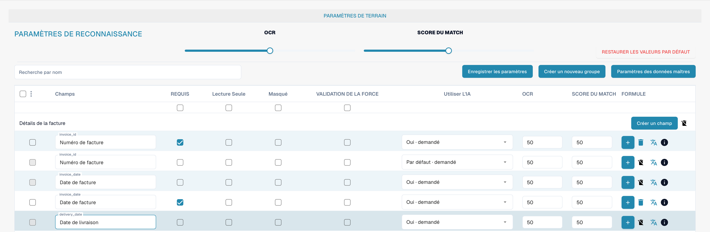
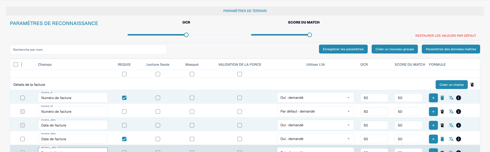
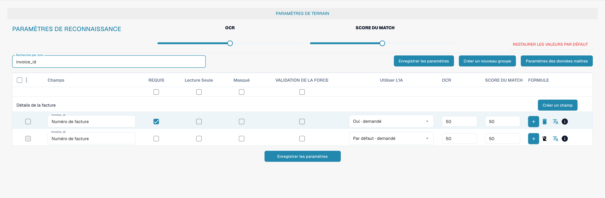

# Validation et score de correspondance

L’obligation, la validation forcée, l’OCR et Match Score sont des propriétés différentes d’un champ. Consultez les champs du type de document pour les vérifier.

<figure><figcaption>
Colonnes distinctes de validation forcée, OCR et Match Score.
</figcaption></figure>

## Validation forcée

La validation forcée demande une vérification explicite du champ. Elle ne crée pas à elle seule une expression régulière ni une règle de comparaison. Les règles de validation personnalisées se configurent séparément.

<figure><figcaption>
Validation et reconnaissance configurées séparément pour chaque champ.
</figcaption></figure>

## OCR et Match Score

OCR définit le seuil de reconnaissance du champ. Match Score est un seuil numérique de correspondance ; ce n’est ni un texte de référence ni un sélecteur de valeur de comparaison.

<figure><figcaption>
Numéro de facture filtré avec validation forcée et Match Score.
</figcaption></figure>

Contrôlez le comportement avec des documents représentatifs avant d’enregistrer les paramètres. L’obligation d’un champ ne remplace pas la validation forcée.
