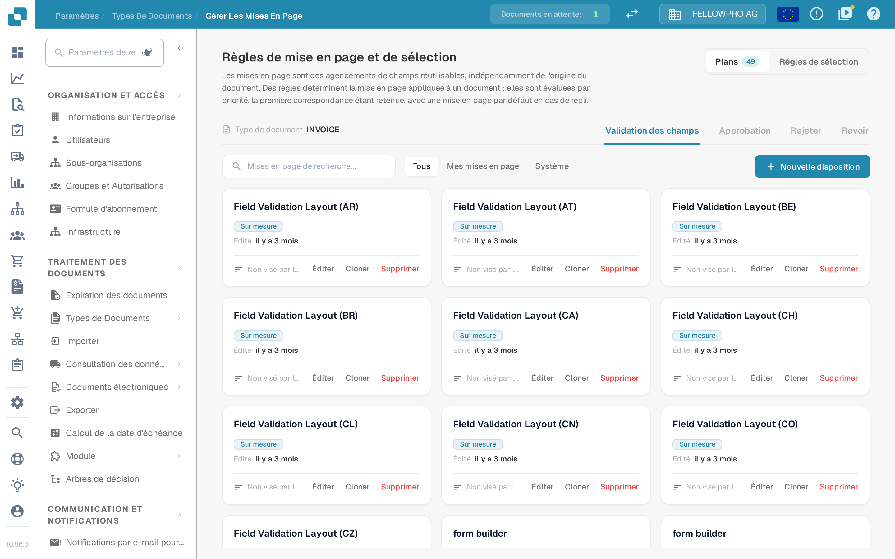

# Gestionnaire de mise en page

<figure><figcaption>Le gestionnaire de mise en page pour le type de document Invoice.</figcaption></figure>

Le **gestionnaire de mise en page** détermine l'aspect d'un type de document pour les personnes qui valident, approuvent, rejettent et revoient les documents : quels champs et quels groupes apparaissent à l'écran, dans quel ordre, et comment chaque champ se comporte. Chaque type de document possède ses propres mises en page.

La page s'ouvre sur **Règles de mise en page et de sélection** : les mises en page sont des agencements de champs réutilisables, indépendants de l'origine du document, et les règles déterminent la mise en page appliquée à un document.

#### Écrans et types de mise en page

La validation, l'approbation, le rejet et la revue sont des écrans distincts, et chacun possède ses propres mises en page, ses propres règles et sa propre mise en page par défaut : une règle d'approbation ne modifie jamais l'écran de validation. Changez d'écran avec les onglets **Validation des champs**, **Approbation**, **Rejeter** et **Revoir**.

#### Cartes de mise en page

Dans l'onglet **Plans**, chaque mise en page de l'écran sélectionné est une carte. Une carte indique le nom de la mise en page, si elle appartient à votre organisation (**Sur mesure**) ou s'il s'agit de la mise en page système par défaut, la date de sa dernière modification et si une règle de sélection la cible. **Éditer** ouvre la mise en page dans le Layout Builder, **Cloner** la copie sous un nom de votre choix et **Supprimer** la retire — la mise en page système par défaut peut seulement être consultée, ni modifiée ni supprimée. **Nouvelle disposition** demande un nom et ouvre le Layout Builder sur la nouvelle mise en page vide. Le filtre au-dessus des cartes bascule entre **Tous**, **Mes mises en page** et **Système**.

#### Le Layout Builder

**Éditer** ouvre le [Layout Builder](navigating-the-layout-manager.md) :

* **Structure**, **Champs** et **Éléments** à gauche — la mise en page sous forme d'arborescence, chaque champ du type de document avec un compteur des champs déjà placés, ainsi que les groupes et les éléments de formulaire à faire glisser sur le canevas.
* Le **canevas** au centre montre la mise en page telle que l'utilisateur la voit. **Mise en page principale** et **Tableau** basculent entre la page et un tableau de postes, **Document** ouvre le document d'exemple à côté.
* Le panneau **Propriétés** à droite suit l'élément sélectionné ; ses paramètres sont regroupés en affichage, comportement, valeurs et listes, automatisation, bordures et espacement.

**Enregistrer** dans l'en-tête conserve la mise en page. Pour les autres actions de l'en-tête, voir [Enregistrer et appliquer les modifications](save-and-apply-changes.md).

#### Quelle mise en page reçoit un document

L'onglet **Règles de sélection** de chaque écran contient les règles qui choisissent la mise en page : elles sont évaluées par priorité, la première correspondance étant retenue, et une mise en page par défaut s'applique en cas de repli. Voir [Règles de sélection de mise en page](layout-selection-rules.md).
