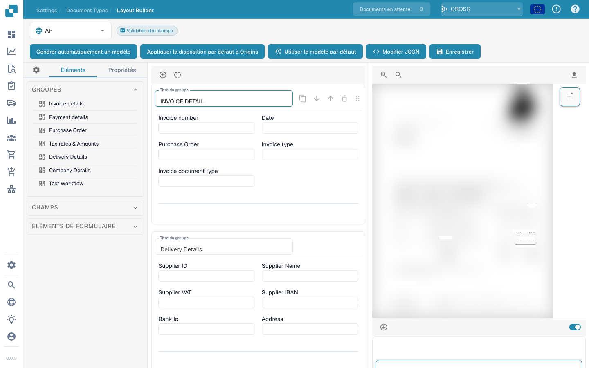

# Gestionnaire de mise en page

<figure><figcaption></figcaption></figure>

#### Vue d’ensemble

Le gestionnaire de mise en page permet aux administrateurs de configurer et de modifier visuellement la mise en page des types de documents en définissant les propriétés de divers champs et groupes de données au sein d'un document. Cette interface permet de garantir que les modèles d'extraction et les points de saisie manuelle des données s'alignent précisément sur la structure du document tel qu'il est numérisé ou téléversé dans Docbits.

#### Composants principaux

1. **Groupes et champs** :
   * **Groupes** : unités organisationnelles au sein d'un type de document qui catégorisent les champs associés (par exemple, détails de la facture, détails du paiement). Ceux-ci peuvent être développés ou réduits et disposés pour refléter le regroupement logique dans le document réel.
   * **Champs** : points de données individuels au sein de chaque groupe (par exemple, numéro de facture, conditions de paiement). Chaque champ peut être personnalisé en fonction de la manière dont les données sont capturées, affichées et traitées.
2. **Properties Panel**:
   * Ce panneau affiche les propriétés du champ ou du groupe sélectionné, permettant une configuration détaillée, telle que :
     * **Label** : L'étiquette visible du champ dans l'interface utilisateur.
     * **Field Name** : L'identifiant technique utilisé dans le système.
     * **Largeur de l'élément en pourcentage** : Détermine la largeur du champ par rapport à la mise en page du document.
     * **Tab Index** : Contrôle l'ordre de tabulation pour la navigation.
     * **Exécuter le script en cas de changement** : s'il faut exécuter un script lorsque la valeur du champ change.
     * **Afficher l'étiquette à gauche** : Indique si l'étiquette est affichée à gauche du champ ou au-dessus de celui-ci.
     * **Is Textarea** : Spécifie si le champ doit être une zone de texte, pouvant accueillir de plus grandes quantités de texte.
     * **Sélectionner le type de modèle** : Option pour sélectionner le type de modèle qui gérera l'extraction de ce champ.
     * **Longueur du champ** : Longueur maximale des données à accepter dans ce champ.
     * **Mots clés interdits** : Mots clés non autorisés dans le champ.
3. **Template Preview**:
   * Affiche un aperçu en temps réel de la façon dont le document apparaîtra en fonction de la configuration de mise en page actuelle. Cela permet de garantir que la mise en page correspond à la structure réelle du document et est essentiel pour tester et affiner la configuration du traitement des documents.



