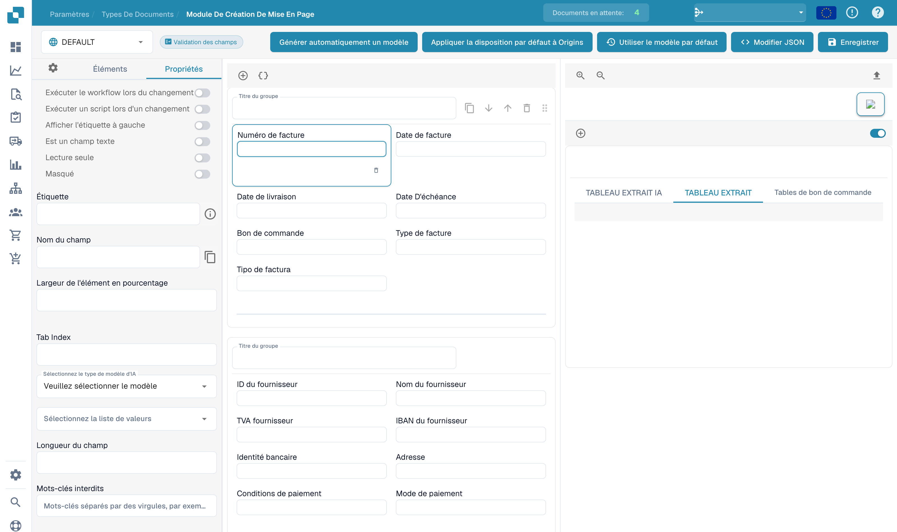

# Configurer les propriétés d’un champ

Ouvrez une mise en page existante dans le générateur et sélectionnez un champ de l’aperçu. Le panneau des propriétés présente les commandes de cet élément.

<figure><figcaption>
Propriétés d’un champ dans le générateur de mise en page.
</figcaption></figure>

Vérifiez le libellé, le nom technique, la largeur en pourcentage et l’ordre de tabulation. Selon l’élément, vous pouvez aussi configurer la lecture seule, la visibilité, la position du libellé, une saisie multiligne ou l’exécution d’un workflow ou script lorsque la valeur change.

Sélectionnez le modèle d’IA ou la liste de valeurs appropriée si le champ les propose. La longueur et les mots interdits ajoutent des contraintes. Les noms techniques et les noms d’origine configurés ne changent pas avec la langue de l’interface.

Vérifiez l’aperçu après chaque changement. Enregistrez les modifications prévues et testez la validation avec des documents représentatifs. Les règles de validation et seuils de reconnaissance du type de document se configurent séparément.
