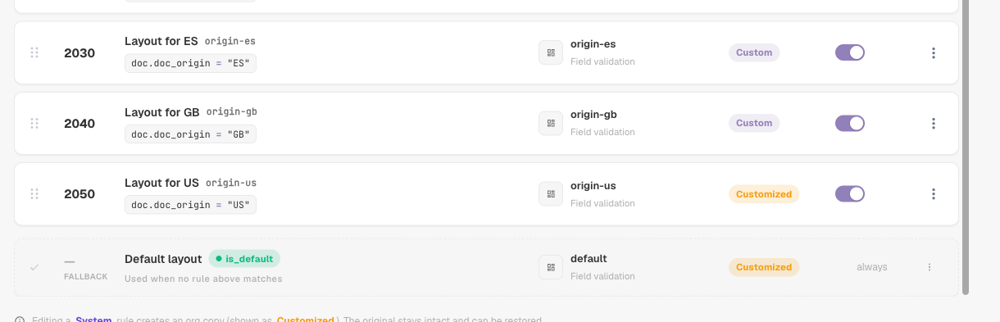

# Règles de sélection de mise en page

## Vue d'ensemble

Une **mise en page** détermine quels champs et groupes un utilisateur voit — et dans quel ordre — sur les écrans de **validation**, d'**approbation**, de **rejet** et de **révision** d'un document. Vous concevez les mises en page dans le [Gestionnaire de mise en page](README.md).

Classiquement, DocBits choisissait la mise en page selon l'**origine** du document : le pays ou la région tirés des paramètres de langue du document, par exemple `DE` ou `US`. Chaque origine avait sa propre copie de la mise en page, et rien d'autre ne pouvait influencer le choix.

Avec les **règles de sélection de mise en page**, les mises en page deviennent des blocs réutilisables indépendants de l'origine, et ce sont des **règles** qui décident de la mise en page d'un document :

> *Quand* le document remplit une condition, *alors* il obtient cette mise en page. Les règles sont vérifiées de haut en bas ; **la première règle qui correspond l'emporte**. Si aucune règle ne correspond, la **mise en page par défaut** est utilisée.

L'origine reste disponible — comme une condition parmi d'autres. Une règle peut tout aussi bien porter sur le fournisseur, le montant, le statut du document, la méthode d'extraction ou n'importe quel champ d'en-tête.

### Problèmes résolus

| Besoin | Mises en page classiques par origine | Avec les règles de sélection |
| --- | --- | --- |
| Les factures d'un fournisseur nécessitent des champs supplémentaires (projet, numéro de douane) | impossible sans nouvelle origine | règle *L'ID fournisseur est 20723* → mise en page « Facture avec champs projet » |
| Les documents DE, AT et CH doivent avoir le même aspect | trois copies de la même mise en page à maintenir | une seule mise en page, une règle par origine (ou un groupe ANY) qui y renvoie |
| Les factures électroniques nécessitent un écran plus simple que les PDF numérisés | impossible | règle *La méthode d'extraction est ELECTRONIC_DOCUMENT* → mise en page « Facture électronique » |
| Les factures de montant élevé nécessitent plus de champs sur l'écran d'approbation | impossible | règle d'approbation *Le montant total est supérieur à 10000* → mise en page « Approbation montant élevé » |
| Le second approbateur doit voir un écran différent du premier | type de mise en page distinct « seconde approbation » | règle d'approbation *Le statut du document est Pending second approval* → mise en page « Seconde approbation » |

## Activer les mises en page basées sur des règles

Les mises en page basées sur des règles s'activent **par type de document** par un **administrateur de l'organisation**.

1. Allez dans **Paramètres → Paramètres globaux → Types de documents**.
2. Cliquez sur l'icône **paramètres** (engrenage) sur la carte du type de document.
3. Ouvrez **Gérer les mises en page** et activez l'interrupteur.

<figure><figcaption>
L'interrupteur Gérer les mises en page dans les paramètres supplémentaires d'un type de document
</figcaption></figure>

Le lien **Mises en page** sur la carte du type de document ouvre désormais **Mises en page et règles de sélection**.

### Ce qui se passe lorsque vous l'activez

DocBits convertit vos mises en page existantes basées sur l'origine en règles — une seule fois, pour ce type de document et pour chaque écran :

* La mise en page de l'origine **DEFAULT** devient la **mise en page par défaut** (le repli).
* Chaque mise en page d'une origine spécifique devient une règle **« Layout for XX »** avec la condition *L'origine du document est XX*, qui renvoie à cette mise en page. Ces règles reçoivent des priorités par pas de 10 (par exemple 2000, 2010, 2020 …), afin que vous puissiez placer vos propres règles avant, entre ou après elles.

<figure><figcaption>
Les règles d'origine créées à l'activation, suivies de la mise en page par défaut (FALLBACK)
</figcaption></figure>

Rien n'est supprimé ni modifié dans les mises en page elles-mêmes. Juste après l'activation, chaque document obtient donc exactement la mise en page qu'il obtenait auparavant. Le comportement ne change que lorsque vous ajoutez ou modifiez des règles.

**La désactivation** ramène immédiatement le type de document à la sélection basée sur l'origine. Les règles sont conservées mais non utilisées, et elles reprennent effet lorsque vous réactivez l'interrupteur.

## L'écran Mises en page et règles de sélection

<figure><figcaption>
L'onglet Mises en page : chaque mise en page du type de document sous forme de carte
</figcaption></figure>

* **Mises en page / Règles de sélection** (en haut à droite) permettent de basculer entre la liste des mises en page et la liste des règles. Les nombres indiquent combien il y en a.
* **Validation des champs / Approbation / Rejet / Révision** changent d'**écran**. Chaque écran a ses propres mises en page, ses propres règles et sa propre mise en page par défaut — une règle d'approbation ne modifie jamais l'écran de validation.
* Dans l'onglet **Mises en page**, vous pouvez créer, modifier, cloner et supprimer des mises en page. Chaque carte indique si une règle utilise la mise en page (« Aucune règle ne la cible » si ce n'est pas le cas). Filtrez avec **Toutes / Mes mises en page / Système** ; les mises en page système sont fournies avec DocBits et peuvent être consultées et clonées, mais pas modifiées.


La première et la seconde approbation partagent les mises en page et les règles **Approbation**. Pour donner à la seconde étape d'approbation son propre écran, ajoutez une règle d'approbation avec la condition *Le statut du document est Pending second approval* — voir l'[exemple](#ecrans-differents-pour-la-premiere-et-la-seconde-approbation).


## Comment une mise en page est choisie

Chaque fois qu'un document est ouvert, puis de nouveau après son enregistrement, DocBits détermine sa mise en page pour l'écran courant :

1. Les **règles actives** de l'écran sont vérifiées par ordre de **priorité** (le nombre le plus bas d'abord). **La première règle dont la condition est vraie l'emporte**, et sa mise en page est utilisée.
2. Si aucune règle ne correspond, la **mise en page par défaut** est utilisée.
3. S'il n'y a pas non plus de mise en page par défaut, DocBits revient au choix classique basé sur l'origine.

Les règles dont la mise en page a été supprimée ou est vide sont ignorées.

### Un exemple concret

Règles de l'écran **Validation des champs** :

| Priorité | Règle | Condition | Mise en page |
| --- | --- | --- | --- |
| 5 | Factures Behaelterbau | *L'ID fournisseur est HP0000278* | Facture avec champs projet |
| 10 | Factures électroniques | *La méthode d'extraction est ELECTRONIC_DOCUMENT* | Facture électronique |
| 2020 | Layout for DE | *L'origine du document est DE* | Field Validation Layout (DE) |
| — | Mise en page par défaut | — | Field Validation Layout (Base) |

Mise en page obtenue par chaque document :

| Document | Fournisseur | Extraction | Origine | Mise en page | Parce que |
| --- | --- | --- | --- | --- | --- |
| 1 | HP0000278 | facture électronique | DE | Facture avec champs projet | la priorité 5 correspond en premier ; les règles suivantes ne sont pas vérifiées |
| 2 | 10040 | facture électronique | DE | Facture électronique | la priorité 5 ne correspond pas, la 10 oui |
| 3 | 10040 | PDF numérisé | DE | Field Validation Layout (DE) | seule la règle d'origine correspond |
| 4 | 10040 | PDF numérisé | US | Field Validation Layout (Base) | aucune règle ne correspond → par défaut |

**L'ordre compte** : placez les règles spécifiques (un fournisseur) au-dessus des règles générales (un pays).

### Lorsqu'un utilisateur modifie un champ examiné par les règles

La mise en page est toujours choisie à partir des valeurs **actuelles** du document. Si un utilisateur corrige, par exemple, le fournisseur sur l'écran de validation, DocBits choisit de nouveau la mise en page après l'enregistrement, et l'écran peut passer à une autre mise en page. Aucune donnée n'est perdue : un champ qui ne fait pas partie de la nouvelle mise en page conserve sa valeur ; il n'est simplement pas affiché tant qu'une mise en page qui le contient ne s'applique pas de nouveau.

## Gérer les règles de sélection

<figure><figcaption>
L'onglet Règles de sélection de l'écran Validation des champs
</figcaption></figure>

Chaque ligne affiche la **priorité** (la première ligne est marquée **FIRST**), le **nom et la clé de la règle** avec ses **conditions**, la **mise en page cible**, le badge de **source** et un interrupteur **Actif**.

| Tâche | Comment |
| --- | --- |
| Créer une règle | **Nouvelle règle** |
| Modifier une règle | Cliquez sur la ligne |
| Changer l'ordre | Faites glisser la poignée à gauche d'une ligne vers le haut ou le bas. Le nouvel ordre est enregistré immédiatement. |
| Désactiver une règle | Interrupteur **Actif**. Les règles inactives sont ignorées. |
| Dupliquer ou supprimer | Menu **⋮** de la ligne |
| Trouver une règle | **Rechercher des règles…** |

Le badge de **source** indique l'origine d'une règle : les règles **Système** sont fournies avec DocBits. En modifier une crée une copie pour votre organisation, affichée comme **Personnalisée** ; l'original reste intact et peut être restauré. Les règles que vous créez sont **Personnalisées**.

### La mise en page par défaut

La dernière ligne, marquée **FALLBACK** et **is_default**, est la mise en page par défaut : elle est utilisée chaque fois qu'aucune règle ci-dessus ne correspond et n'a pas de condition. Elle est créée lorsque vous activez la fonction (à partir de la mise en page de l'origine DEFAULT).


Pour utiliser une autre mise en page de repli, créez une règle **sans aucune condition** et donnez-lui le numéro de priorité le plus élevé, afin qu'elle soit vérifiée en dernier. Elle correspond à tous les documents qu'aucune règle précédente n'a retenus, avant que la mise en page par défaut ne soit atteinte.


## Créer une règle

Cliquez sur **Nouvelle règle** dans l'onglet Règles de sélection de l'écran que vous souhaitez modifier.

<figure><figcaption>
L'éditeur de règle : phrase récapitulative en haut, trois étapes à gauche, aperçu en direct à droite
</figcaption></figure>

La phrase en haut résume la règle au fur et à mesure de sa construction — « When header.supplier_id = HP0000278, an INVOICE document gets the Field Validation Layout (Base) layout for Field validation. Checked at priority 5 — the first matching rule wins. »

### Étape 1 — Portée et priorité

| Paramètre | Ce qu'il fait |
| --- | --- |
| **Nom de la règle** | Affiché dans la liste des règles. Décrivez le cas métier : « Factures Behaelterbau », « Factures électroniques », « Approbation montant élevé ». |
| **Clé de la règle** | Générée à partir du nom ; reste identique si vous renommez la règle. |
| **Type de document** / **Type de mise en page** | Le type de document et l'écran concernés par la règle. Repris de l'endroit où vous avez cliqué sur **Nouvelle règle**. |
| **Priorité** | Les nombres les plus bas sont vérifiés en premier. Laissez des écarts (5, 10, 20 …) pour pouvoir insérer des règles plus tard. |

### Étape 2 — S'applique quand

La condition qu'un document doit remplir. Vous pouvez utiliser :

* des **attributs du document** : Origine du document, Méthode d'extraction, Statut du document, Sous-type de document,
* des **champs d'en-tête** : ID fournisseur, Montant total, Devise, Bon de commande et tous les autres champs du type de document,
* un **chemin JSON personnalisé** (Avancé).

Les colonnes de tableau ne sont pas disponibles : la mise en page est choisie une seule fois pour l'ensemble du document.

Laissez l'étape vide pour retenir tous les documents à cette priorité. Le fonctionnement des conditions — ALL / ANY, groupes imbriqués, tous les opérateurs, valeurs vides, majuscules/minuscules — est expliqué dans [Conditions de règle (S'applique quand)](../rule-conditions-applies-when.md).

### Étape 3 — Mise en page cible

Cliquez sur la mise en page que le document doit obtenir. La liste affiche vos propres mises en page et les mises en page système de l'écran sélectionné. Une mise en page ne peut pas être supprimée tant qu'une règle y renvoie encore.

### Aperçu en direct · /resolve

Le panneau de droite montre ce que fait la règle pour un exemple de document dont les valeurs correspondent à vos conditions :

| Ligne | Signification |
| --- | --- |
| **Sample document** | Les valeurs utilisées pour l'aperçu, tirées de vos conditions |
| **matched_by** | `rule` si une règle a correspondu, sinon la mise en page par défaut |
| **Resolved layout** | La mise en page que l'exemple de document obtiendrait |
| **Priority hit** | La priorité de la règle qui a correspondu |
| **watched_fields** | Les champs dont dépend le choix de la mise en page. Lorsqu'un utilisateur en modifie un, la mise en page est choisie de nouveau. |

Cliquez sur **Créer la règle** (ou **Enregistrer la règle** lors d'une modification) pour enregistrer. **Annuler** ramène à la liste des règles.

## Exemples

### Champs supplémentaires pour un fournisseur

Écran **Validation des champs** · priorité **5** · *L'ID fournisseur est HP0000278* · cible *Facture avec champs projet* (un clone de votre mise en page standard avec les champs supplémentaires projet et centre de coûts).

### Une mise en page pour plusieurs pays

Écran **Validation des champs** · priorité **100** · **ANY** : *L'origine du document est Deutsch*, *L'origine du document est Austria*, *L'origine du document est Switzerland* · cible *Facture DACH*. Désactivez les règles migrées « Layout for AT » et « Layout for CH » si elles renvoient à des copies plus anciennes.

### Un écran plus simple pour les factures électroniques

Écran **Validation des champs** · priorité **10** · *La méthode d'extraction est ELECTRONIC_DOCUMENT* · cible *Facture électronique* (sans les champs liés à l'OCR).

### Un écran d'approbation plus strict pour les montants élevés

Écran **Approbation** · priorité **10** · *Le montant total est supérieur à 10000* · cible *Approbation montant élevé* (affichant centre de coûts, responsable budgétaire et numéro de contrat).

### Écrans différents pour la première et la seconde approbation

Écran **Approbation** · priorité **5** · *Le statut du document est Pending second approval* · cible *Second Approval Layout*. Les documents en première étape d'approbation ne correspondent pas et obtiennent la mise en page par défaut d'Approbation.

<figure><figcaption>
Une règle d'approbation pour la seconde étape d'approbation ; l'aperçu résout la mise en page Second Approval Layout
</figcaption></figure>

### Un écran de rejet spécial pour certains fournisseurs

Écran **Rejet** · priorité **10** · *L'ID fournisseur fait partie de* `10040, 10041` · cible *Rejet avec codes de motif*.

## Bonnes pratiques

* **Le spécifique avant le général.** Les règles par fournisseur au-dessus des règles par pays, les règles par pays au-dessus de la mise en page par défaut.
* **Laissez des écarts de priorité** (5, 10, 20 …) pour que les nouvelles règles s'insèrent sans renumérotation.
* **Basez les conditions sur des champs fiables.** Le fournisseur et l'origine sont définis tôt et changent rarement. Des conditions sur des champs que les utilisateurs modifient souvent font changer l'écran de mise en page pendant leur travail.
* **Clonez, ne repartez pas de zéro.** Clonez votre mise en page standard et ajustez-la, afin que toutes les mises en page gardent la même structure de base.
* **Vérifiez l'aperçu en direct** et ouvrez un document réel de chaque sorte après avoir modifié des règles.
* **Conservez une mise en page par défaut pertinente** pour chaque écran, afin qu'aucun document ne se retrouve sans mise en page.

## Dépannage

| Symptôme | Ce qu'il faut vérifier |
| --- | --- |
| Un document obtient la mauvaise mise en page | Une règle précédente correspond en premier. Examinez les règles au-dessus, ou le **Priority hit** dans l'aperçu. |
| La mise en page par défaut est utilisée alors qu'une règle devrait correspondre | La règle est-elle **Active** ? La condition correspond-elle exactement à la valeur (casse, espaces) ? La règle est-elle sur le bon onglet d'**écran** ? |
| La mise en page change pendant le travail d'un utilisateur | Un champ de **watched_fields** a été modifié. Basez la règle sur un champ plus stable. |
| Une mise en page ne peut pas être supprimée | Une règle y renvoie encore. Redirigez ou supprimez d'abord cette règle. |
| Aucune mise en page n'est affichée | Aucune règle n'a correspondu, il n'y a pas de mise en page par défaut et aucune mise en page basée sur l'origine n'existe pour cet écran. Ajoutez une règle sans condition comme règle fourre-tout. |
| Rien n'a changé après l'activation | C'est normal : l'activation reproduit le choix précédent basé sur l'origine. Ajoutez vos propres règles. |
| La seconde approbation affiche la mise en page de la première | Ajoutez une règle d'approbation sur *Le statut du document est Pending second approval* au-dessus des autres règles d'approbation. |

## Voir aussi

* [Conditions de règle (S'applique quand)](../rule-conditions-applies-when.md)
* [Règles de validation personnalisées](../custom-validation-rules.md)
* [Règles de transformation](../transformation-rules.md)
* [Navigation dans le Gestionnaire de mise en page](navigating-the-layout-manager.md)
