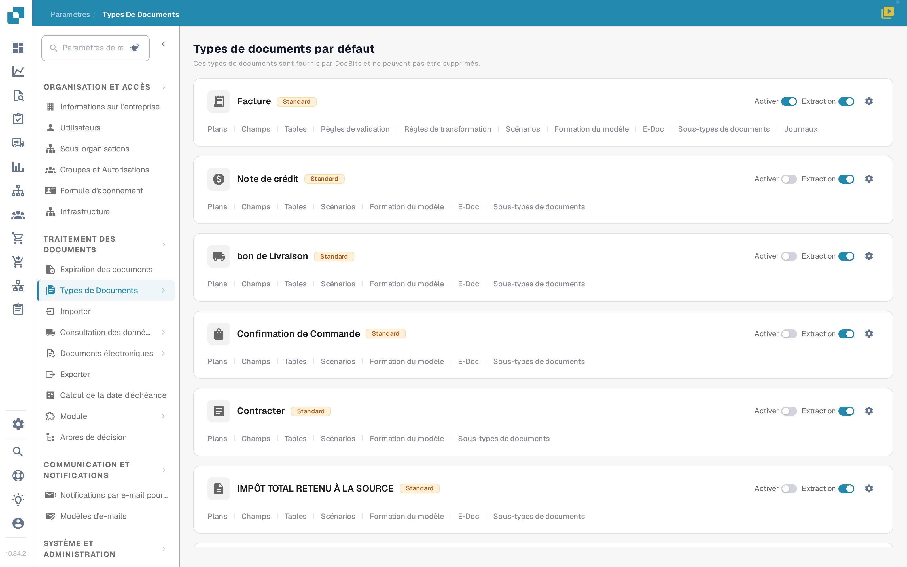
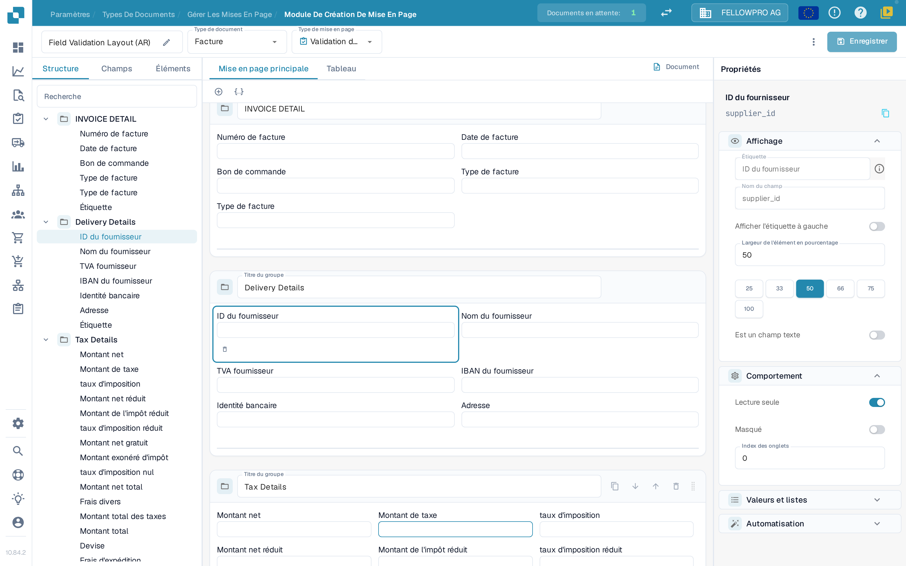
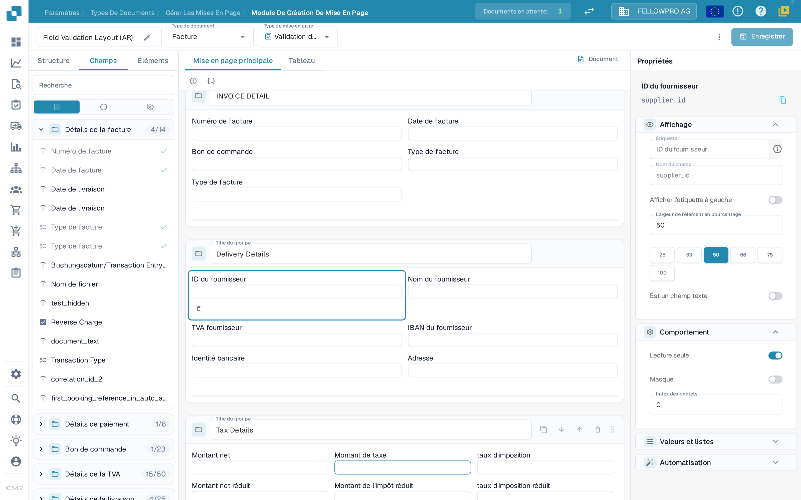
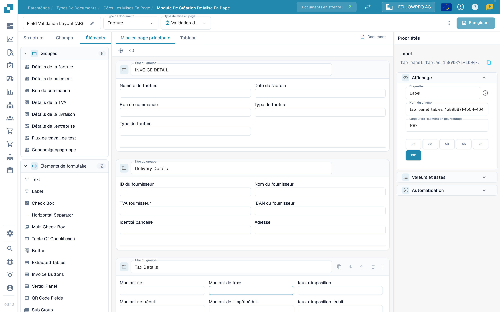

# Navigation dans le Gestionnaire de Mise en Page

Le **Gestionnaire de mise en page** sert à organiser les groupes et les champs que les utilisateurs voient sur un document. Ce guide s'appuie sur la mise en page de **Facture** d'une organisation sandbox ; les captures d'écran montrent l'interface en français.

## Ouvrir la mise en page de la facture

1. Allez dans **Paramètres → Types de documents**.
2. Repérez **Facture** et sélectionnez **Plans** sous son nom. Le Gestionnaire de mise en page s'ouvre pour ce type de document.
3. L'en-tête affiche le nom de la mise en page (modifiable avec le crayon), le **Type de document** et le **Type de mise en page**. Ce dernier sélecteur permet de passer à une autre mise en page du même type de document.

<figure><figcaption>
Les plans d'un type de document s'ouvrent depuis sa carte.
</figcaption></figure>

## Travailler avec les trois onglets du panneau

Le panneau de gauche comporte trois onglets : **Structure**, **Champs** et **Éléments**. Le Gestionnaire de mise en page s'ouvre sur **Champs**.

**Structure** présente la mise en page sous forme d'arborescence, dans l'ordre où les groupes et les champs apparaissent sur le document. Dépliez un groupe avec son chevron pour voir les champs qu'il contient ; le nom technique du champ apparaît dans le panneau **Propriétés**. La zone de recherche filtre l'arborescence et, lorsque vous sélectionnez une ligne, l'élément correspondant est sélectionné sur le canevas.

<figure><figcaption>
L'arborescence Structure, le canevas et le panneau Propriétés.
</figcaption></figure>

**Champs** réunit tous les champs proposés par le type de document, classés par groupe. Le compteur à droite du nom d'un groupe indique combien de ses champs sont déjà placés, par exemple **4/14**. Les trois boutons sous la zone de recherche, sans texte, filtrent la liste : tous les champs, uniquement ceux qui ne sont pas encore placés, ou uniquement ceux qui sont masqués. Chaque ligne affiche le libellé du champ ; une coche verte à droite signale les champs déjà présents dans la mise en page, qui apparaissent en grisé.

<figure><figcaption>
Filtrez les champs et repérez les champs déjà placés à leur coche.
</figcaption></figure>

**Éléments** contient les blocs à faire glisser sur le canevas : **Groupes**, avec les groupes de cette mise en page, et **Éléments de formulaire**, avec Text, Label, Check Box, Horizontal Separator, Multi Check Box, Table Of Checkboxes, Button, Extracted Tables, Invoice Buttons, Vertex Panel, QR Code Fields et Sub Group.

<figure><figcaption>
Les palettes Groupes et Éléments de formulaire.
</figcaption></figure>

## Placer et organiser les éléments

- Faites glisser un champ depuis **Champs**, ou un élément depuis **Éléments**, dans le groupe où il doit apparaître. Les champs déjà placés portent une coche dans l'onglet **Champs**.
- Faites glisser un champ à l'intérieur d'un groupe ou d'un groupe à l'autre pour le réordonner.
- Le **+** au-dessus du canevas ajoute un groupe vide ; l'icône JSON à côté crée un groupe à partir d'une définition JSON.
- Dans l'en-tête d'un groupe, vous pouvez renommer le groupe via **Titre du groupe**, copier son JSON, le déplacer vers le bas ou vers le haut, ou le supprimer. La poignée à droite de l'en-tête sert à déplacer le groupe.
- Sélectionnez un champ sur le canevas pour ouvrir ses propriétés à droite. La petite barre d'outils qui apparaît sous le champ sélectionné permet de le retirer de la mise en page.

## Le panneau Propriétés

Le panneau de droite reste toujours ouvert et suit l'élément que vous avez sélectionné. Ses réglages sont répartis en quatre sections : **Affichage**, **Comportement**, **Valeurs et listes** et **Automatisation**. **Affichage** regroupe le libellé, le nom du champ et la **Largeur de l'élément en pourcentage**, à choisir parmi les valeurs 25, 33, 50, 66, 75 et 100. Le détail de chaque option figure dans [Configurer les propriétés des champs](configuring-field-properties.md).

Les réglages de validation, d'OCR et de correspondance concernent le champ lui-même, pas la mise en page : configurez-les dans les [paramètres Champs](../fields/configuring-field-properties-1.md), qui sont distincts.

## Aperçu et enregistrement

Le canevas montre la mise en page telle qu'elle apparaîtra sur le document. Les onglets **Mise en page principale** et **Tableau** permettent de passer de la page à un tableau de lignes, et **Document** ouvre le document d'exemple à côté du canevas. Voir [Utiliser l'aperçu du modèle](using-the-template-preview.md).

Sélectionnez **Enregistrer** dans l'en-tête lorsque vous avez terminé. Les autres actions de l'en-tête, dont la génération de modèles, les modèles par défaut et l'application d'une mise en page aux origines, sont décrites dans [Enregistrer et appliquer les modifications](save-and-apply-changes.md).
