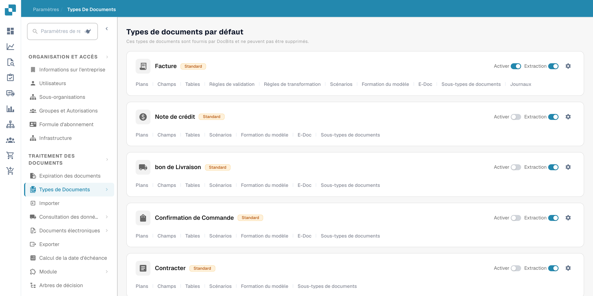
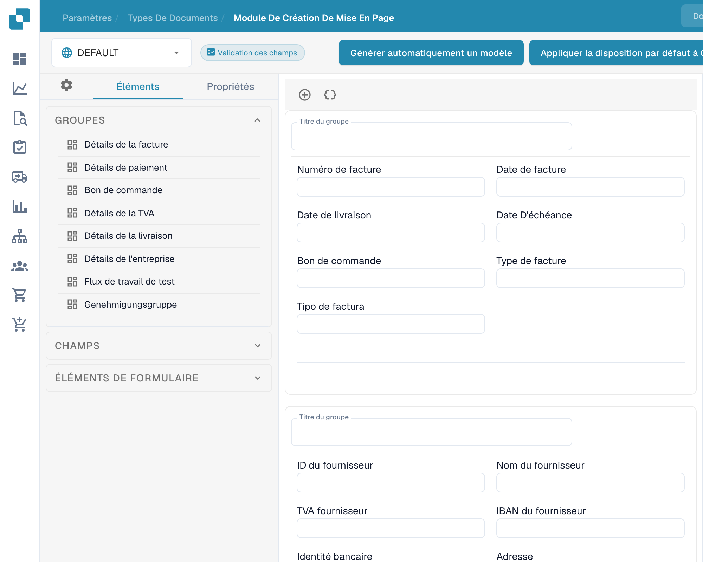
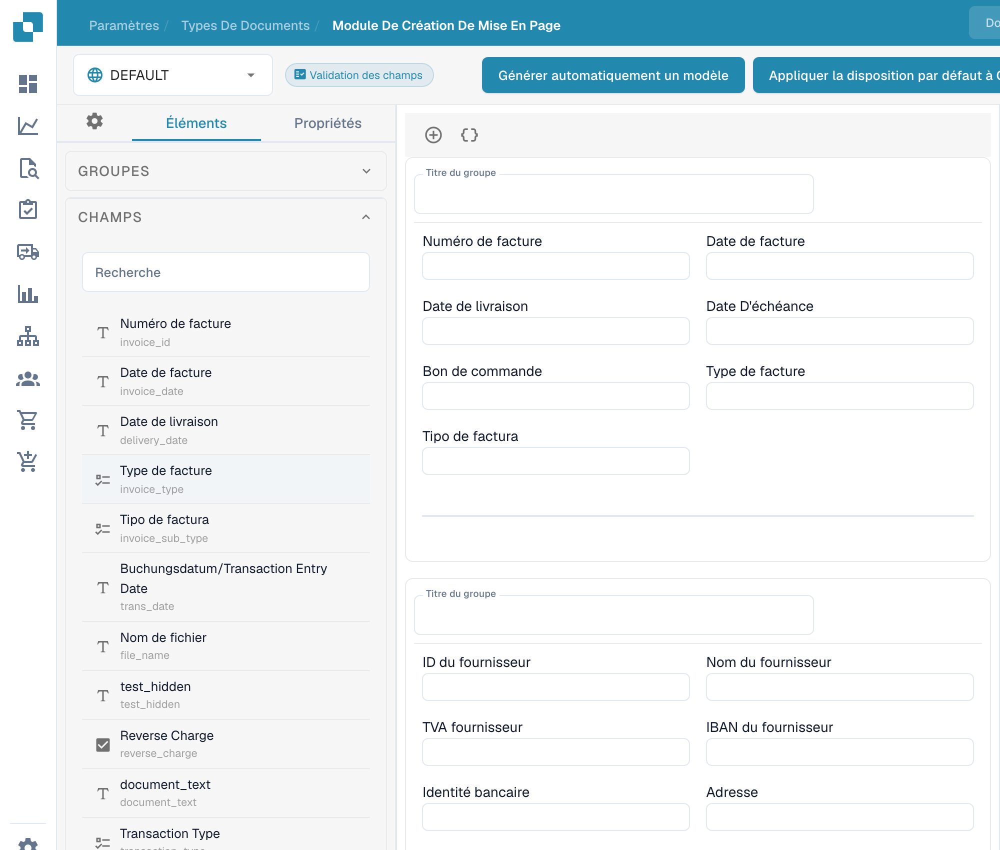
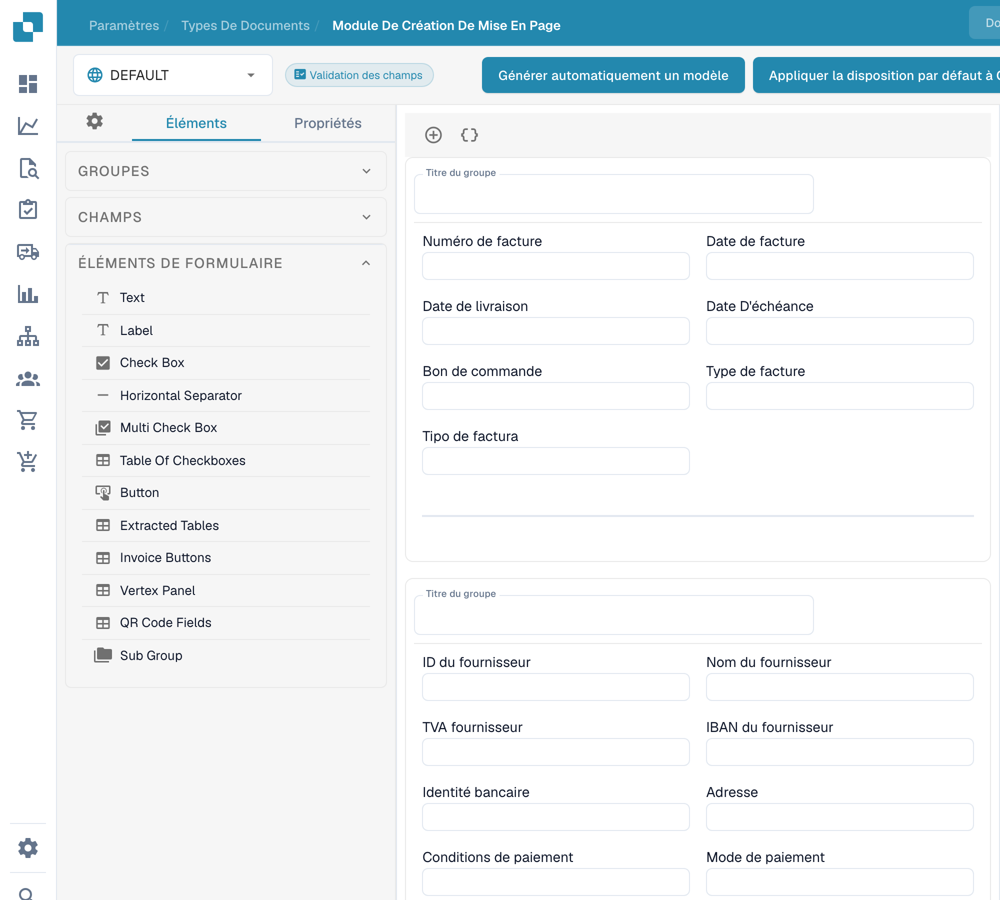

# Naviguer dans le Layout Builder

Utilisez le **Module de création de mise en page** pour organiser les champs et les groupes que les utilisateurs voient sur un document. Ce guide utilise la mise en page anglaise de **Facture** dans une organisation sandbox.

## Ouvrir la mise en page Invoice

1. Allez dans **Paramètres → Types de documents**.
2. Trouvez **Facture** et sélectionnez **Plans** sur sa carte. Le Layout Builder s'ouvre pour ce type de document.
3. Vérifiez le sélecteur de mise en page en haut à gauche. L'exemple ci-dessous affiche **DEFAULT**.

<figure><figcaption>
Accès aux types de document depuis les paramètres.
</figcaption></figure>

## Trouver les groupes et les champs

Le panneau **Éléments** à gauche comporte trois sections. **Groupes** répertorie les sections du document ; le canevas central montre leur disposition actuelle. Sélectionnez un champ dans le canevas et ouvrez **Propriétés** pour modifier ses paramètres d'affichage. Voir [Configuring Field Properties](configuring-field-properties.md) pour les options disponibles.

<figure><figcaption>
Éléments et groupes d’une mise en page existante.
</figcaption></figure>

Ouvrez **Champs** pour trouver les champs de document disponibles. Utilisez sa zone de recherche lorsque la liste est longue, puis faites glisser le champ vers le groupe souhaité dans le canevas. Les champs déjà placés dans la mise en page peuvent apparaître comme indisponibles dans la liste.

<figure><figcaption>
Champs disponibles dans le générateur de mise en page.
</figcaption></figure>

Ouvrez **Éléments de formulaire** pour les contrôles visuels tels que Text, Label, Check Box, séparateur, Button et Sub Group. Faites glisser l'élément dont vous avez besoin dans le canevas, puis vérifiez ses **Propriétés**.

<figure><figcaption>
Éléments de formulaire du générateur de mise en page.
</figcaption></figure>

## Organiser et enregistrer

- Sélectionnez le titre d'un groupe dans le canevas pour le modifier. Le **+** au-dessus du canevas ajoute un groupe ; l'icône d'accolades adjacente ouvre le formulaire de groupe JSON avancé.
- Survolez un groupe pour accéder aux actions copier le JSON, monter, descendre, supprimer et à la poignée de déplacement. Pour réorganiser les champs, faites-les glisser dans un groupe ou d'un groupe à l'autre.
- Sélectionnez un champ dans le canevas pour ouvrir **Propriétés**. Son icône de suppression le retire de cette mise en page. Pour configurer la validation, l'OCR ou la correspondance, utilisez les [paramètres Fields](../fields/configuring-field-properties-1.md) distincts.
- Sélectionnez **Enregistrer** dans la barre supérieure après la modification. Consultez [Save and Apply Changes](save-and-apply-changes.md) avant d'utiliser les autres actions de la barre supérieure, notamment la génération de modèles, les modèles par défaut et l'application d'une mise en page aux origines.
