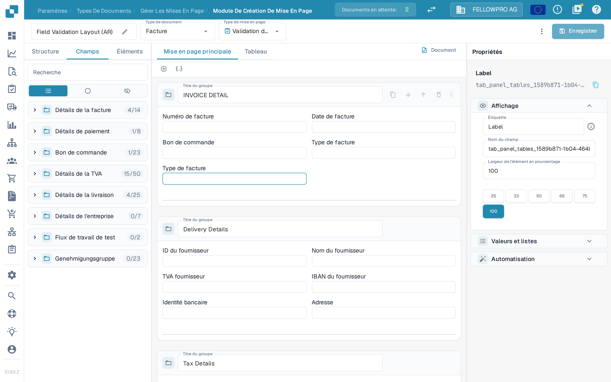
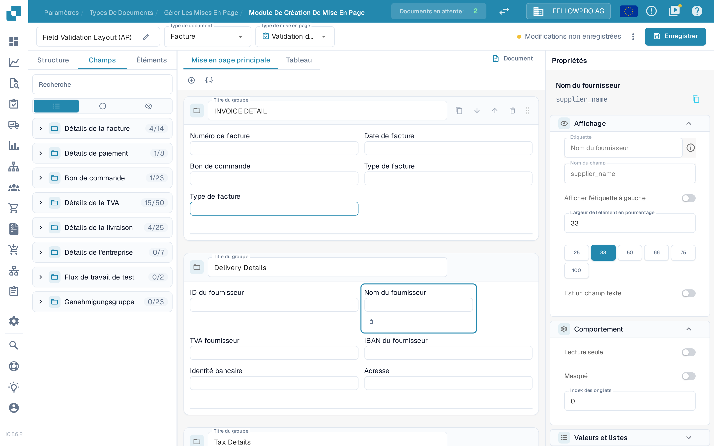
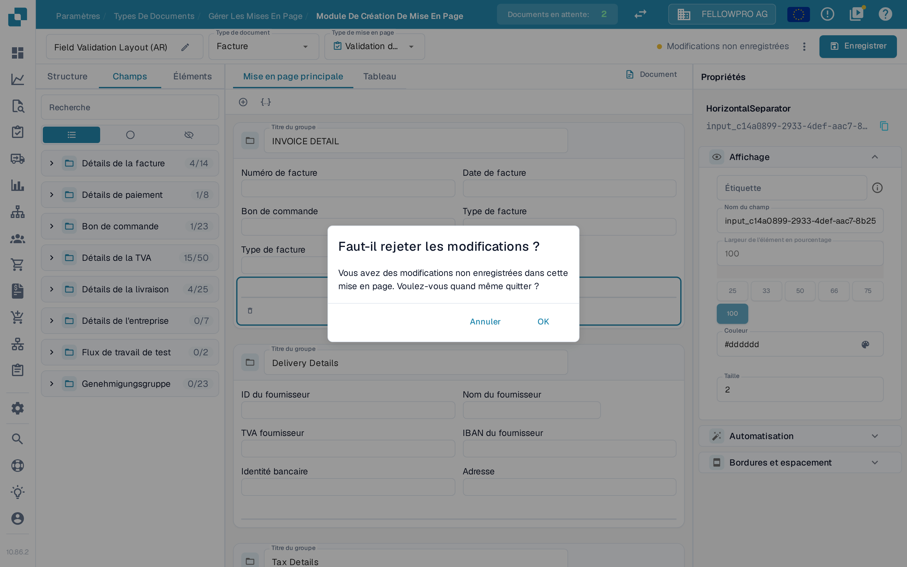
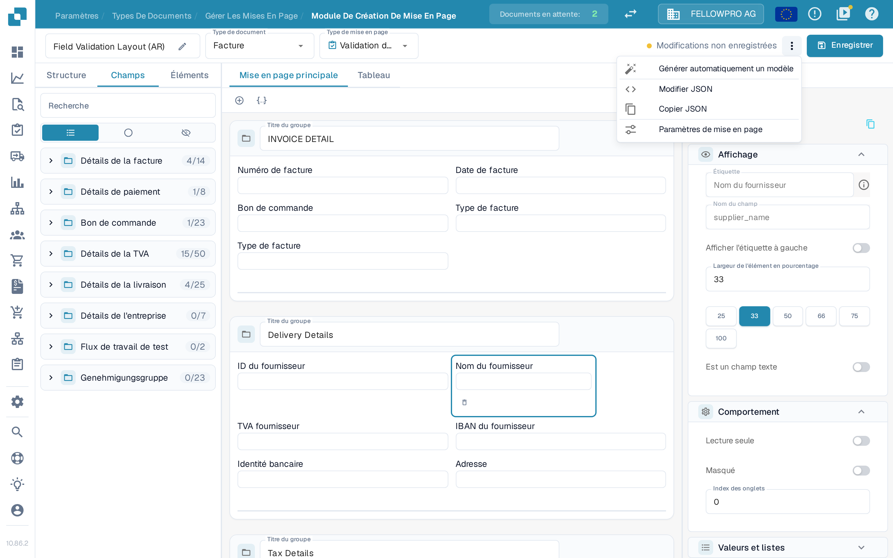

# Enregistrer et appliquer les modifications

Les modifications effectuées dans le Layout Builder ne prennent effet qu'une fois enregistrées. L'enregistrement associe la mise en page au type de document, afin que les nouveaux documents l'utilisent.

## Enregistrer vos modifications

Après avoir modifié la mise en page, sélectionnez **Enregistrer** en haut à droite de l'en-tête.

<figure><figcaption>Le bouton **Enregistrer** se trouve en haut à droite du Layout Builder.</figcaption></figure>

Pendant que vous travaillez, l'en-tête indique l'état de vos modifications :

- Un bouton **Enregistrer** sans message à côté signifie que la mise en page n'a pas changé.
- **Modifications non enregistrées** apparaît dès que vous modifiez la mise en page. Sélectionnez **Enregistrer** pour les conserver.

<figure><figcaption>L'indication **Modifications non enregistrées** s'affiche tant que la mise en page n'a pas été enregistrée.</figcaption></figure>

Après un enregistrement réussi, l'indication est remplacée par l'heure du dernier enregistrement. Sélectionner **Enregistrer** à nouveau est sans risque : si rien n'a changé depuis le dernier enregistrement, rien n'est écrit.

Si vous quittez le Layout Builder avec des modifications non enregistrées, DocBits affiche la question **Faut-il rejeter les modifications ?**. Sélectionnez **Annuler** pour rester et enregistrer, ou **OK** pour partir sans enregistrer.

<figure><figcaption>Confirmation affichée lorsque vous quittez avec des modifications non enregistrées.</figcaption></figure>

## Autres actions de l'en-tête

Le menu à trois points, à côté d'**Enregistrer**, regroupe les autres actions de mise en page :

- **Générer automatiquement un modèle** – construit une mise en page à partir des champs du type de document.
- **Modifier JSON** – modifie directement la définition de la mise en page au format JSON.
- **Copier JSON** – copie la définition de la mise en page dans le presse-papiers.
- **Paramètres de mise en page** – ouvre les paramètres généraux de la mise en page.

**Générer automatiquement un modèle** remplace la mise en page existante : vérifiez donc au préalable quelle mise en page est ouverte. **Modifier JSON** s'adresse aux utilisateurs avancés et ne doit être utilisé que si vous connaissez le format du modèle.

<figure><figcaption>Les actions disponibles dans le menu à trois points.</figcaption></figure>

## Appliquer les modifications

Une fois enregistrée, la mise en page est utilisée par le flux de traitement des documents pour ce type de document :

- Les nouveaux documents traités avec ce type de document utilisent la mise en page mise à jour.
- Les documents déjà traités conservent la mise en page avec laquelle ils ont été capturés.

## Tester les modifications

Après l'enregistrement, ouvrez un document de ce type de document et vérifiez que les champs et les groupes apparaissent comme prévu. S'il manque quelque chose, revenez dans le Layout Builder, ajustez la mise en page et enregistrez de nouveau.
