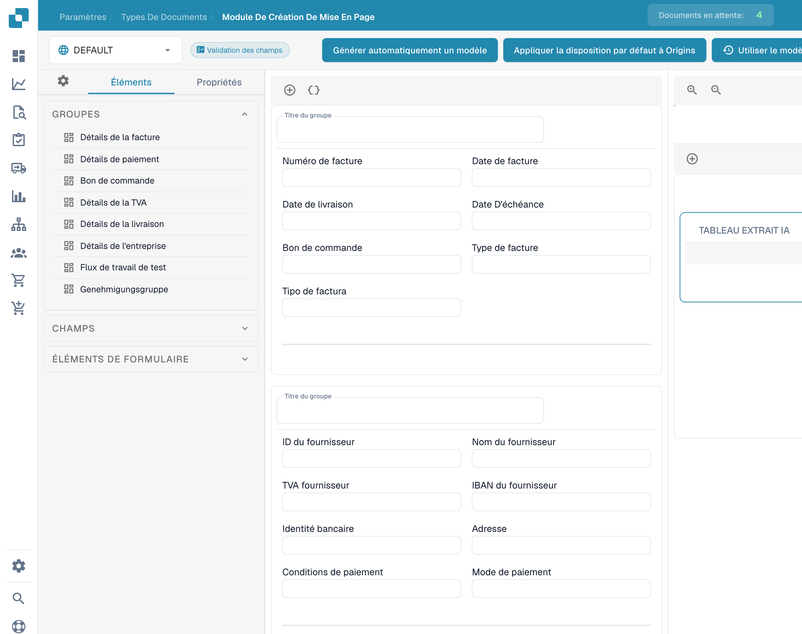

# Utiliser l’aperçu d’un modèle

L’aperçu du générateur permet d’examiner la disposition des groupes, champs et tableaux d’une mise en page existante.

<figure><figcaption>
Aperçu d’un modèle dans le générateur de mise en page.
</figcaption></figure>

Ouvrez le type de document et la mise en page prévus. Consultez les éléments disponibles, puis sélectionnez un champ pour ouvrir ses propriétés et vérifier libellés, largeurs et visibilité.

Le sélecteur d’origine permet de consulter le contexte configuré. Les noms d’origine restent inchangés. L’exemple ne démontre ni une mise en page nouvellement enregistrée ni son application à d’autres origines.

Enregistrez les modifications prévues et vérifiez la vue du document obtenue.
