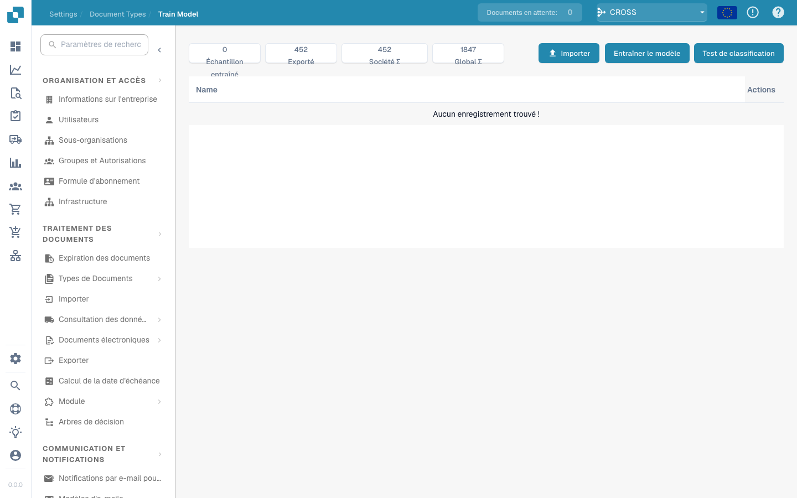

# Formation de Modèle

<figure><figcaption></figcaption></figure>

#### Aperçu

L'Entraînement du Modèle permet aux administrateurs de superviser et gérer la formation des modèles d'apprentissage automatique spécifiques à chaque type de document. En fournissant une interface structurée pour l'importation de données d'échantillons, la formation des modèles et le test de leurs performances, Docbits garantit que ses capacités d'extraction de données s'améliorent continuellement avec le temps.

#### Fonctionnalités Clés et Options

1. **Aperçu des Métriques**:

* **Échantillon**: Nombre de documents d'échantillons utilisés pour l'entraînement.
* **Exportés**: Nombre de documents qui ont été exportés avec succès après traitement.
* **Entreprise Σ**: Nombre total de documents spécifiques à l'entreprise traités.
* **Total Σ**: Nombre total de documents traités dans toutes les catégories.

2. **Options d'Entraînement et de Test**:

* **Importation**: Permet aux administrateurs d'importer de nouveaux ensembles de données d'entraînement qui sont généralement des échantillons structurés de documents devant être reconnus par le système.
* **Entraîner le Modèle**: Lance le processus d'entraînement en utilisant les données importées pour améliorer les capacités de reconnaissance et d'extraction du système.
* **Test de Classification**: Permet de tester le modèle pour évaluer sa performance dans la classification et l'extraction de données à partir de documents nouveaux ou non vus.

3. **Boutons d'Action**:

* **Créer un Champ**: Ajoute de nouveaux champs de données que le modèle devrait reconnaître et extraire.
* **Actions**: Ce menu déroulant peut inclure des options telles que voir les détails, modifier les configurations ou supprimer les données d'entraînement.


