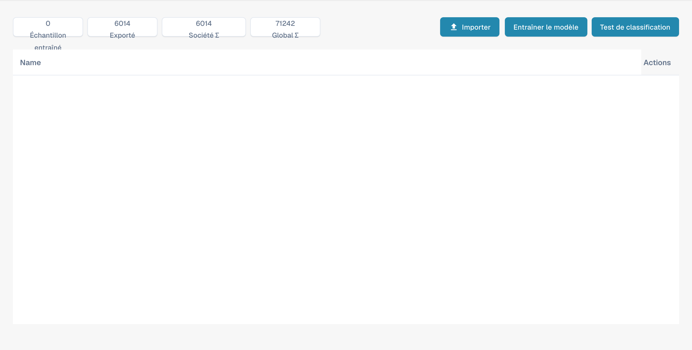

# Entraînement du modèle

Cette vue permet de gérer les exemples et de tester la classification pour chaque type de document. Elle n’est pas l’éditeur des champs d’extraction.

<figure><figcaption>
Vue d’ensemble de l’entraînement du modèle en français.
</figcaption></figure>

## Compteurs et commandes

La partie supérieure indique les exemples, les documents exportés et les compteurs de l’entreprise et globaux. Tenez compte de leur portée pour interpréter les valeurs.

* L’import permet d’ajouter des exemples d’entraînement.
* La commande d’entraînement lance l’entraînement du modèle de classification.
* Le test de classification permet de vérifier la classification de nouveaux documents.

Cette vue ne crée pas de champs ; utilisez les paramètres des champs du type de document. Les captures ne démontrent pas un entraînement exécuté ni les résultats d’un test de classification. Certains libellés peuvent rester en anglais ou avoir une traduction inexacte dans le produit.
