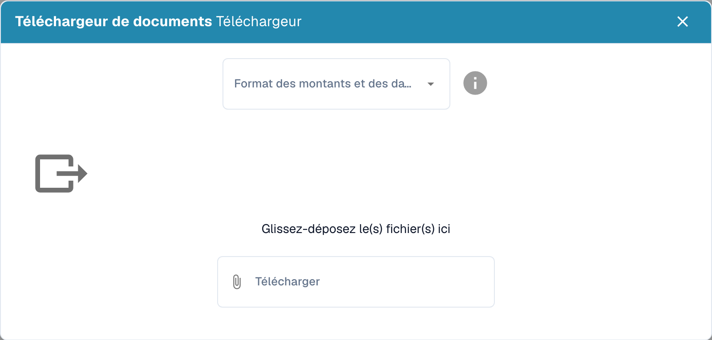

# Importer des données : entraînement du modèle

<figure><figcaption>
Import de données d’entraînement avec le format des montants et dates.
</figcaption></figure>

Fournit des instructions détaillées sur la manière d'importer des documents d'exemple pour l'entraînement, y compris le format et les types de documents à utiliser.

**Pour importer des documents d'exemple pour l'entraînement, suivez ces étapes :**

* **Préparer les documents d'exemple :** Assurez-vous que les documents d'exemple sont dans un format pris en charge, tel que PDF, Word, Excel, etc. Ces documents doivent couvrir une variété de types et de formats susceptibles d'être rencontrés en exploitation dans le système de traitement de documents.
* **Accéder à la fonction d'import :** Connectez-vous à la zone d'administration du système de traitement de documents et accédez à l'endroit où vous pouvez importer de nouveaux documents.

<figure><figcaption>
Global Settings
</figcaption></figure>

<figure><figcaption></figcaption></figure>

* **Sélectionner l'option d'import de documents :** Cliquez sur le bouton ou le lien permettant d'importer des documents. Il peut s'agir d'une option telle que « Import ».

<figure><figcaption></figcaption></figure>

* **Sélectionner le format des montants et des dates :**

<figure><figcaption></figcaption></figure>

**Format des montants :**

Le format des montants peut varier selon la région, mais il existe en général quelques conventions courantes :

1. Symbole monétaire : le symbole monétaire est généralement indiqué avant le montant, par exemple « $ » pour les dollars américains, « € » pour les euros, « £ » pour les livres sterling, etc.
2. Séparateur des milliers : dans certains pays, les grands nombres sont séparés par un séparateur des milliers pour une meilleure lisibilité. Aux États-Unis, on utilise couramment une virgule (par ex. 1,000), tandis que dans de nombreux pays européens on utilise un point (par ex. 1.000).
3. Séparateur décimal : le séparateur décimal sépare la partie entière des décimales. La plupart des pays anglophones utilisent un point (par ex. 10.99), tandis que de nombreux pays européens utilisent une virgule (par ex. 10,99).

#### Format des dates :

Le format des dates varie également selon la région, chaque pays ayant ses propres conventions. Voici les formats les plus courants :

1. Jour-Mois-Année (JJ-MM-AA ou JJ.MM.AA) : dans de nombreux pays européens, la date est indiquée au format jour-mois-année. Par exemple, « 21.05.24 » représente le 21 mai 2024.
2. Mois-Jour-Année (MM-JJ-AA ou MM/JJ/AA) : aux États-Unis, le format mois-jour-année est souvent utilisé. Par exemple, « 05/21/24 » représente le 21 mai 2024.
3. Année-Mois-Jour (AA-MM-JJ ou AA/MM/JJ) : dans d'autres pays, le format année-mois-jour est privilégié. Par exemple, « 24/05/21 » représente le 21 mai 2024.

Il est important de noter le format précis afin d'éviter les malentendus, en particulier dans les communications internationales ou les transactions financières.

* **Sélectionner les documents d'exemple :** Sélectionnez les documents d'exemple que vous souhaitez importer. Vous pouvez le faire en téléversant les fichiers depuis votre ordinateur local ou en sélectionnant des documents depuis un emplacement déjà connecté.

<figure><figcaption></figcaption></figure>

* **Configurer les types et sous-types de documents (si nécessaire) :** Si votre système prend en charge différents types ou sous-types de documents, attribuez le type approprié à chaque document importé. Cela aidera le système à catégoriser et à traiter correctement les documents.
* **Démarrer le processus d'import :** Confirmez la sélection des documents et démarrez le processus d'import. Selon la taille et le nombre de documents, ce processus peut prendre un certain temps.

<figure><figcaption></figcaption></figure>

* **Vérifier l'état de l'import :** Vérifiez l'état du processus d'import pour vous assurer que tous les documents ont été importés avec succès. Vérifiez qu'aucune erreur ne s'est produite et que les documents ont été traités correctement.
* **Entraîner le modèle :** Une fois les documents importés, utilisez-les pour entraîner le modèle du système de traitement de documents. Effectuez l'entraînement selon les instructions du système afin de vous assurer qu'il peut traiter efficacement les données d'exemple.

<figure><figcaption></figcaption></figure>

<figure><figcaption></figcaption></figure>

En ajoutant régulièrement des documents d'exemple pour l'entraînement, vous vous assurez que votre système de traitement de documents est toujours à jour et offre un traitement précis et efficace.
