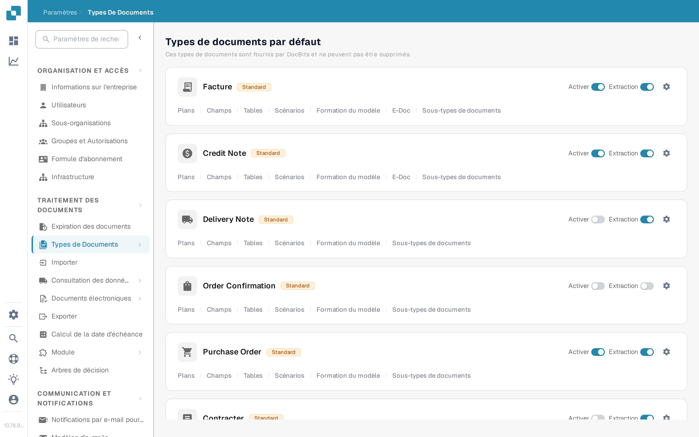
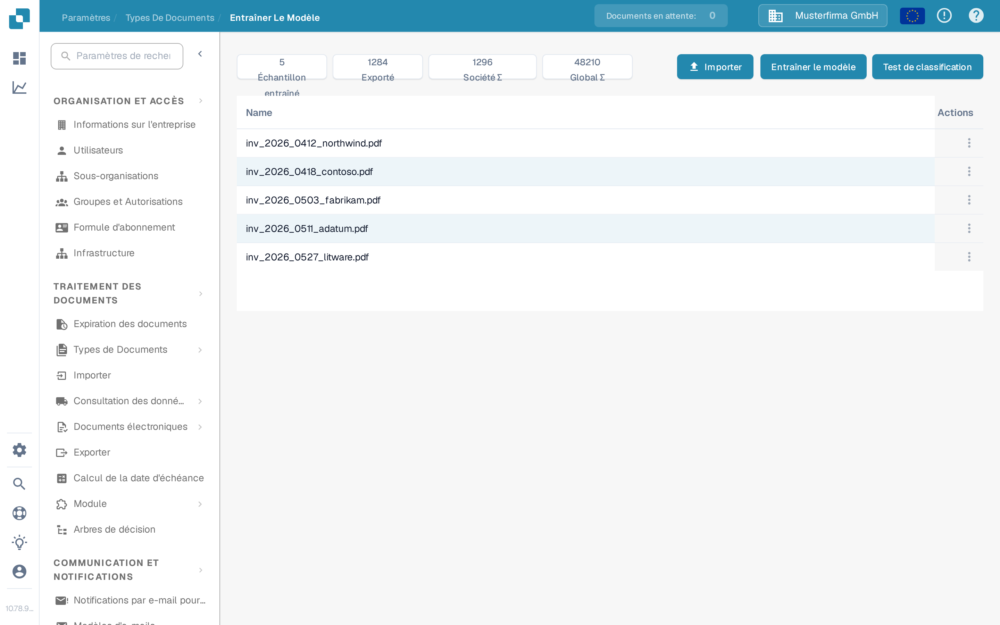
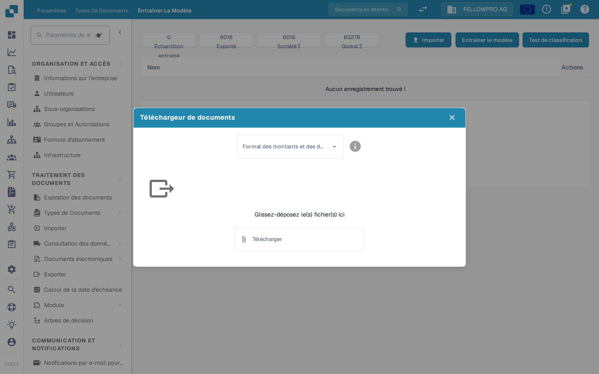
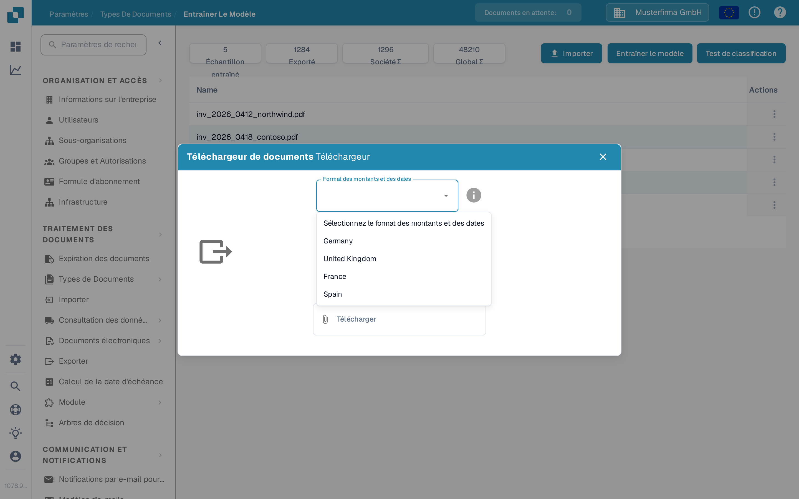
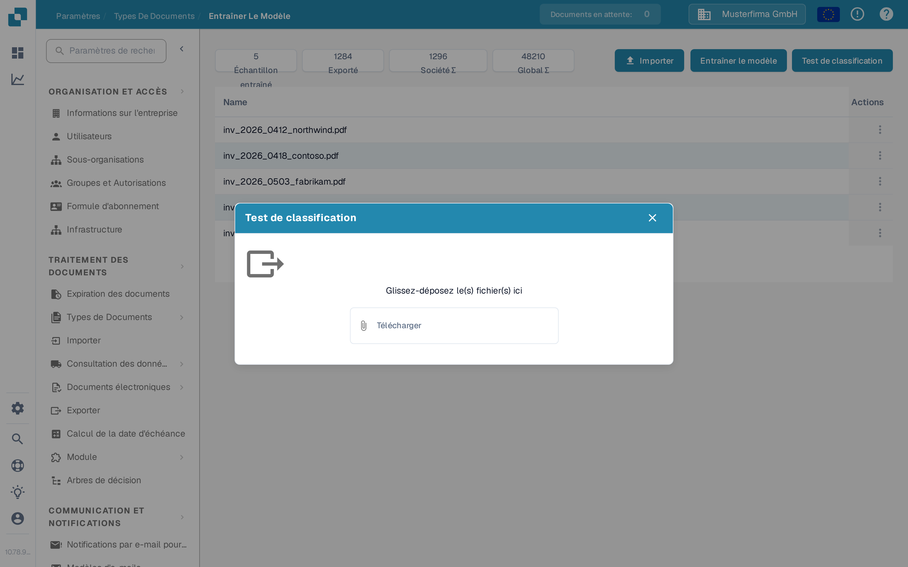

# Importer des documents d'exemple pour l'entraînement du modèle

## Préparer, importer et vérifier des exemples de documents

<figure><figcaption>
Préparer, importer et vérifier des exemples de documents
</figcaption></figure>

Choisissez des exemples de documents représentatifs, préparez les options d’importation disponibles et vérifiez le statut de l’importation. Seuls les échantillons importés avec succès sont prêts pour un entraînement ultérieur. Résolvez les erreurs d’importation avant l’étape suivante et conservez les documents de test indépendants séparés de l’ensemble de données d’entraînement.

Utilisez cette page pour ajouter des PDF d'exemple pour un type de document, puis entraîner ou tester son modèle de classification. Vous devez avoir accès aux **Paramètres** et aux **Types de Documents**. Pour l'objectif des fonctions d'entraînement, voir [Objectif et utilisation : entraînement du modèle](purpose-and-use-model-training.md).

## Ouvrir le type de document

1. Allez dans **Paramètres → Types de Documents**.
2. Trouvez le type de document que vous souhaitez entraîner. Dans sa ligne, sélectionnez **Formation du modèle**. L'exemple ci-dessous utilise **Facture**.

<figure><figcaption>
Ouvrez Formation du modèle depuis le type de document choisi.
</figcaption></figure>

Les autres commandes de cette carte servent à d'autres fins : **Activer** active le type de document, **Extraction** change son mode d'extraction, l'engrenage ouvre ses paramètres, et les autres liens ouvrent d'autres zones de configuration. Vous n'avez pas besoin de les modifier juste pour ouvrir Formation du modèle.

La page **Entraîner Le Modèle** affiche le nombre d'échantillons et la liste des documents d'entraînement téléchargés. Dans l'organisation d'exemple, la liste contient des documents ; votre organisation peut afficher d'autres documents et d'autres nombres.

<figure><figcaption>
Les trois actions se trouvent en haut à droite de la liste d'entraînement.
</figcaption></figure>

## Importer des PDF d'exemple

1. Sélectionnez **Importer**.
2. Choisissez le **Format des montants et des dates** qui correspond au document d'exemple. Par exemple, choisissez **Germany** pour les conventions de nombres et de dates allemandes. Cette sélection indique à DocBits comment interpréter les valeurs du document téléchargé ; elle ne modifie pas la langue de l'application.
3. Glissez-déposez les fichiers PDF dans le dialogue ou utilisez **Télécharger** pour les sélectionner. L'importateur actuel de documents d'exemple accepte les **fichiers PDF** ; il refuse les autres types de fichiers. La sélection des fichiers démarre le téléchargement.
4. Fermez le dialogue et vérifiez que les documents apparaissent dans la liste d'entraînement. Si DocBits signale une erreur de téléchargement ou un document déjà existant, corrigez le fichier ou choisissez un autre exemple avant de continuer.

<figure><figcaption>
Choisissez un format avant de sélectionner les PDF d'exemple.
</figcaption></figure>

<figure><figcaption>
Choisissez le format utilisé dans le document, pas votre langue d'interface préférée.
</figcaption></figure>

Pour les actions sur les échantillons importés, voir [Gérer les données d'entraînement](manage-training-data.md).

## Entraîner et vérifier le modèle

Lorsque les PDF d'exemple souhaités sont dans la liste, sélectionnez **Entraîner le modèle**. DocBits peut traiter l'entraînement en arrière-plan ; attendez son message de fin avant de considérer le nouveau modèle comme prêt. Le nombre d'échantillons et toute limite de formule affichés sur cette page appartiennent à votre organisation.

Pour vérifier la classification, sélectionnez **Test de classification**, puis téléchargez un fichier d'exemple distinct dans le dialogue. Après le traitement, DocBits indique si le type de document prédit correspond à cette page et rapporte les détails de la classification. Le dialogue de test vide ci-dessous est montré sans téléchargement de fichier.

<figure><figcaption>
Utilisez Test de classification pour vérifier le modèle avec un autre document.
</figcaption></figure>

Pour interpréter le résultat, voir [Tester le modèle](testing-the-model.md). Si le résultat est mauvais, examinez les [données d'entraînement](manage-training-data.md) et le [guide de dépannage](troubleshooting.md) avant d'ajouter d'autres échantillons.
