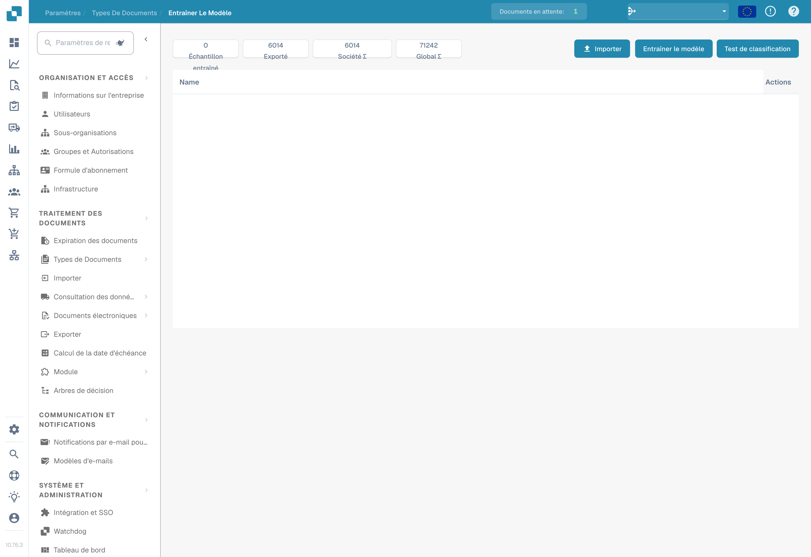

# Tester le modèle

## Évaluez avec des documents de test indépendants

<figure><figcaption>
Évaluez avec des documents de test indépendants
</figcaption></figure>

Les données d’entraînement et les documents de test servent à des fins différentes. Pour les documents de test indépendants, définissez les types de documents et les valeurs de champ attendus, puis comparez-les aux prédictions. Enregistrez la version du modèle, l'échantillon, les écarts et les défaillances techniques. Apportez des améliorations ciblées et répétez le test avec le même protocole d’évaluation. Les valeurs indiquées sont un exemple et non une mesure de précision.

Utilisez des documents représentatifs qui n’ont pas servi à entraîner le modèle. Préparez pour chacun les réponses attendues : type de document et, si vous évaluez l’extraction, valeurs des champs.

## Réaliser l’évaluation

1. Ouvrez l’entraînement du modèle pour le type de document à examiner.
2. Choisissez le test de classification si votre version propose cette fonction.
3. Sélectionnez l’échantillon et lancez l’évaluation avec les options disponibles.
4. Attendez la fin et consignez les résultats et les erreurs. Un échec technique ou une évaluation incomplète ne constitue pas une classification correcte.

<figure><figcaption>
Vue générale de l’entraînement du modèle dans la version illustrée. Aucune importation, aucun entraînement ni test de performance n’a été lancé.
</figcaption></figure>

## Interpréter les résultats

Comparez les prédictions aux réponses attendues et analysez les erreurs par catégorie et format. Si vous calculez l’exactitude, la précision, le rappel ou le score F1, indiquez la taille de l’échantillon et les catégories évaluées. N’attribuez pas au produit des métriques que votre version n’affiche pas ; vous pouvez les calculer séparément à partir des résultats enregistrés ou exportés.

Les règles de classification et d’extraction sont des configurations distinctes de l’entraînement. Vérifiez leur effet lorsqu’elles interviennent dans le traitement ; ne modifiez pas une règle uniquement pour masquer une erreur de l’échantillon de test.

## Corriger et répéter

Corrigez les données d’entraînement, les étiquettes ou les réglages réellement disponibles, puis entraînez de nouveau le modèle si nécessaire. Répétez le même protocole et conservez un échantillon indépendant. Consignez la version, les données, les résultats et les régressions. Un bon résultat sur l’échantillon ne garantit pas les mêmes performances sur tous les documents futurs. Aucun test de performance n’a été exécuté pour les images de cette page.
