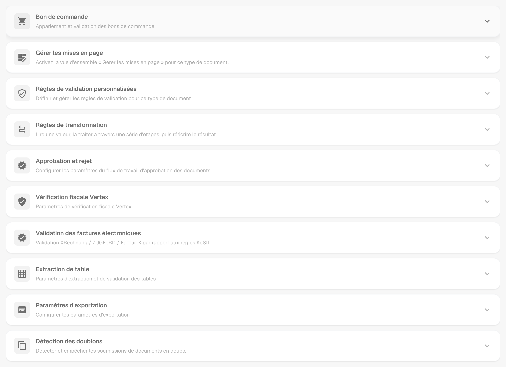
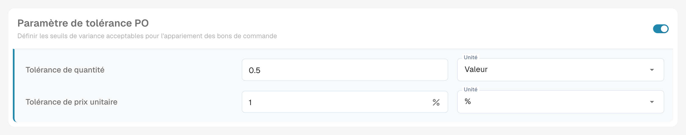
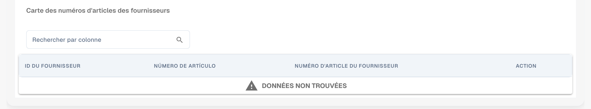
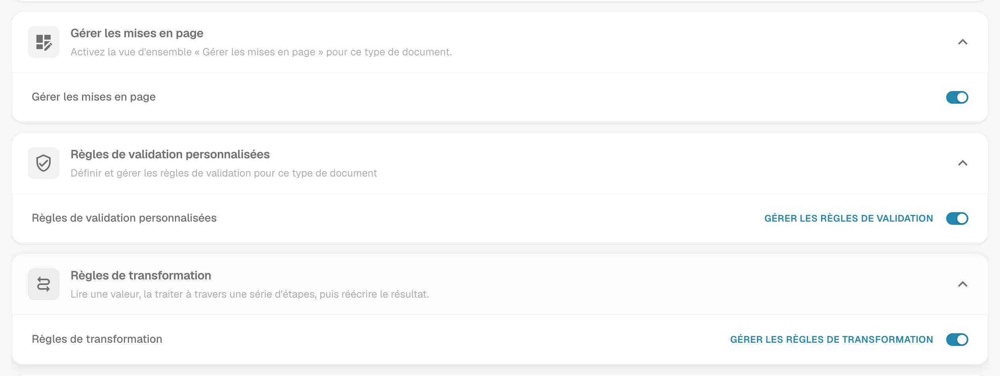
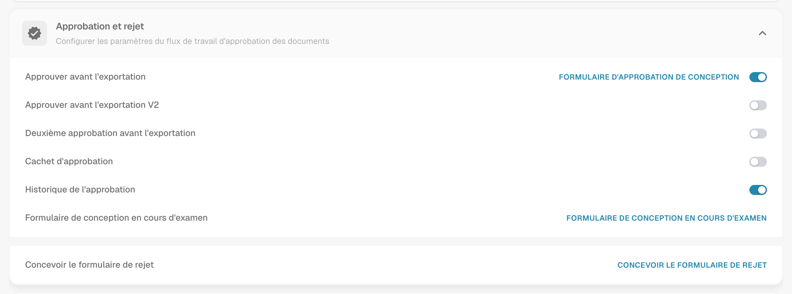
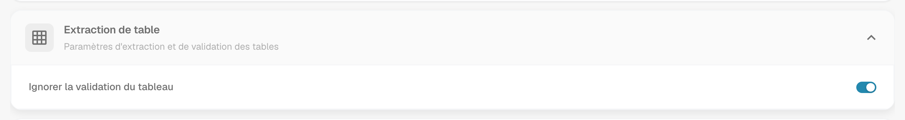
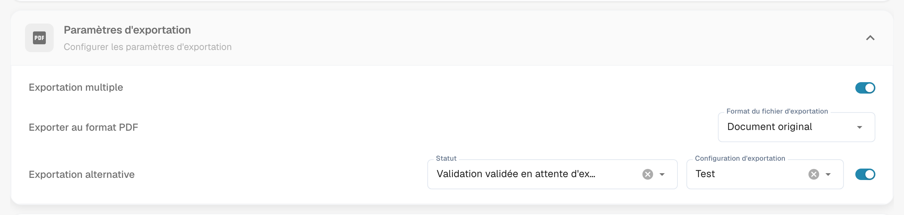
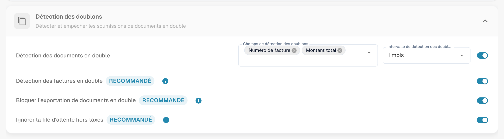

# Plus de paramètres

## Aperçu

**Plus de paramètres** regroupe les options qui appartiennent à un type de document, par exemple la facture. Un paramètre que vous activez ici s'applique uniquement à ce type de document. La page se compose de cartes repliables, une par thème. Ouvrez une carte pour afficher ses paramètres.

<figure><figcaption>
Les cartes de la page Plus de paramètres, toutes repliées.
</figcaption></figure>

## Comment accéder

1. Naviguez vers **Paramètres** → **Paramètres globaux** → **Types de documents**.
2. Sélectionnez le type de document et cliquez sur **Plus de paramètres**.

Le fil d'Ariane en haut de la page affiche **Paramètres / Types de documents / Plus de paramètres**. L'assistant de paramètres, à droite de la page, explique les paramètres de la carte ouverte.

| Carte | Ce que vous y définissez |
| ----- | ------------------------ |
| Bon de commande | Correspondance des BC, tolérances, exportation des lignes de BC, numéros d'articles des fournisseurs |
| Gérer les mises en page | Interrupteur pour l'aperçu Gérer les mises en page |
| Règles de validation personnalisées | Vos propres règles de validation pour ce type de document |
| Règles de transformation | Règles qui lisent une valeur, la modifient par étapes et la réécrivent |
| Approbation et rejet | Flux d'approbation et formulaires En révision et Rejet |
| [Vérification fiscale Vertex](vertex-tax-verification.md) | Concevoir le formulaire de la vérification fiscale Vertex |
| Validation des factures électroniques | Validation des factures XRechnung, ZUGFeRD et Factur-X |
| Extraction de table | Ignorer la validation des tableaux extraits |
| Paramètres d'exportation | Exportation multiple, format PDF, exportation alternative |
| Détection des doublons | Détecter et bloquer les documents en double |

## Bon de commande

La carte **Bon de commande** (**Appariement et validation des bons de commande**) contrôle comment les documents de ce type sont appariés aux bons de commande.

<figure><figcaption>
La carte Bon de commande avec ses options.
</figcaption></figure>

* [**Bon de commande**](purchase-order/purchase-order.md) : Bascule si le document doit être traité dans l'écran de correspondance des bons de commande. Vous pouvez également spécifier sur quelle quantité la correspondance doit être basée.
* [**Correspondance des commandes côté serveur**](purchase-order/purchase-order-matching-rules.md) : Effectue la correspondance avec l'ensemble de règles configurable. **Configurer les règles de correspondance des commandes d'achat** ouvre la [page des règles](purchase-order/purchase-order-matching-rules.md).
* [**Table PO dans le générateur de mise en page**](purchase-order/po-table-in-layout-builder.md) : Permet l'inclusion de tables de bon de commande dans le générateur de mise en page pour des mises en page de documents personnalisées.
* [**Vérification automatique des mises à jour de l'OP**](purchase-order/auto-check-for-po-updates.md) : Affiche un indicateur visuel dans l'écran de correspondance des bons de commande lorsqu'un bon de commande a été mis à jour, incitant les utilisateurs à actualiser.
* **Mise à jour automatique des données de la commande** : Met automatiquement à jour les données de la commande lorsque de nouvelles données sont disponibles. Cet interrupteur appartient à **Vérification automatique des mises à jour de l'OP**.
* [**Statut de la ligne de commande consommée**](purchase-order/consumed-po-line-status.md) : Applique un code couleur aux lignes de bon de commande dans l'écran de correspondance.
* [**Calculer le prix unitaire de la commande**](purchase-order/calculate-po-unit-price.md) : Calcule le prix unitaire de la commande en utilisant le montant net et la quantité, au lieu de l'extraire.
* [**Exporter les lignes de bon de commande non assorties**](purchase-order/export-not-matched-po-lines.md) : Lorsqu'il est désactivé, seules les lignes appariées sont exportées. Lorsqu'il est activé, toutes les lignes de bon de commande sont exportées, même si elles ne sont pas appariées.
* **Ignorer les lignes déjà appariées** : Ignore les lignes qui ont déjà été appariées lors d'un nouveau processus de correspondance.
* [**Mettre à jour le statut du bon de commande du document**](purchase-order/update-document-purchase-order-status.md) : Met à jour la colonne État de la commande sur le tableau de bord chaque fois que le statut du bon de commande change.
* [**Autoriser l'exportation automatique pour les lignes de commande non comparables**, **Correspondance automatique et exportation visibles pour** et **Utilisez le montant net des lignes pour le total correspondant visible à**](purchase-order/auto-match-and-export-options.md) : Déterminent qui voit les raccourcis Correspondance automatique et exportation et quels documents peuvent être exportés automatiquement.

### Paramètre de tolérance PO

<figure><figcaption>
Tolérance pour la quantité et le prix unitaire.
</figcaption></figure>

Le [**Paramètre de tolérance PO**](purchase-order/purchase-order-tolerance-settings-additional-purchase-order-tolerance.md) vous permet de définir des niveaux de tolérance pour la quantité et le prix unitaire, afin que de petites divergences ne soient pas signalées comme des incohérences. Pour chaque valeur, vous choisissez le montant et l'unité : soit une **Valeur** absolue, soit un pourcentage (**%**). Le bloc contient aussi le [**Paramètre de tolérance PO supplémentaire**](purchase-order/purchase-order-tolerance-settings-additional-purchase-order-tolerance.md#parametre-pour-configurer-les-parametres-de-tolerance-de-commande-dachat-supplementaires) pour le fret, les charges et les taxes, ainsi que les [**PO désactiver statuts**](purchase-order/purchase-order-disable-statuses.md).


Lorsque l'attribut de type de document `CUSTOM_RANGE_FOR_PO_TOLERANCE` est activé, les tolérances de prix unitaire et de quantité proviennent de ces paramètres du type de document et non de l'ensemble de règles. Le diagramme des règles sur la [page des règles de correspondance des BC](purchase-order/purchase-order-matching-rules.md) affiche une remarque dans ce cas.


### Carte des numéros d'articles des fournisseurs

<figure><figcaption>
La Carte des numéros d'articles des fournisseurs.
</figcaption></figure>

La [**Carte des numéros d'articles des fournisseurs**](purchase-order/supplier-item-number-map-admin-documentation.md) associe les numéros d'articles des fournisseurs à vos numéros d'articles internes, afin que les lignes correspondent même lorsque le fournisseur utilise ses propres numéros. Recherchez par colonne pour trouver une entrée.

## Gérer les mises en page, règles de validation personnalisées et règles de transformation

Trois cartes se trouvent directement sous la carte Bon de commande :

* **Gérer les mises en page** active l'aperçu Gérer les mises en page pour ce type de document. Voir le [Gestionnaire de mises en page](../layout-manager/README.md).
* **Règles de validation personnalisées** active vos propres règles de validation. **Gérer les règles de validation** les ouvre. Voir [Règles de validation personnalisées](../custom-validation-rules.md).
* **Règles de transformation** active les règles de transformation. **Gérer les règles de transformation** les ouvre. Voir [Règles de transformation](../transformation-rules.md).

<figure><figcaption>
Les trois cartes avec leurs interrupteurs.
</figcaption></figure>

## Approbation et rejet

La carte **Approbation et rejet** contient le flux d'approbation et les formulaires que les utilisateurs voient lorsqu'ils examinent ou rejettent un document.

<figure><figcaption>
La carte Approbation et rejet.
</figcaption></figure>

* **Approuver avant l'exportation** : Les documents doivent être approuvés avant de pouvoir être exportés. **Formulaire d'approbation de conception** ouvre le **Module de création de mise en page** pour l'écran d'approbation.
* **Approuver avant l'exportation V2** : Active l'Approbation V2, qui prend en charge l'utilisation de champs dynamiques à la place de champs statiques.
* **Deuxième approbation** : Ajoute une couche d'approbation supplémentaire.
* [**Cachet d'approbation**](approval/approval-stamp.md) : Ajoute un cachet au document lorsqu'il est approuvé.
* [**Historique de l'approbation**](approval/approval-history.md) : Affiche l'historique des approbations dans l'écran d'approbation et dans la validation des champs.
* **Formulaire de conception en cours d'examen** : Configure la mise en page du formulaire de révision avec le **Module de création de mise en page**.
* **Concevoir le formulaire de rejet** : Configure la mise en page du formulaire de rejet avec le **Module de création de mise en page**.

Pour le **Module de création de mise en page**, voir le [Gestionnaire de mises en page](../layout-manager/README.md).

## Vérification fiscale Vertex

La carte **Vérification fiscale Vertex** contient **Vérification fiscale du sommet de conception**. Elle ouvre le Module de création de mise en page pour le formulaire que les utilisateurs voient lorsque DocBits compare la taxe du fournisseur à la taxe calculée par Vertex. Voir [Vérification fiscale Vertex](vertex-tax-verification.md) pour l'intégration, la tolérance et le résultat.

## Validation des factures électroniques

La carte **Validation des factures électroniques** active la validation des factures électroniques entrantes et vous permet de décider si le fournisseur est informé lorsqu'une facture est rejetée. Voir [Validation des factures électroniques](../../../document-processing/e-documents/validation-rules.md).

## Extraction de table

<figure><figcaption>
La carte Extraction de table.
</figcaption></figure>

* **Ignorer la validation du tableau** : Contourne la validation standard des données de tableau. Utilisez cette option lorsqu'une gestion flexible des données est requise ou lorsque certaines étapes de validation peuvent être ignorées pour améliorer les performances.

## Paramètres d'exportation

<figure><figcaption>
La carte Paramètres d'exportation.
</figcaption></figure>

* **Exportation multiple** : Permet d'exporter un document plus d'une fois.
* **Exporter au format PDF** : **Format du fichier d'exportation** définit le format PDF utilisé lors de l'exportation des documents, par exemple **Document original**.
* [**Exportation alternative**](purchase-order/alternate-export.md) : Configure une exportation alternative pour un statut de document choisi. Sélectionnez le **Statut** et la **Configuration d'exportation** qui s'exécute pour ce statut, puis activez le paramètre.

## Détection des doublons

<figure><figcaption>
La carte Détection des doublons.
</figcaption></figure>

La carte contient **Détection des documents en double** avec les champs qui déterminent ce qui compte comme un doublon et l'intervalle dans lequel les documents sont comparés, ainsi que les options **Détection des factures en double**, **Bloquer l'exportation de documents en double** et **Ignorer la file d'attente hors taxes**. Les trois portent une étiquette **Recommandé**. Voir [Détection des doublons](duplicate-document-handling.md) pour savoir comment un document signalé est traité.
