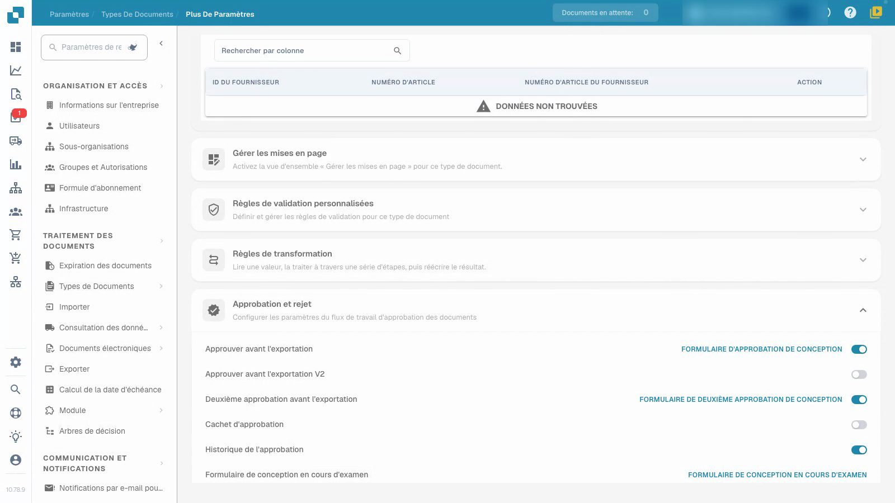
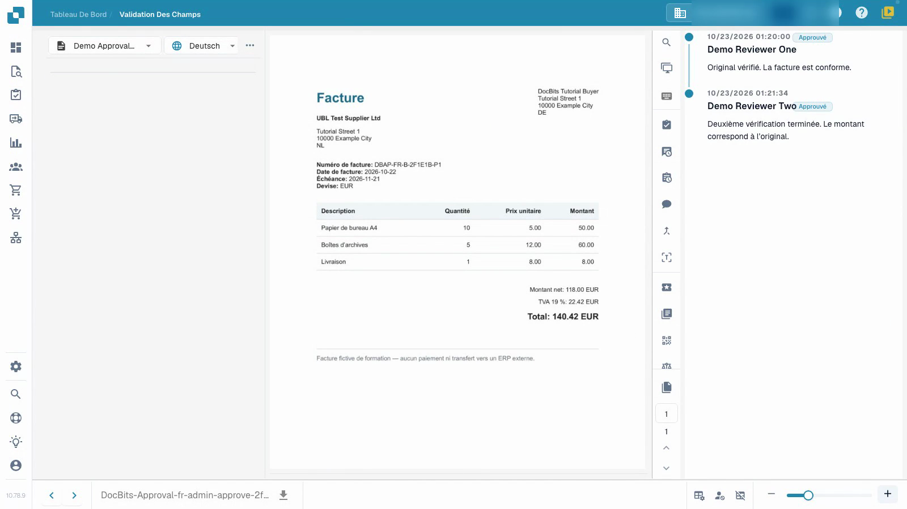

# Configurer et tester les approbations de factures

Cette vidéo montre la configuration et le test des approbations.


Configurer et tester les approbations de factures


[Regarder la vidéo avec sous-titres](https://docbits-videos.fra1.cdn.digitaloceanspaces.com/settings-assistant/invoice-approval-admin/v2/fr.html)

L'application réelle est affichée ; la formulation des options peut dépendre de la version déployée.

Configurez l'approbation pour le type de document utilisé par votre processus. Identifiez les vérificateurs prévus et décidez si vous avez besoin d'un deuxième examen indépendant. La vidéo utilise un type de test séparé, des factures synthétiques et des comptes de vérificateurs ordinaires temporaires ; son présentateur est fictif.

## Configurer le type de document

Ouvrez **Paramètres → Types de Documents**, sélectionnez le type prévu et ouvrez **Plus de paramètres → Approbation et rejet**. Choisissez les paramètres dont votre processus a besoin, puis rechargez la page pour vérifier ce qui a été enregistré.

| Paramètre | Objectif |
| --- | --- |
| Approuver avant l'exportation | Exiger une décision d'approbation avant que le document ne passe à l'exportation. |
| Deuxième approbation avant l'exportation | Ajouter une deuxième étape d'approbation au processus configuré. |
| Historique de l'approbation | Garder les décisions enregistrées disponibles pour examen. |
| Cachet d'approbation | Configurer une marque sur un document approuvé ; voir le guide de tampon séparé. |

L'option V2 supplémentaire et les éditeurs de formulaires sont des paramètres distincts. Ce tutoriel utilise des formulaires d'approbation standard préparés.

## Tester avec les rôles prévus

1. Donnez au premier et au deuxième vérificateur des groupes séparés et l'accès prévu aux documents assignés. Dans cet exemple, le premier compte a l'autorisation d'approbation de première étape et le deuxième compte a l'autorisation de deuxième étape. Un commutateur seul n'assigne pas une personne ou n'accorde pas cette autorisation.
2. Utilisez le premier compte ordinaire pour vérifier la facture assignée et déjà validée, ajoutez une note et donnez la première approbation. Vérifiez que le document enregistré attend toujours la deuxième approbation. Vérifiez que ce compte ne peut pas effectuer la deuxième étape lorsque ses autorisations l'interdisent.
3. Assignez la facture en attente à l'autre vérificateur autorisé. Utilisez ce deuxième compte ordinaire pour la vérifier et donner la deuxième approbation avec une note séparée.
4. Rouvrez l'historique et vérifiez les deux vérificateurs différents, les heures et les notes. Rejetez également une facture de test séparée avec une raison et vérifiez cette décision après le rechargement.

<figure><figcaption>
Paramètres d’approbation enregistrés pour un type de document de test dédié.
</figcaption></figure>

<figure><figcaption>
Deux vérificateurs différents et les deux notes enregistrées.
</figcaption></figure>

## Vérifier le résultat

Gardez la première approbation, la deuxième approbation en attente et le rejet comme des résultats différents. Confirmez que les valeurs de la facture restent inchangées après chaque décision. Dans cet exemple, le canal de test attend la récupération des données et n’est relié à aucun ERP externe. Le statut technique `pending_data_fetch`, lorsqu'il est affiché, signifie l'attente de la récupération des données. L'historique d'approbation seul ne prouve pas un transfert ERP.

Testez les rôles configurés, l'assignation et le chemin de décision complet avant d'appliquer le processus aux documents en production.

## Pages associées

- [Groupes, utilisateurs et autorisations](../../../groups-users-and-permissions/README.md)
- [Historique d'approbation](approval-history.md)
- [Tampon d'approbation](approval-stamp.md)
