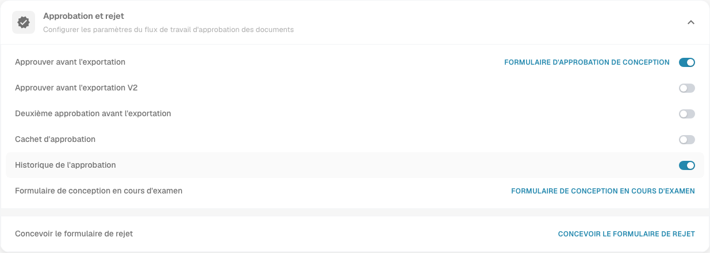

# Approbation

Utilisez les options d'approbation pour décider comment un document est vérifié avant de quitter DocBits. Les options se configurent pour chaque type de document, commencez donc par le type utilisé par votre équipe, par exemple **Facture**.

1. Ouvrez **Paramètres** → **Types de Documents**.
2. Sélectionnez l'**icône d'engrenage** de la carte du type de document pour ouvrir **Plus de paramètres**.
3. Faites défiler jusqu'à **Approbation et rejet**. Passez en revue les quatre options principales et l'option V2 supplémentaire, si elle est visible, avant de modifier un paramètre.

<figure><figcaption>
Vue native de l'environnement Dev en français pour Facture : « Approuver avant l'exportation » et « Historique de l'approbation » sont activés ; « Approuver avant l'exportation V2 », « Deuxième approbation avant l'exportation » et « Cachet d'approbation » sont désactivés. Ces valeurs ont été constatées sans modification ; elles ne définissent ni les valeurs par défaut ni une configuration recommandée.
</figcaption></figure>

| Option | À quoi elle sert |
| --- | --- |
| **Approuver avant l'exportation** | Exiger une décision d'approbation avant d'exporter le document. Lorsque cette option est activée, **Approuver avant l'exportation V2** est également visible. |
| **Deuxième approbation avant l'exportation** | Ajouter une autre étape d'approbation lorsqu'une seule décision ne suffit pas pour votre processus. |
| **Cachet d'approbation** | Ajouter une marque d'approbation à un document approuvé. Voir [Cachet d'approbation](approval-stamp.md) pour la configuration et les options de téléchargement. |
| **Historique de l'approbation** | Conserver un enregistrement des décisions d'approbation. Voir [Historique de l'approbation](approval-history.md) pour le paramètre et la consultation de l'historique. |

Choisissez les options requises par votre propre processus. Utilisez ensuite un document de test sans client réel et les rôles de réviseur prévus pour vérifier le circuit d'approbation avant de l'appliquer à des documents réels. La capture montre les paramètres disponibles ; aucun flux d'approbation ni exportation n'a été effectué lors de ce contrôle de la documentation.
