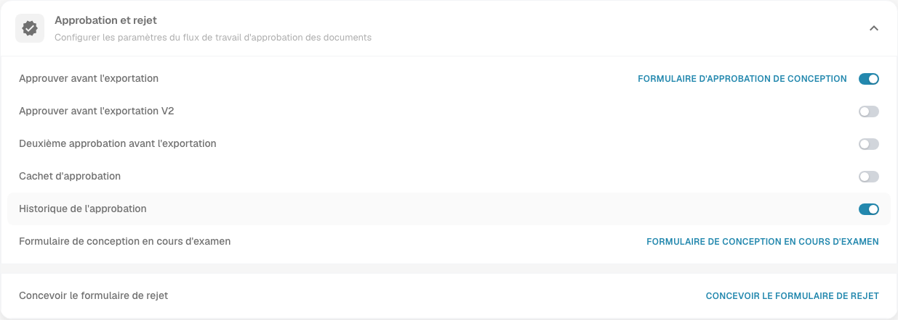

# Historique de l'approbation

L'**Historique de l'approbation** permet de consulter les décisions du workflow d'approbation d'un document. L'ancienne version de cette page indiquait un ancien chemin via **Paramètres généraux** et montrait trois images d'une interface plus ancienne sans expliquer les commandes. Utilisez les paramètres actuels du type de document pour activer l'option, puis vérifiez le résultat avec une approbation de test dans votre propre organisation.

## Activer l'option pour un type de document

1. Avec un compte administrateur, ouvrez **Paramètres** → **Types de Documents**. Recherchez le type de document, par exemple **Facture**, et sélectionnez son **icône d'engrenage** pour ouvrir **Plus de paramètres**. Les liens **Plans** et **Champs** sur la carte mènent à d'autres éditeurs.

   <figure><figcaption>
Ouvrez « Plus de paramètres » sur le type de document dont vous voulez examiner le workflow d'approbation.
</figcaption></figure>

2. Dépliez **Approbation et rejet** et repérez **Historique de l'approbation**. Ce paramètre est distinct des options **Approuver avant l'exportation**, **Deuxième approbation avant l'exportation** et **Cachet d'approbation**. La capture native française montre le type de document **Facture** : **Approuver avant l'exportation** et **Historique de l'approbation** étaient déjà **activés** ; **Approuver avant l'exportation V2**, **Deuxième approbation avant l'exportation** et **Cachet d'approbation** étaient **désactivés**. Ces valeurs ont été constatées sans modification ; elles ne définissent ni les valeurs par défaut ni une configuration recommandée.

   <figure><figcaption>
Vérifiez le commutateur « Historique de l'approbation » pour le type de document sélectionné.
</figcaption></figure>

3. N'activez l'historique d'approbation qu'après avoir confirmé le workflow d'approbation prévu et les personnes autorisées à voir ses décisions. Notez le paramètre précédent afin de pouvoir comparer un test avec celui-ci.

## Vérifier avec un document de test

Utilisez un document de test du type configuré qui entre réellement dans le workflow d'approbation. Faites-le approuver ou rejeter par un utilisateur de test autorisé, puis ouvrez la vue d'approbation de ce document et consultez l'historique disponible. Comparez la décision, l'utilisateur, l'heure et tout commentaire saisi avec l'action effectuée. Pour un workflow avec plusieurs approbateurs, vérifiez l'ordre après chaque décision. Si aucun historique n'est visible, contrôlez le type de document, l'état du workflow, le commutateur et les droits de consultation avant de le considérer comme une erreur de documentation ou de produit.

Les deux captures natives de l'environnement Dev montrent le chemin des paramètres et les options visibles. Aucun document n'a été approuvé ou rejeté et aucune exportation n'a été exécutée pour ces captures. La vue d'historique nécessite toujours un document de test avec une activité d'approbation ; un commutateur activé ne prouve pas à lui seul qu'un historique existe déjà.
