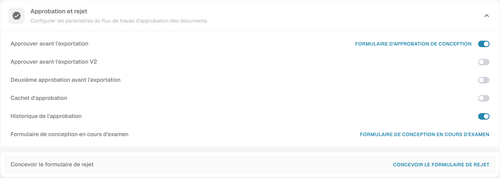

# Historique de l'approbation

L’historique permet d’examiner les décisions d’approbation et de rejet enregistrées pour un document. Les informations visibles dépendent des traitements antérieurs et de vos autorisations.

## Trouver le réglage

1. Ouvrez **Paramètres → Types de Documents**.
2. Ouvrez l’engrenage du type concerné.
3. Dépliez **Approbation et rejet** et examinez **Historique de l’approbation**. Modifiez le réglage uniquement si votre flux le requiert.

<figure><figcaption>
Réglages Approbation et rejet avec Historique de l’approbation. L’image montre une configuration, pas un historique de décisions créé pendant cette vérification ; aucune approbation, aucun rejet ni changement de réglage.
</figcaption></figure>

## Examiner les décisions

Ouvrez le document et l’historique proposé par votre version, lorsqu’il est disponible. Vérifiez la décision, son auteur, sa date et l’ordre des étapes. Les commentaires peuvent préciser le motif lorsqu’ils ont été enregistrés.

Évaluez le texte de la décision, pas seulement sa couleur. Un historique vide ne prouve pas une approbation. L’image montre la configuration : aucun document n’a été approuvé, aucun document n’a été rejeté et aucun historique de décisions n’a été créé pendant cette vérification.
