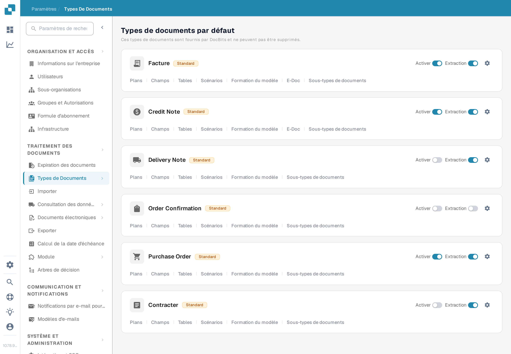
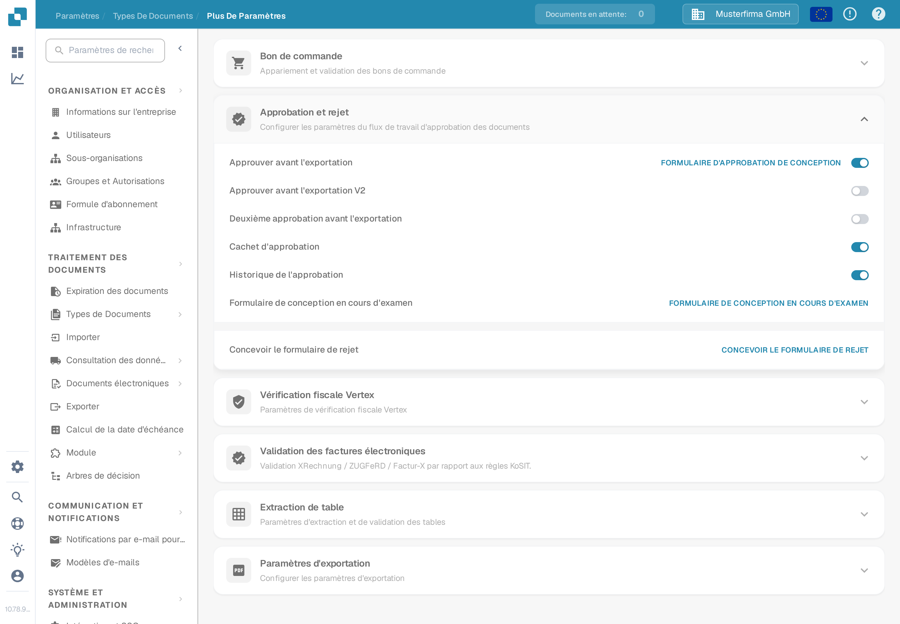

# Cachet d'approbation

Un cachet d'approbation est une annotation ajoutée lors de l'approbation d'un document lorsque l'option est activée pour ce type de document. C'est utile lorsqu'une personne chargée de la validation doit voir qui a approuvé un document et quand. La page précédente montrait six captures d'écran d'une ancienne interface et présentait le cachet, l'export IDM et le téléchargement PDF comme déjà vérifiés ensemble. Vérifiez chaque résultat dans votre propre processus avant de vous y fier.

## Trouver l'option

1. Avec un compte administrateur, ouvrez **Paramètres → Types de Documents**. Trouvez le type à configurer, par exemple **Facture**, et sélectionnez l'**icône d'engrenage** sur sa carte. L'engrenage ouvre **Plus de Paramètres** pour ce type de document ; **Plans** et **Champs** ouvrent d'autres éditeurs.

   <figure><figcaption>
Ouvrez l'engrenage sur le type de document concerné.
</figcaption></figure>

2. Dans **Plus de Paramètres**, dépliez **Approbation et rejet**. Repérez le commutateur **Cachet d'approbation** à côté de **Approuver avant l'exportation**, **Deuxième approbation avant l'exportation** et **Historique de l'approbation**. La capture montre l'organisation synthétique **DocBits Documentation Test A** avec le cachet **désactivé**. Elle ne montre pas de document cacheteté.

   <figure><figcaption>
Vérifiez le réglage du Cachet d'approbation pour le type de document sélectionné.
</figcaption></figure>

3. Activez le commutateur seulement après avoir convenu dans votre organisation du fonctionnement des approbations et des exports. Conservez une trace du réglage précédent afin de pouvoir vérifier son effet sur une facture de test.

## Vérifier une approbation

Envoyez une facture synthétique de ce type de document dans le flux d'approbation configuré. Sur l'écran **En attente d'approbation**, approuvez-la avec un compte de test autorisé. Le client web DocBits actuel vérifie l'option Cachet d'approbation lors de l'approbation et ajoute une annotation de cachet avec le nom de l'approbateur et la date. Rouvrez le document approuvé et examinez l'annotation ainsi que le PDF téléchargé que votre processus utilise réellement. Si le cachet est absent, vérifiez le type de document, le statut d'approbation, le réglage et la configuration d'export.

Un cachet d'approbation est distinct de la **Deuxième approbation** et de l'**Historique de l'approbation**. Activer l'un ne prouve pas que les autres sont configurés. Les actions de téléchargement disponibles dans le tableau de bord et le format d'export IDM dépendent de l'environnement et n'ont pas été vérifiés pour cette page ; ce guide ne promet donc pas de libellés précis dans le menu de téléchargement ni de sortie IDM automatique.

Les deux nouvelles captures ont été vérifiées visuellement dans le bac à sable Test A en français. Aucun commutateur n'a été modifié et aucun document n'a été approuvé ni exporté pendant cette vérification ; l'état final avec cachet nécessite une facture approuvée synthétique dédiée.
