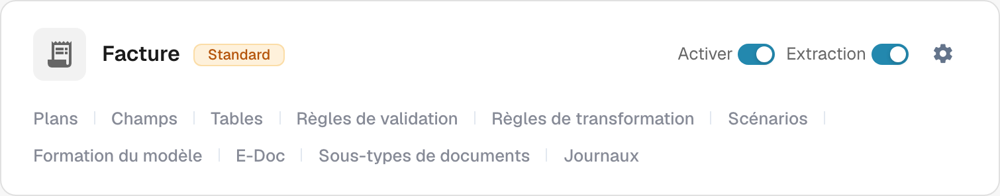
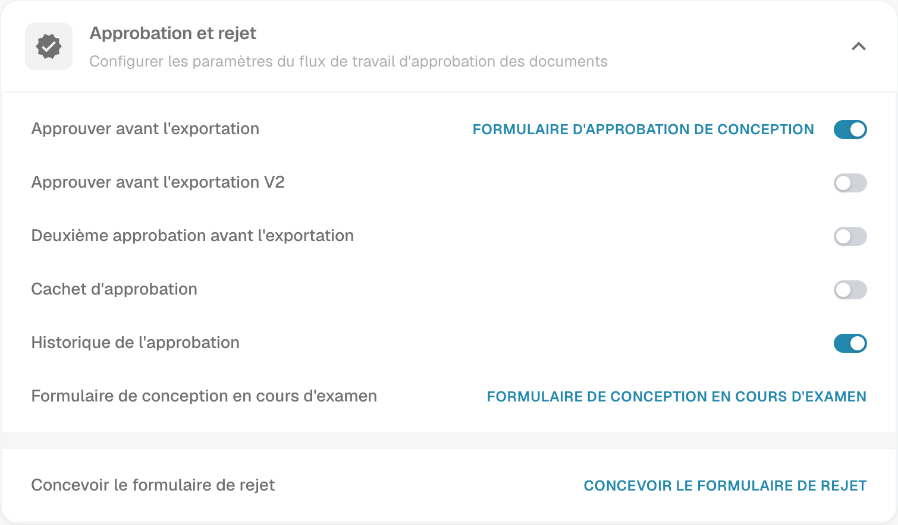

# Cachet d'approbation

Un cachet d'approbation est une annotation du flux d'approbation lorsque l'option est activée pour ce type de document. Il aide la personne chargée de la validation à vérifier qui a approuvé un document et quand. Vérifiez l'annotation et le résultat PDF avec une facture de test dans le processus réellement utilisé par votre organisation.

## Trouver l'option

1. Avec un compte administrateur, ouvrez **Types de Documents** dans les paramètres d'administration. Trouvez le type à configurer, par exemple **Facture**, et sélectionnez l'**icône d'engrenage** sur sa carte. L'engrenage ouvre **Plus de paramètres** pour ce type de document.

   <figure><figcaption>
Carte Facture réelle dans Dev en français. L'engrenage ouvre Plus de paramètres ; aucun contrôle n'a été modifié.
</figcaption></figure>

   **Activer** contrôle la disponibilité du type de document et **Extraction** son mode d'extraction. Les liens au bas de la carte ouvrent des espaces distincts : **Plans**, **Champs**, **Tables**, **Règles de validation**, **Règles de transformation**, **Scénarios**, **Formation du modèle**, **E-Doc**, **Sous-types de documents** et **Journaux**. Les liens disponibles dépendent des modules et des réglages du type. Pour accéder au cachet, utilisez l'engrenage.

2. Dans **Plus de paramètres**, dépliez **Approbation et rejet**. Repérez **Cachet d'approbation** à côté de **Approuver avant l'exportation**, **Deuxième approbation avant l'exportation** et **Historique de l'approbation**. L'image montre le réglage existant du cachet **désactivé** ; ce réglage peut être différent dans votre organisation. Elle ne montre pas de document approuvé.

   <figure><figcaption>
Vue réelle d'Approbation et rejet dans Dev en français. Les états des contrôles ont uniquement été consultés.
</figcaption></figure>

   **Approuver avant l'exportation**, **Approuver avant l'exportation V2**, **Deuxième approbation avant l'exportation** et **Historique de l'approbation** sont des réglages du flux distincts du cachet. Les liens de conception ouvrent les éditeurs des formulaires d'approbation, d'examen ou de rejet correspondants. Il n'est pas nécessaire d'ouvrir ces éditeurs pour consulter le réglage du cachet.

3. Modifiez **Cachet d'approbation** seulement après avoir convenu dans votre organisation du fonctionnement des approbations et des exports. **La modification du commutateur enregistre immédiatement le réglage.** Conservez une trace de l'état précédent afin de vérifier son effet sur une facture de test.

## Vérifier une approbation

Envoyez une facture synthétique de ce type de document dans le flux d'approbation configuré. À l'étape d'approbation de ce flux, approuvez-la avec un compte de test autorisé. Rouvrez le document approuvé et vérifiez que l'annotation contient le nom et la date attendus. Examinez également le PDF téléchargé que votre processus utilise réellement. Si le cachet est absent, vérifiez le type de document, le statut d'approbation, le réglage et la configuration d'export.

Un cachet d'approbation est distinct de la **Deuxième approbation** et de l'**Historique de l'approbation**. Activer l'un ne prouve pas que les autres sont configurés. Les actions de téléchargement disponibles dans le tableau de bord et le format d'export IDM dépendent de l'environnement et n'ont pas été vérifiés pour cette page ; ce guide ne promet donc pas de libellés précis dans le menu de téléchargement ni de sortie IDM automatique.

Les deux captures montrent des vues réelles de Dev en français. Aucun commutateur n'a été modifié et aucun document n'a été approuvé ni exporté pendant cette vérification. Le résultat final avec cachet nécessite une facture synthétique approuvée dédiée au test.
