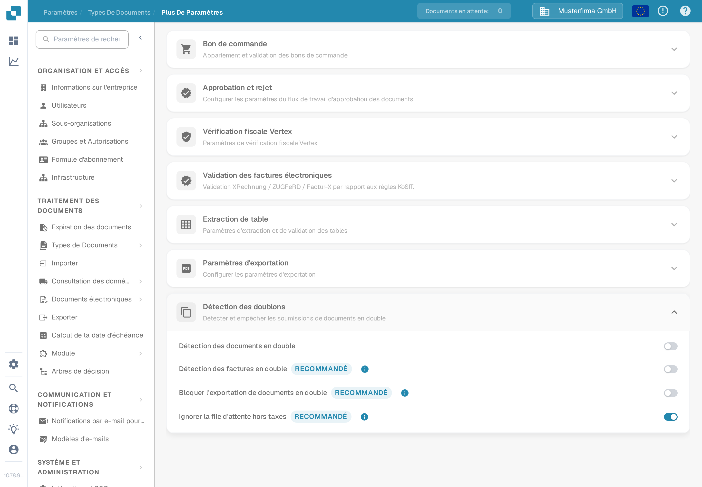
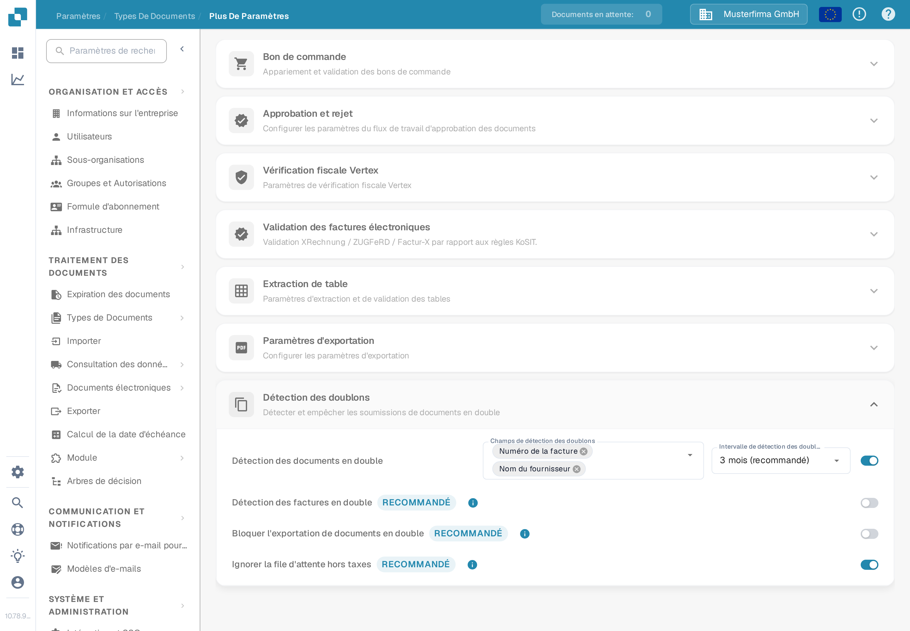
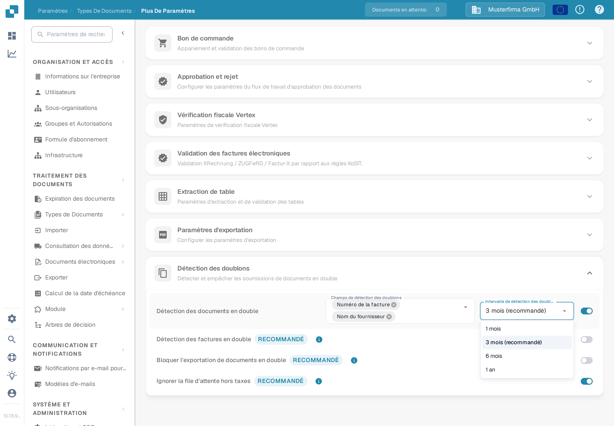

# Détection des doublons

Utilisez la **Détection des doublons** pour signaler les documents qui correspondent à un autre document sur des champs choisis, dans une période donnée. Les options appartiennent à chaque type de document.

## Ouvrir les paramètres

1. Ouvrez **Paramètres → Types de Documents**.
2. Sur le type de document que vous voulez configurer, sélectionnez **Plus De Paramètres**.
3. Dans **Plus De Paramètres**, ouvrez **Détection des doublons**.

<figure><figcaption>
Les paramètres de Facture montrent quatre interrupteurs séparés. Les sélecteurs de champs et d'intervalle apparaissent lorsque la détection est activée.
</figcaption></figure>

## Choisir ce qui compte comme doublon

1. Activez **Détection des documents en double**. Les sélecteurs **Champs de détection des doublons** et **Intervalle de détection des doublons** apparaissent.
2. Sélectionnez les champs qui doivent correspondre. Pour une facture, vous pouvez choisir par exemple le numéro de la facture et le nom du fournisseur. Choisissez des champs qui distinguent les documents dans votre propre processus.
3. Choisissez un intervalle : **1 mois**, **3 mois (recommandé)**, **6 mois** ou **1 an**. Un intervalle plus long vérifie une plage de dates plus large et peut allonger le temps de chargement.

Chaque modification est enregistrée dès que vous la faites ; il n'y a pas de bouton d'enregistrement séparé dans cette section. Si vous désactivez la détection, les sélecteurs de champs et d'intervalle sont masqués.

<figure><figcaption>
Activez la détection avant de choisir les champs de comparaison et l'intervalle de temps.
</figcaption></figure>

<figure><figcaption>
Trois mois est marqué comme intervalle recommandé dans le menu.
</figcaption></figure>

Pour **Facture**, cette section propose aussi **Détection des factures en double**, **Bloquer l'exportation de documents en double** et **Ignorer la file d'attente hors taxes**. Ce sont des interrupteurs séparés ; activez uniquement le comportement dont votre processus de facturation a besoin. Les interrupteurs supplémentaires ne sont pas affichés pour les autres types de documents.

## Examiner un document signalé

Quand DocBits trouve une correspondance, la ligne du document sur le **Tableau de bord** affiche une icône de doublon. Sélectionnez l'icône pour comparer les enregistrements correspondants dans le panneau latéral. L'icône n'apparaît que lorsqu'une correspondance existe.

Lorsque vous ouvrez un document signalé, l'avertissement de doublon propose de consulter le doublon, de continuer malgré tout et, si le document n'a pas déjà été archivé, de l'archiver. Examinez les enregistrements correspondants avant de choisir une action. Voir [le guide du Tableau de bord](../../dashboard/README.md) pour la liste des documents.
