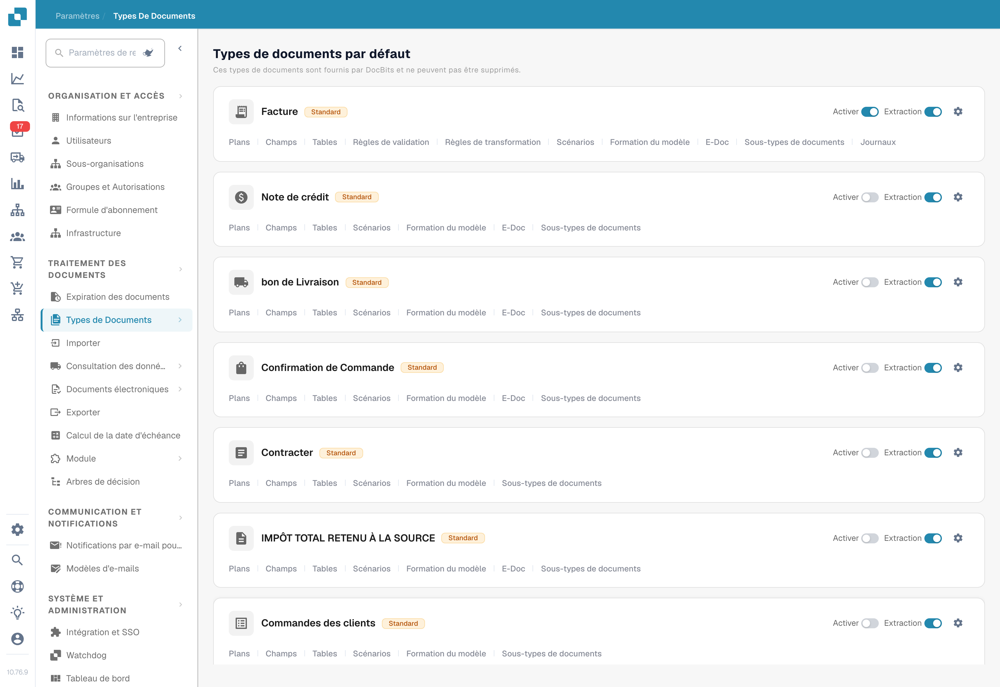
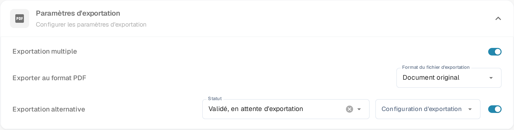

# Exportation alternative

L’exportation alternative propose une destination pour les documents qui remplissent le **Statut** configuré. Ce statut détermine la disponibilité de l’option ; il ne désigne pas le statut écrit après l’exportation.

## Trouver la configuration

1. Ouvrez **Paramètres → Types de Documents**.
2.  Repérez la carte du type de document et ouvrez ses paramètres avec l'engrenage (**Plus de paramètres**).

<figure><figcaption>
Exemple de la liste des types de documents et de leurs engrenages de configuration. Aucun réglage Activer ou Extraction n’a été modifié.
</figcaption></figure>

3.  Dépliez **Paramètres d'exportation** et activez **Exportation alternative**.

    <figure><figcaption>
L'interrupteur <strong>Exportation alternative</strong> dans <strong>Paramètres d'exportation</strong>. Une fois activé, <strong>Statut</strong> et <strong>Configuration d'exportation</strong> apparaissent à côté. Aucune exportation n'a été exécutée.
</figcaption></figure>

## Définir la disponibilité

Choisissez le statut adapté parmi les options proposées par votre version et associez la configuration d’exportation du bon destinataire. Le libellé actuel **Validation validée en attente d’exportation** désigne ici un document validé qui attend son exportation ; sa rédaction native est maladroite.

* **Statut** — le statut du document pour lequel l'option d'exportation supplémentaire est proposée.
* **Configuration d'exportation** — la configuration d'exportation utilisée par cette option.

Consultez les [réglages d’exportation](../../../../document-processing/export.md) pour préparer la destination. Lorsque le document remplit le statut et que l’option est disponible dans votre flux, sélectionnez cette destination dans l’écran de rapprochement des commandes. L’illustration montre uniquement les réglages ; aucune exportation n’a été exécutée.
