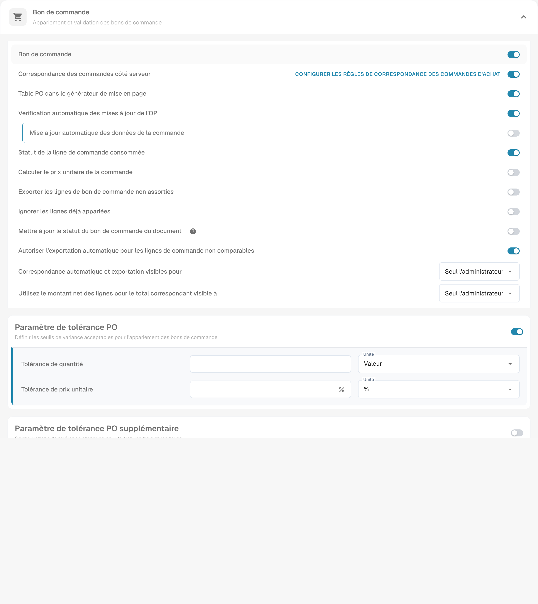

# Calculer le prix unitaire de la commande

## **Présentation**

Vous pouvez choisir de calculer automatiquement le **prix unitaire** de chaque ligne de bon de commande à partir du **montant** et de la **quantité** de la ligne, au lieu d’utiliser le prix unitaire fourni avec le bon de commande. Cela est particulièrement utile lorsque le prix unitaire dans le bon de commande (dans Infor ERP / SAP) diffère du prix sur le document. De telles divergences peuvent survenir si une remise est appliquée au prix unitaire dans le bon de commande, tandis que le document applique uniquement la remise au montant net.

## Activer le réglage

Ouvrez **Paramètres → Types de Documents**, puis l’engrenage du type concerné. Dans **Bon de commande**, repérez **Calculer le prix unitaire de la commande** et examinez son effet avant de modifier le réglage.

<figure><figcaption>
Partie supérieure des réglages Bon de commande avec Calculer le prix unitaire de la commande et les tolérances. Les valeurs privées sont masquées ; aucun interrupteur ni paramètre n’a été modifié.
</figcaption></figure>

## Comment le prix est calculé

Une fois le paramètre activé, le prix unitaire d’une ligne de bon de commande est calculé comme suit :

**`Prix unitaire = Montant de la ligne ÷ Quantité × Prix unitaire par`**

où le **montant de la ligne** est choisi ainsi :

| La ligne de bon de commande contient                                                          | Montant de la ligne utilisé             |
| -------------------------------------------------------------------------------------------- | -------------------------------------- |
| un **montant net** (`extended_amount`) supérieur à 0 et ne dépassant pas le total de la ligne | le montant net                         |
| pas de montant net, ou un montant net supérieur au total de la ligne                          | le **total** de la ligne (`total_amount`) |
| aucun montant positif, ou aucune quantité positive                                           | rien n’est calculé, le prix du BC reste |

Pourquoi le montant net est prioritaire : les flux ERP (Infor BODs) envoient le montant net de la ligne sous `extended_amount` et incluent **les taxes et charges en supplément** dans `total_amount`. Diviser un total taxé par la quantité donne un prix unitaire brut, et toute facture dont le prix est net apparaît alors comme un _prix unitaire sous-évalué_ bien que correct. Exemple chiffré : quantité 9, montant net 879,84, total 954,63 (8,5 % de taxe) — le prix basé sur le net est 97,76 et correspond à la facture ; le prix basé sur le total serait 106,07.

Si le montant net dépasse le total de la ligne, l’implémentation utilise le total comme valeur de repli. Vérifiez les données et les conventions de votre intégration pour interpréter ce cas. Un `Prix unitaire par` de 0 ou vide est considéré comme 1.


Le prix calculé est écrit dans la copie des données du bon de commande associée au document, et il est **recalculé à chaque fois que le document est apparié** (appariement automatique du BC, appariement manuel, appariement à l’enregistrement). Un document apparié avant la modification du paramètre adopte donc le nouveau prix lors de son prochain appariement — aucun rechargement du bon de commande n’est nécessaire.


## Exemple :

Dans ce cas, le prix unitaire (sans la remise) est extrait du document, tandis que le bon de commande dans l’ERP stocke le prix unitaire avec la remise appliquée. Cela entraîne une discordance dans le prix unitaire. Avec le paramètre activé, le prix unitaire est pris à partir du montant de la ligne et de la quantité, ce qui peut expliquer ou réduire une différence liée à la base de prix. Cela ne garantit pas une concordance : vérifiez aussi les quantités, la base de prix, les arrondis et les tolérances.

## Paramètres associés

* [Règles d’appariement des bons de commande](purchase-order-matching-rules.md) — les règles comparent le prix unitaire **effectif**, qui est ce prix calculé lorsque le paramètre est activé.
* [Paramètres de tolérance des bons de commande](purchase-order-tolerance-settings-additional-purchase-order-tolerance.md) — la marge de déviation possible entre le prix de la facture et le prix calculé.

Exemple avec quantité 9 et base de prix 1 : 879,84 ÷ 9 × 1 = 97,76 de prix unitaire net. Le total 954,63 comprenant 8,5 % de taxe donne 106,07. Pour une facture à prix nets, comparez le prix unitaire net.

La capture montre le réglage existant ; aucun calcul ni rapprochement n’a été exécuté pendant cette prise de vue.
