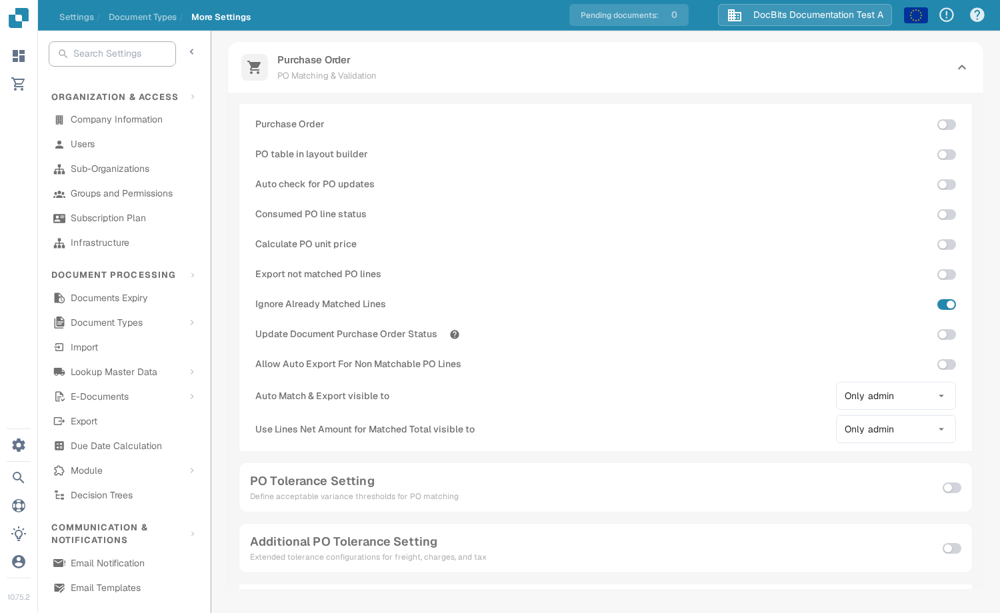

# Statut de la ligne de commande PO consommée

**Consumed PO line status** colore les lignes de bon de commande dans la vue de rapprochement selon la part de chaque ligne qui a déjà été rapprochée. Activez-le pour le type de document des factures si votre équipe doit repérer rapidement les lignes de PO inutilisées, partiellement utilisées et entièrement utilisées. La couleur est une aide visuelle ; vérifiez la **Matched Quantity** et la colonne de la quantité PO sélectionnée avant de décider si une ligne peut à nouveau être rapprochée.

## Activer le paramètre

1. Ouvrez **Settings → Document Types**. Trouvez le type de document utilisé pour vos factures et sélectionnez l'engrenage sur sa carte pour ouvrir **More Settings**. La capture d'écran montre la carte **Invoice**. Laissez les commutateurs **Activate** et **Extraction** tels quels.

   <figure><figcaption>
Ouvrez More Settings depuis la carte Invoice.
</figcaption></figure>

2. Développez **Purchase Order** s'il est réduit. Trouvez **Consumed PO line status** et activez son commutateur. Il s'agit d'un paramètre distinct de **Update Document Purchase Order Status**, situé plus bas dans la même section.

   <figure><figcaption>
Choisissez le commutateur Consumed PO line status.
</figcaption></figure>

   <figure><figcaption>
Le commutateur est désactivé dans cet exemple ; activez-le pour afficher les couleurs de rapprochement.
</figcaption></figure>

3. Ouvrez une facture avec rapprochement de bons de commande et examinez ses lignes de PO. Les exemples ci-dessous montrent le lien entre les couleurs des lignes et l'état du rapprochement. Pour les étapes du rapprochement, consultez [Purchase Order Matching](../../../../../../end-user-and-partner-section/end-user-section/purchase-order-matching/README.md).

## Lire les couleurs des lignes de PO

| Apparence | Signification | Ce qu'il faut vérifier |
| --- | --- | --- |
| Uni ou blanc | Aucune quantité de cette ligne de PO n'a encore été rapprochée. | Vérifiez la quantité du PO et la ligne de facture avant le rapprochement. |
| Teinte bleue | Vous avez sélectionné la ligne dans la vue de rapprochement actuelle. | La sélection est temporaire ; elle ne signifie pas que la ligne est entièrement rapprochée. |
| Orange pâle | Une partie de la quantité a été rapprochée, mais la quantité rapprochée est inférieure à la quantité PO sélectionnée. | Vérifiez la quantité restante. |
| Violet pâle | La quantité rapprochée est au moins égale à la quantité PO sélectionnée. | Ne supposez pas qu'une quantité supplémentaire est disponible. |

<figure><figcaption>
Aucune quantité n'a encore été rapprochée.
</figcaption></figure>

<figure><figcaption>
La ligne est sélectionnée pour le rapprochement en cours.
</figcaption></figure>

<figure><figcaption>
La ligne est partiellement utilisée.
</figcaption></figure>

<figure><figcaption>
La ligne est entièrement utilisée.
</figcaption></figure>

Une ligne barrée a une signification différente : son statut PO peut être exclu par les [PO disable statuses](purchase-order-disable-statuses.md). Vérifiez ce paramètre si une ligne ne peut pas être sélectionnée.
