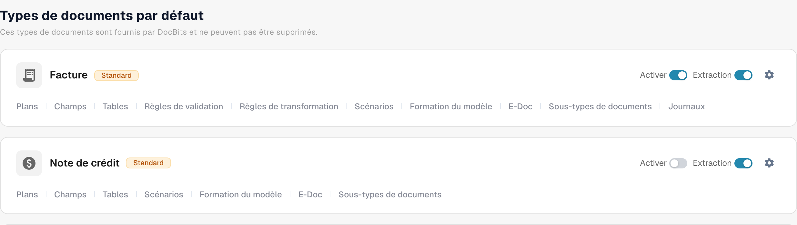
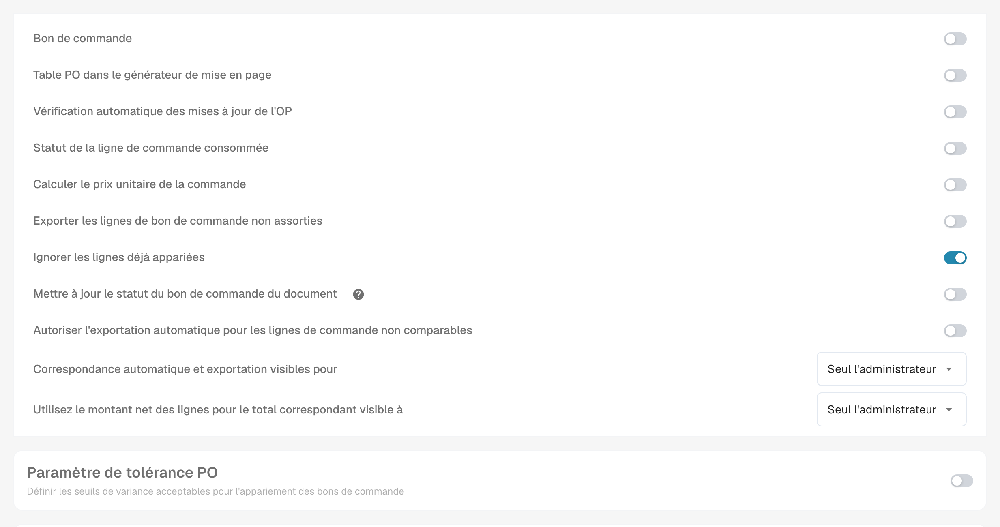

# Statut de la ligne de commande PO consommée

**Statut de la ligne de commande consommée** colore les lignes de bon de commande dans la vue de rapprochement selon la part de chaque ligne qui a déjà été rapprochée. Activez-le pour le type de document des factures si votre équipe doit repérer rapidement les lignes de PO inutilisées, partiellement utilisées et entièrement utilisées. La couleur est une aide visuelle ; vérifiez la **Quantité appariée** et la colonne de la quantité PO sélectionnée avant de décider si une ligne peut à nouveau être rapprochée.

## Activer le paramètre

1. Ouvrez **Paramètres → Types de documents**. Trouvez le type de document utilisé pour vos factures et sélectionnez l'engrenage sur sa carte pour ouvrir **Autres paramètres**. La capture d'écran montre la carte **Facture**. Laissez les commutateurs **Activer** et **Extraction** tels quels.

   <figure><figcaption>
Accès aux paramètres supplémentaires du type de document Facture.
</figcaption></figure>

2. Développez **Bon de commande** s'il est réduit. Trouvez **Statut de la ligne de commande consommée** et activez son commutateur. Il s'agit d'un paramètre distinct de **Mettre à jour le statut du bon de commande du document**, situé plus bas dans la même section.

   <figure><figcaption>
Paramètres du statut des lignes de commande consommées.
</figcaption></figure>

3. Ouvrez une facture avec rapprochement de bons de commande et examinez ses lignes de PO. Les exemples ci-dessous montrent le lien entre les couleurs des lignes et l'état du rapprochement. Pour les étapes du rapprochement, consultez [Purchase Order Matching](../../../../../../end-user-and-partner-section/end-user-section/purchase-order-matching/README.md).

## Lire les couleurs des lignes de PO

| Apparence | Signification | Ce qu'il faut vérifier |
| --- | --- | --- |
| Uni ou blanc | Aucune quantité de cette ligne de PO n'a encore été rapprochée. | Vérifiez la quantité du PO et la ligne de facture avant le rapprochement. |
| Teinte bleue | Vous avez sélectionné la ligne dans la vue de rapprochement actuelle. | La sélection est temporaire ; elle ne signifie pas que la ligne est entièrement rapprochée. |
| Orange pâle | Une partie de la quantité a été rapprochée, mais la quantité rapprochée est inférieure à la quantité PO sélectionnée. | Vérifiez la quantité restante. |
| Violet pâle | La quantité rapprochée est au moins égale à la quantité PO sélectionnée. | Ne supposez pas qu'une quantité supplémentaire est disponible. |

Une ligne barrée a une signification différente : son statut PO peut être exclu par les [PO disable statuses](purchase-order-disable-statuses.md). Vérifiez ce paramètre si une ligne ne peut pas être sélectionnée.

La légende suivante explique les états de rapprochement sans dépendre des captures d’anciennes versions. Vérifiez toujours la quantité déjà affectée avant de réutiliser une ligne.
