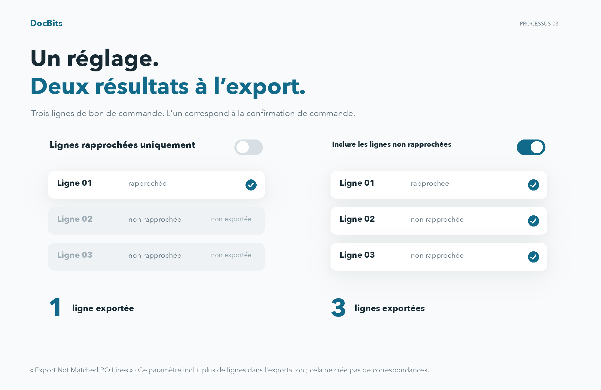

# Export des lignes de commande non appariées

## Comprendre la portée des exportations avec trois lignes de bon de commande

<figure><figcaption>
Comprendre la portée des exportations avec trois lignes de bon de commande
</figcaption></figure>

Dans cet exemple, le bon de commande comporte trois lignes et une seule est mise en correspondance avec une ligne de confirmation de commande. Avec « Export Not Matched PO Lines » désactivé, seule la ligne de bon de commande correspondante est exportée. Lorsque l'option est activée, les deux lignes de bon de commande sans correspondance sont également incluses. Cela ne crée pas de correspondances supplémentaires.

## **Où le trouver**

Allez dans **Paramètres → Paramètres généraux → Types de documents → Plus de paramètres → Section des commandes d'achat → Exporter les lignes de commande non appariées**. Activez le bouton pour activer ce paramètre.

## **Comment ça fonctionne**

* **Lorsque désactivé**, le système n'exporte que les lignes de commande d'achat qui sont appariées avec une ligne de confirmation de commande. Les lignes de commande d'achat non appariées ne seront pas incluses dans l'exportation.
* **Lorsque activé**, le système exporte toutes les lignes de commande d'achat, même si elles ne sont pas appariées à une ligne de confirmation de commande.

Par exemple, si une commande d'achat a **trois lignes**, mais que le fournisseur envoie une **confirmation de commande avec seulement une ligne**, vous appariez cette ligne à une ligne de commande d'achat. Les deux lignes de commande d'achat restantes non appariées seront :

* **Exclues de l'exportation** si le paramètre est désactivé.
* **Incluses dans l'exportation** si le paramètre est activé.
