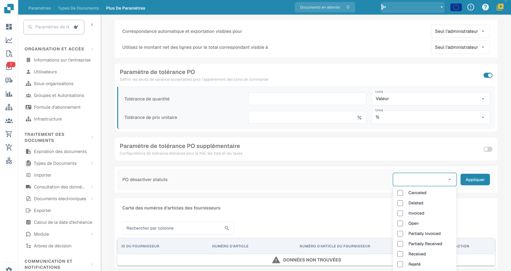

# Statuts de désactivation des bons de commande

Le réglage affiché **PO désactiver statuts** exclut certains statuts de bons de commande du rapprochement avec les factures. Son libellé est maladroit ; il s’agit de l’éligibilité des commandes au rapprochement.

Cette exclusion ne constitue pas, à elle seule, une interdiction universelle de traiter une facture, de l’exporter ou de la payer. Ces étapes dépendent d’autres règles et contrôles du flux.

## Accès

1. Ouvrez **Paramètres → Types de Documents**.
2. Ouvrez l’engrenage du type concerné.

<figure><figcaption>
Exemple de la liste des types de documents et de leurs engrenages de configuration. Aucun réglage Activer ou Extraction n’a été modifié.
</figcaption></figure>

3. Dépliez **Bon de commande** et repérez **PO désactiver statuts**.

<figure><figcaption>
Sélecteur PO désactiver statuts dans Bon de commande. Canceled, Deleted, Invoiced, Open, Partially Invoiced, Partially Received et Received restent en anglais ; Rejeté est traduit. Aucun statut n’a été sélectionné ni appliqué.
</figcaption></figure>

## Configurer et vérifier

Examinez les statuts proposés par votre version, sélectionnez ceux à exclure et confirmez **Appliquer** si vous souhaitez enregistrer le réglage. Plusieurs valeurs du sélecteur restent en anglais dans la version illustrée ; conservez les valeurs attendues par votre intégration et votre flux.

Testez séparément une commande admissible et une commande portant un statut exclu, puis examinez le résultat de rapprochement. Une mise en forme barrée ou une liste de paramètres ne prouve pas à elle seule le résultat d’un paiement ou d’une exportation. Aucun statut n’a été modifié et aucun rapprochement n’a été exécuté pour cette illustration.
