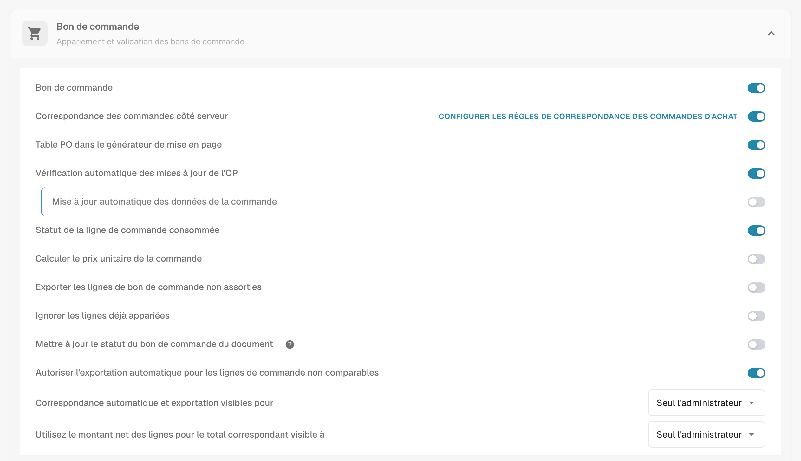
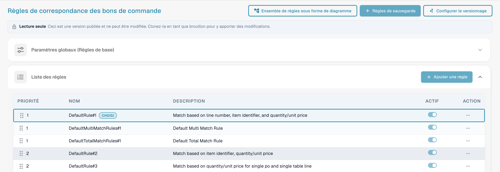
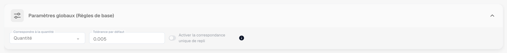
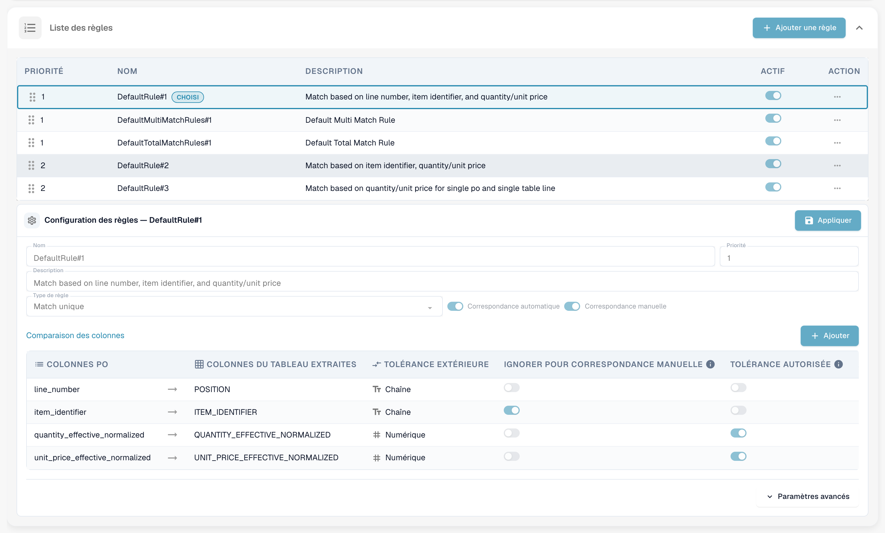
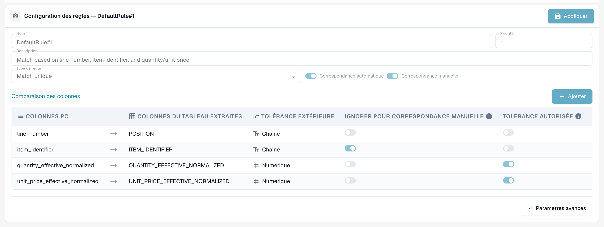
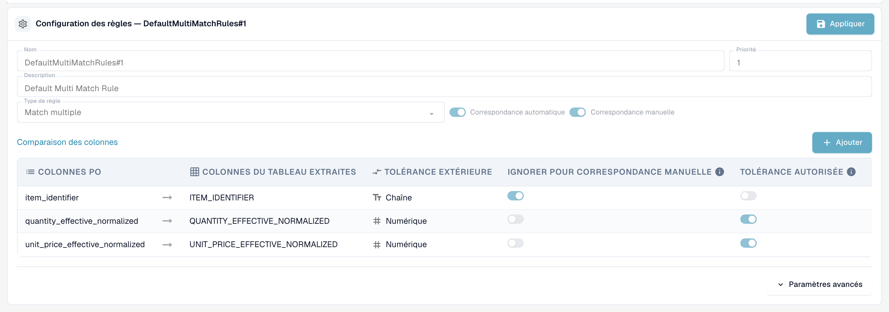
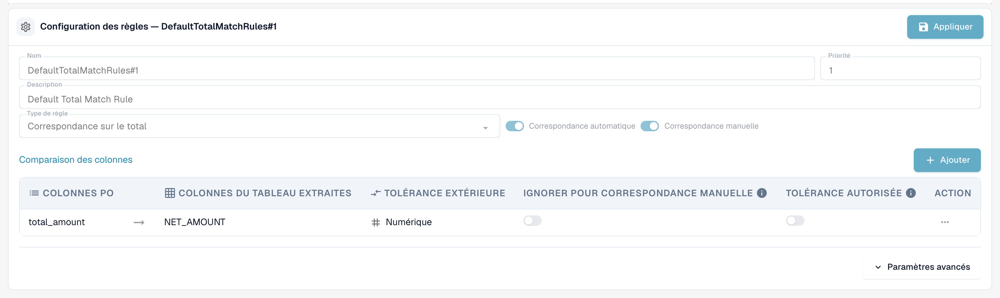
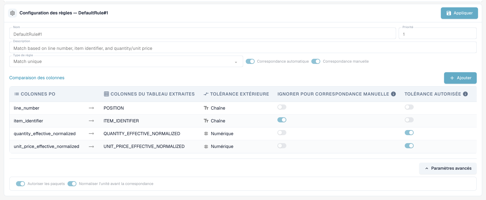
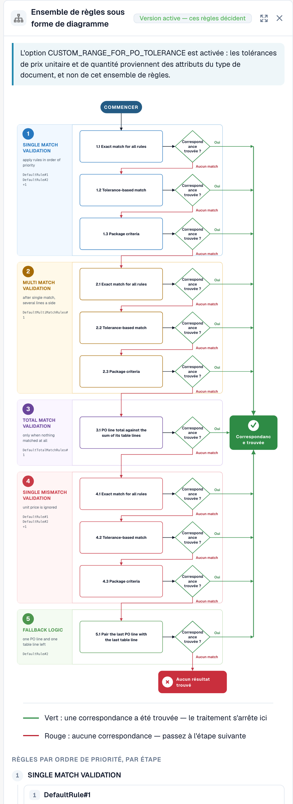
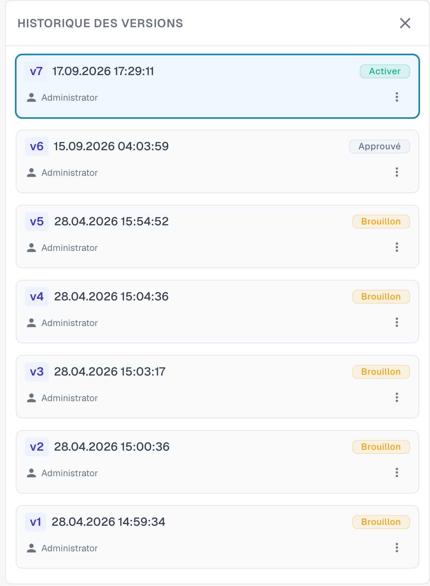

# Règles de Correspondance des Bons de Commande

## Introduction : Bons de Commande et Gestion des Règles de BC

La correspondance des Bons de Commande (BC) est un processus crucial pour garantir la cohérence entre les Bons de Commande (BC) et les factures entrantes ou réceptions de marchandises correspondantes. Un ensemble robuste de règles est essentiel pour atteindre un taux élevé de correspondance automatique, prévenir la fraude et assurer des paiements corrects.

Cette page de configuration est utilisée pour définir et gérer les règles qui déterminent _comment_ les lignes de BC sont appariées au document entrant correspondant (Facture, Confirmation de commande).


**Prérequis :** les règles de correspondance ne sont utilisées que lorsque **Correspondance des commandes côté serveur** est activé pour le type de document (Paramètres → Types de documents → Plus de paramètres → Bon de commande). Lorsque ce paramètre est désactivé, DocBits utilise son moteur de correspondance intégré (quantité, prix unitaire, numéro d'article, numéro de bon de commande) et ignore l'ensemble des règles.


***

## Comment y accéder

1. Naviguez vers **Paramètres** → **Paramètres globaux** → **Types de documents**, sélectionnez le type de document et cliquez sur **Plus de paramètres**.
2. Dans la carte **Bon de commande**, activez **Correspondance des commandes côté serveur**.
3. Cliquez sur **Configurer les règles de correspondance des commandes d'achat** à côté de l'interrupteur.

<figure><figcaption>
La carte Bon de commande. <strong>Configurer les règles de correspondance des commandes d'achat</strong> se trouve à côté de <strong>Correspondance des commandes côté serveur</strong>.
</figcaption></figure>

## La page en un coup d'œil

<figure><figcaption>
La page Règles de correspondance des bons de commande.
</figcaption></figure>

La page comporte trois boutons en haut :

* **Ensemble de règles sous forme de diagramme** ouvre un organigramme de l'ensemble de règles actif. Voir Ensemble de règles sous forme de diagramme ci-dessous.
* **Règles de sauvegarde** enregistre vos modifications dans le brouillon que vous éditez.
* **Configurer le versionnage** ouvre l'historique des versions. Voir Versions et brouillons ci-dessous.

Sous les boutons, un avis **Lecture seule** apparaît lorsque vous consultez une version publiée : *Ceci est une version publiée et ne peut être modifiée. Clonez-la en tant que brouillon pour y apporter des modifications.* Viennent ensuite la carte **Paramètres globaux (Règles de base)** et la **Liste des règles**. Sélectionnez une règle dans la liste pour la configurer dans la zone **Configuration des règles** sous la liste.

***

## Paramètres globaux (Règles de base)

Ces paramètres établissent le cadre qui s'applique à toutes les règles de correspondance :

<figure><figcaption>
La carte Paramètres globaux (Règles de base), ouverte.
</figcaption></figure>

* **Paramètre :** Correspondre à la quantité
  * **Objectif :** Définit quelle quantité de la ligne de bon de commande est comparée à la ligne du document — par exemple la quantité commandée ou la **quantité ouverte de la facture** (commandée moins déjà facturée), ce qui est le choix habituel pour les factures.
  * **Valeurs valides :** Quantité ou autres champs de quantité disponibles dans le système, selon la structure des données (par exemple, un champ de quantité normalisée alternatif).
  * **Dépendance :** Détermine la base pour toutes les règles de correspondance qui incluent la quantité dans leurs critères de comparaison.
* **Paramètre :** Tolérance standard (Tolérance par défaut)
  * **Objectif :** Définit jusqu'où une valeur numérique sur le document peut s'écarter de la valeur du bon de commande tout en étant considérée comme une correspondance. Cela compense les différences d'arrondi. S'applique à **chaque colonne numérique** avec l'option "Tolérance autorisée" activée — quantité ainsi que prix unitaire.
  * **Valeur valide :** Un nombre décimal. Qu'il soit interprété comme une **valeur absolue** (0,005 = un écart jusqu'à 0,005 dans la quantité ou le prix comparé) ou comme un **pourcentage** (0,5 = 0,5 % de la valeur comparée) est défini par le **type de tolérance** de l'ensemble de règles (`value` ou `percent` ; les nouveaux ensembles de règles utilisent `value`). Les tolérances par article (voir [Paramètres de tolérance](purchase-order-tolerance-settings-additional-purchase-order-tolerance.md)) remplacent la tolérance standard pour cet article.
  * **Dépendance :** S'applique aux règles qui utilisent des champs numériques pour la correspondance et ont l'option "Tolérance autorisée" activée.
* **Paramètre :** Activer la correspondance unique de repli
  * **Objectif :** Lorsque cette option est activée, la dernière ligne de bon de commande non appariée restante est appariée automatiquement, même si le numéro du bordereau de livraison diffère. La correspondance est signalée comme une divergence pour votre vérification.
  * **Valeurs valides :** Activé ou désactivé. La valeur par défaut est désactivé.

***

## Liste des règles

La liste des règles affiche toutes les règles de correspondance disponibles et gère leur ordre d'exécution.

<figure><figcaption>
La Liste des règles. La règle sélectionnée est marquée <strong>Sélectionné</strong>. Une règle peut être désactivée avec son interrupteur <strong>Actif</strong>.
</figcaption></figure>

#### Structure et exécution

* **Priorité :** Ce champ numérique (par ex., 1, 2, 3) dicte la séquence d'exécution des règles. Les règles avec un numéro de priorité plus bas sont tentées en premier. Cela permet aux administrateurs de structurer une hiérarchie, commençant typiquement par les règles les plus spécifiques et strictes (par ex., correspondance à la fois par numéro de ligne et numéro de pièce) et en revenant à des règles plus larges ou moins restrictives.
* **Nom & Description :** Fournit une identification claire et un contexte pour la règle, expliquant les critères principaux utilisés (par ex., "Règle standard n° 1 : Correspondance basée sur le numéro de ligne, l'ID de pièce et la quantité").
* **Actif :** Un simple interrupteur qui permet d'activer ou de désactiver instantanément la règle sans avoir besoin de supprimer sa configuration.

**Flux d'exécution :** Le système effectue la correspondance en séquence en cascade. Si une règle (par ex., priorité 1) correspond avec succès à une ligne, le processus pour cet article s'arrête. Si aucune correspondance n'est trouvée, le système passe à la règle suivante dans la séquence de priorité (par ex., priorité 2). Chaque exécution est enregistrée sur le document ; l'**historique des correspondances** dans l'écran de correspondance des bons de commande montre quelle règle a été testée, laquelle a correspondu, et lesquelles ont été ignorées ainsi que la raison.

***

## Configuration des règles (Paramètres détaillés)

Cette zone de configuration détaillée définit la logique spécifique et les critères pour une règle individuelle.

<figure><figcaption>
La zone Configuration des règles pour une règle de correspondance simple. <strong>Appliquer</strong> conserve vos modifications dans le brouillon.
</figcaption></figure>

#### Paramètres de base

* **Type de règle :** Spécifie la cardinalité de la correspondance.

| Type de règle | Ce qu'elle fait | Usage typique |
| ------------- | --------------- | ------------- |
| **Match unique** | Une ligne de bon de commande à une ligne de document. Chaque colonne configurée doit correspondre (dans la tolérance où elle est autorisée). | Le cas standard. |
| **Match multiple** | Plusieurs lignes de bon de commande à une ligne de document, ou plusieurs lignes de document à une ligne de bon de commande. Les quantités sont **sommées**, le prix unitaire est comparé en **moyenne**, les autres colonnes doivent correspondre. | Livraisons fractionnées, une ligne de facture couvrant plusieurs lignes de commande. |
| **Correspondance sur le total** | Compare un **montant** — généralement le montant net de la ligne du document contre le **total** du bon de commande — et apparie l'ensemble du bon de commande en une fois. | Fournisseurs facturant un montant global, factures de services, factures à une ligne. |

<figure><figcaption>
Une règle de correspondance multiple compare l'identifiant d'article, la quantité sommée et le prix unitaire moyen.
</figcaption></figure>

<figure><figcaption>
Une règle de correspondance sur le total compare un montant, ici le montant net avec le total du bon de commande.
</figcaption></figure>

* **Correspondance automatique :** Si activé, le système tentera d'appliquer cette règle entièrement automatiquement. Une grande confiance dans les critères est requise pour le traitement automatique.
* **Correspondance manuelle :** Si activé, cette règle peut être présentée ou appliquée par un utilisateur lors de l'étape de rapprochement manuel, lui offrant un ensemble prédéfini de critères de comparaison pour résoudre les exceptions.
* **Retomber :** Une règle marquée comme repli s'exécute dans une phase ultérieure, uniquement pour les paires de lignes qui restent non appariées après l'exécution de toutes les règles régulières. Utilisez-la pour la règle "plus souple" qui doit attraper ce que les règles strictes ont manqué.

#### Conditions d'activation

Une règle peut comporter des **conditions d'activation** — des expressions qui doivent être vraies avant que la règle ne s'exécute. Si une condition est fausse, la règle est **ignorée pour ce document** (l'historique des correspondances la montre comme "non exécutée" avec la raison). Les expressions utilisent les comptes des lignes qui sont appariées :

| Expression | Signification |
| ---------- | ------------- |
| `[[count(po_lines)]]` | nombre de lignes de bon de commande disponibles pour la correspondance |
| `[[count(table_lines)]]` | nombre de lignes d'articles sur le document qui sont mappées pour la correspondance |

Comparez-les avec `==`, `!=`, `>`, `>=`, `<`, `<=` et combinez plusieurs conditions avec `&` (et). Exemples :

* `([[count(po_lines)]] > 1) & ([[count(table_lines)]] > 1)` — uniquement pour les documents avec plusieurs lignes des deux côtés (typique pour une règle de correspondance multiple).
* `([[count(po_lines)]] == 1) & ([[count(table_lines)]] == 1)` — uniquement pour les documents à une ligne contre une commande à une ligne.
* `([[count(po_lines)]] >= 1) & ([[count(table_lines)]] >= 1)` — chaque fois qu'il y a quelque chose à apparier.


Les conditions d'activation sont la raison la plus fréquente pour laquelle une règle "ne fait rien". Une règle de correspondance sur le total avec la condition `[[count(table_lines)]] > 1` ne s'exécute jamais pour une facture à une ligne — et une [règle de transformation](../../transformation-rules.md) qui réduit la facture à une ligne totale produit exactement un tel document. Vérifiez les comptes dans l'historique des correspondances avant de modifier la règle elle-même.


#### Comparaison des colonnes (Critères de correspondance)

C'est la définition centrale de la logique de la règle, spécifiant quels champs doivent correspondre entre les documents.

1. Définition des colonnes à comparer :
   * **Colonnes PO :** Le champ tiré des données du Bon de commande (par ex., numéro de ligne).
   * **Colonnes du tableau extraites :** Le champ correspondant extrait ou analysé du document entrant (Facture/Confirmation de commande) (par ex., `POSITION`).
2. **Type de comparaison** (colonne « Tolérance extérieure » dans l'interface) **:** Définit la nature de la correspondance requise (par ex., Tt pour comparaison Texte/Chaîne, nécessitant une correspondance exacte caractère par caractère ; # pour comparaison Numérique).
3. **Tolérance autorisée :** Pour les champs numériques (quantité, prix), activer cette option indique au système d'appliquer la Tolérance standard globale définie précédemment. Si cette option n'est _pas_ activée pour un champ numérique, les valeurs doivent correspondre exactement.
4. **Ignorer pour correspondance manuelle :** Si coché, ce critère est assoupli lors de l'intervention manuelle. Cela est utile pour des champs comme les descriptions ou références internes qui peuvent varier légèrement, permettant à l'utilisateur de passer outre de petites divergences non critiques.

**Quelles colonnes peuvent être comparées**

| Colonne | Côté document | Côté bon de commande | Note |
| ------- | ------------- | -------------------- | ---- |
| Numéro de ligne | `POSITION` | `line_number` | Texte, exact. Utile uniquement lorsque le fournisseur imprime les numéros de ligne de commande sur le document. |
| Identifiant d'article | `ITEM_IDENTIFIER` | `item_identifier` | Texte, exact. Numéro d'article ou numéro d'article du fournisseur, aussi via la [Carte des numéros d'articles des fournisseurs](supplier-item-number-map-admin-documentation.md). |
| Quantité normalisée effective | `QUANTITY_EFFECTIVE_NORMALIZED` | `quantity_effective_normalized` | Numérique. La quantité sélectionnée par **Correspondre à la quantité**, convertie dans la même unité des deux côtés (conversion du code unité, quantités "par"). |
| Prix unitaire normalisé effectif | `UNIT_PRICE_EFFECTIVE_NORMALIZED` | `unit_price_effective_normalized` | Numérique. Le prix unitaire par unité après remises et après **Prix unitaire par** — et, si [Calculer le prix unitaire de la commande](calculate-po-unit-price.md) est activé, le prix calculé à partir du montant et de la quantité de la ligne de commande. |
| Montant net | `NET_AMOUNT` | `total_amount` | Numérique. Utilisé par les règles de correspondance sur le total. |

**Exemple : Règle stricte de correspondance BC (`DefaultRule#1`)**

Une règle stricte typique combine des vérifications d'identité obligatoires avec des vérifications de valeurs :

* **Identité obligatoire :** Le numéro de ligne et l'identifiant d'article doivent correspondre exactement (comparaison texte, sans tolérance).
* **Vérifications de valeurs :** La quantité normalisée effective et le prix unitaire normalisé effectif doivent correspondre (comparaison numérique, tolérance autorisée). Ce n'est que si les quatre critères sont remplis (avec tolérance pour les valeurs) qu'une correspondance automatique est effectuée.

***

#### Paramètres avancés

Cliquez sur **Paramètres avancés** sous le tableau des colonnes pour ouvrir deux options supplémentaires pour la règle.

<figure><figcaption>
Paramètres avancés d'une règle.
</figcaption></figure>

* **Autoriser les paquets :** Permet à la règle d'apparier des lignes dont la quantité et le prix unitaire diffèrent d'une taille de paquet. Les tailles de paquet par défaut sont 10, 20, 100 et 1000. DocBits ajuste alors la quantité et le prix unitaire du document selon la taille de paquet avant de les comparer. C'est l'étape **Critères de paquet** de chaque phase dans le diagramme des règles (voir Ensemble de règles sous forme de diagramme ci-dessous).
* **Normaliser l'unité avant la correspondance :** Convertit l'unité de mesure des deux côtés dans la même unité avant la comparaison de la quantité. Cette option est activée par défaut.

***

## Ensemble de règles sous forme de diagramme

**Ensemble de règles sous forme de diagramme** ouvre un panneau à côté des règles. Il montre les règles de la version active sous forme d'organigramme, afin que vous voyiez dans quel ordre DocBits les essaie et où la correspondance s'arrête.

<figure><figcaption>
L'ensemble de règles sous forme de diagramme.
</figcaption></figure>

DocBits parcourt cinq phases de haut en bas. Chaque phase comporte jusqu'à trois passages : **Correspondance exacte pour toutes les règles**, **Correspondance basée sur la tolérance** et **Critères de paquet**. Le premier passage qui trouve une correspondance met fin au processus (flèche verte). Si un passage ne trouve aucune correspondance, DocBits poursuit avec le suivant (flèche rouge).

| Phase | Ce qu'elle fait |
| ----- | --------------- |
| 1. Validation de la correspondance unique | Applique les règles de correspondance simple par ordre de priorité. |
| 2. Validation de la correspondance multiple | S'exécute après la correspondance simple, pour plusieurs lignes d'un côté. |
| 3. Validation de la correspondance sur le total | S'exécute uniquement lorsque rien n'a été apparié. Compare le total du bon de commande avec la somme des lignes du tableau. |
| 4. Validation de la divergence unique | Applique à nouveau les règles de correspondance simple, en ignorant le prix unitaire. |
| 5. Logique de repli | Apparie la dernière ligne de bon de commande avec la dernière ligne du tableau lorsqu'il reste exactement une ligne de chaque côté. |

Sous le diagramme, le panneau répertorie les règles de chaque phase par priorité, avec les colonnes que chaque règle compare. Une remarque en haut indique d'où viennent les tolérances : de l'ensemble de règles ou, lorsque `CUSTOM_RANGE_FOR_PO_TOLERANCE` est activé, des [paramètres du type de document](purchase-order-tolerance-settings-additional-purchase-order-tolerance.md).

***

## L'ensemble de règles par défaut

Chaque organisation commence avec le même ensemble de règles par défaut. C'est une bonne référence lorsque vous créez le vôtre :

| Règle | Type / priorité | Colonnes comparées | Condition d'activation |
| ----- | --------------- | ------------------ | ---------------------- |
| `DefaultRule#1` | correspondance simple, priorité 1 | numéro de ligne, identifiant d'article, quantité (tol.), prix unitaire (tol.) | toujours |
| `DefaultMultiMatchRules#1` | correspondance multiple, priorité 1, repli | identifiant d'article, quantité (tol.), prix unitaire (tol.) | `count(po_lines) > 1` et `count(table_lines) > 1` |
| `DefaultTotalMatchRules#1` | correspondance sur le total, priorité 1 | montant net ↔ total du bon de commande (sans tolérance) | `count(po_lines) >= 1` et `count(table_lines) > 1` |
| `DefaultRule#2` | correspondance simple, priorité 2, repli | identifiant d'article, quantité (tol.), prix unitaire (tol.) | toujours |
| `DefaultRule#3` | correspondance simple, priorité 2, repli | quantité (tol.), prix unitaire (tol.) | `count(po_lines) == 1` et `count(table_lines) == 1` |

Lecture de haut en bas : d'abord la règle stricte (numéro de ligne et article doivent être imprimés sur le document), puis les replis sans numéro de ligne, puis un dernier recours pour les documents à une ligne qui compare seulement quantité et prix.

***

## Impact sur le processus de correspondance des BC

L'ensemble de règles défini gouverne directement l'efficacité et l'intégrité du flux de travail de correspondance des BC :

* **Priorisation et replis :** La priorité définie garantit que le système tente d'abord la méthode de correspondance la plus fiable. Si les règles strictes et prioritaires échouent, le système se rabat sur des règles plus larges, visant à minimiser le nombre d'exceptions envoyées aux utilisateurs.
* **Contrôle de la qualité de la correspondance :** Des règles plus strictes (exigeant des correspondances plus exactes et moins de tolérance) entraînent moins de correspondances automatiques, mais très fiables. Des règles plus souples augmentent le taux de correspondance automatique mais augmentent le risque de faux positifs.
* **Gestion des exceptions (correspondance manuelle) :** En activant les règles pour la correspondance manuelle, le système offre des options structurées aux utilisateurs. Si une transaction ne satisfait pas les critères de correspondance automatique, elle devient une exception. L'utilisateur peut alors tenter de résoudre l'exception en appliquant une règle manuelle prédéfinie, qui peut avoir des critères assouplis (par ex., ignorer une petite divergence de texte selon le paramètre "Ignorer pour correspondance manuelle").

## Autres facteurs influençant le résultat

* **Quand la correspondance s'exécute :** lors du traitement du document, quand un utilisateur clique sur **Correspondance automatique de bon de commande**, et **à chaque sauvegarde** où le numéro de bon de commande a changé ou n'a jamais été recherché auparavant (par exemple lorsque les données maîtres l'ont rempli après traitement). Une sauvegarde ne remplace jamais une correspondance déjà existante.
* Les [**règles de transformation**](../../transformation-rules.md) s'exécutent avant la correspondance et peuvent modifier les lignes — et avec elles les comptes de lignes que les conditions d'activation examinent. Une règle de tableau qui reconstruit les lignes conserve une correspondance existante tant que les lignes restent les mêmes ; si elle remplace des lignes appariées, la correspondance est supprimée et le nom de la règle est affiché comme raison.
* [**Calculer le prix unitaire de la commande**](calculate-po-unit-price.md) modifie le prix unitaire que les règles comparent côté bon de commande.
* Les [**paramètres de tolérance**](purchase-order-tolerance-settings-additional-purchase-order-tolerance.md) et les [**statuts désactivés**](purchase-order-disable-statuses.md) déterminent la rigueur de la comparaison et quelles lignes de bon de commande sont proposées.

## Dépannage

| Symptôme | Que vérifier |
| -------- | ------------ |
| "Pas de correspondance" bien que toutes les valeurs correspondent | Ouvrez l'historique des correspondances : quelle règle a été exécutée, sur quelle colonne a-t-elle échoué (l'écart est affiché par colonne), la règle a-t-elle été ignorée par une condition d'activation ? |
| Prix unitaire sous-apparié exactement du taux de taxe | Le total du bon de commande inclut la taxe ; activez [Calculer le prix unitaire de la commande](calculate-po-unit-price.md) (montant net d'abord) ou comparez le montant net de la ligne. |
| Une règle de correspondance sur le total ne s'exécute jamais | Sa condition d'activation nécessite plus d'une ligne de document. Mettez `[[count(table_lines)]] >= 1` ou ne réduisez pas les lignes avec une règle de transformation. |
| L'ensemble de règles n'a aucun effet | **Correspondance des commandes côté serveur** est désactivé pour le type de document, ou l'ensemble de règles modifié est encore un brouillon — activez la version. |

***

## Versions et brouillons

Les règles de correspondance sont versionnées. Vous ne pouvez modifier qu'un **brouillon** ; une version publiée ne peut être que consultée. Cliquez sur **Configurer le versionnage** pour ouvrir l'**Historique des versions**.

<figure><figcaption>
L'Historique des versions avec toutes les versions de l'ensemble de règles.
</figcaption></figure>

Chaque version affiche son numéro, la date et l'heure ainsi que son statut, par exemple **Brouillon** ou **Approuvé**. Le menu d'une version propose les actions correspondantes. Pour modifier l'ensemble de règles par défaut, clonez-le d'abord : ouvrez **Configurer le versionnage** et choisissez **Cloner comme brouillon** dans les options de carte de la version. Modifiez le brouillon, cliquez sur **Appliquer** pour chaque règle modifiée, puis sur **Règles de sauvegarde**. Les règles modifiées prennent effet lorsque la version est activée.
