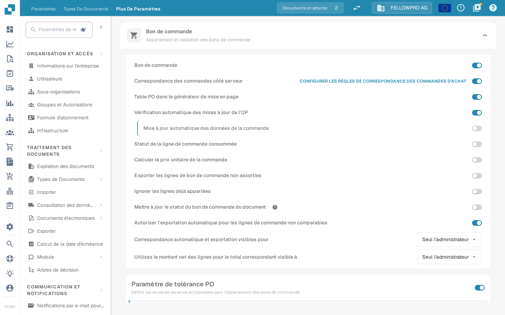

# Bon de commande

## Aperçu

Ce paramètre active la section [**Correspondance des Bon de commande**](../../../../../../end-user-and-partner-section/end-user-section/purchase-order-matching/), qui devient accessible après la validation du document.

<mark style="color:red;">**Remarque**</mark>: Pour le type de document **Facture**, les exigences supplémentaires suivantes doivent être respectées :

* Le paramètre **Bon de commande** doit être activé (comme décrit sur cette page)
* La facture doit être de type **Facture d'achat**
* Un **Tableau extrait** doit être présent

## Étapes d'activation 

1. Allez dans **Paramètres** -> **Paramètres globaux** -> **Types de documents**
2.  Repérez la carte du type de document et ouvrez ses paramètres avec l'engrenage (**Plus de paramètres**).
3.  Dépliez la section **Bon de commande** et activez **Bon de commande**.

<figure><figcaption>
La section <strong>Bon de commande</strong> dans les paramètres avancés. Le premier interrupteur active l'appariement des bons de commande pour le type de document, les interrupteurs suivants l'affinent.
</figcaption></figure>

## **Fonctionnalité**

Une fois activée, la section [**Correspondance des Bon de commande**](../../../../../../end-user-and-partner-section/end-user-section/purchase-order-matching/) devient disponible après la validation du document.

### Quelle quantité est comparée

La quantité de la commande comparée par l'appariement dépend de **Correspondance des commandes côté serveur** :

* **Correspondance des commandes côté serveur désactivée** – une liste s'affiche à côté de l'interrupteur **Bon de commande**, avec **Quantité**, **Quantité Reçue** et **Réception Livraison Quantité en cours**. DocBits compare la quantité choisie avec son propre moteur d'appariement.
* **Correspondance des commandes côté serveur activée** – l'appariement suit les règles du type de document et la quantité comparée fait partie de ces règles. Le lien **Configurer les règles de correspondance des commandes d'achat**, à droite de la ligne, ouvre ces règles.


La capture ci-dessus a été prise avec **Correspondance des commandes côté serveur** activée : la liste de quantité n'y figure donc pas, elle se règle dans les règles d'appariement.

