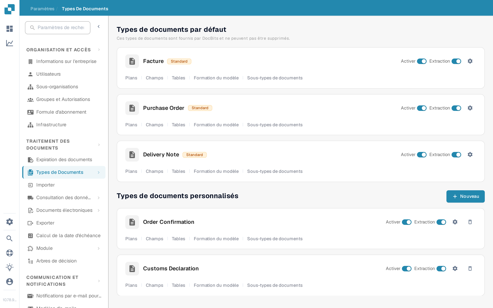
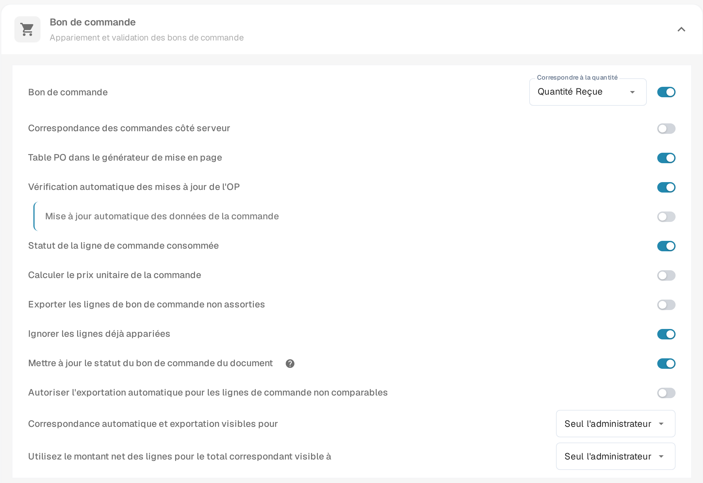
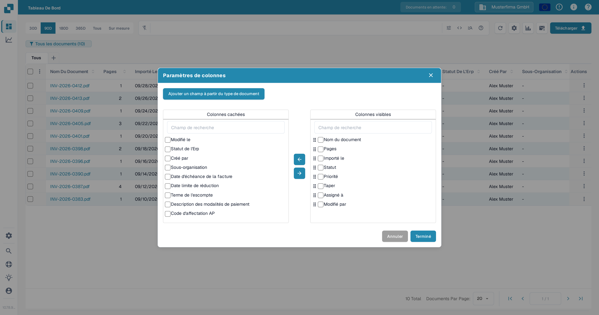
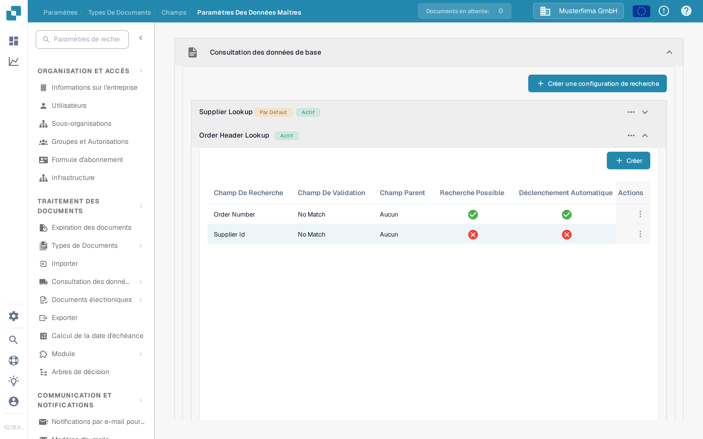

# Mettre à jour le statut du bon de commande du document

Ce paramètre concerne les types de documents qui utilisent des bons de commande. Il contrôle si un document peut recevoir des mises à jour de statut depuis le bon de commande auquel il est lié. Le commutateur se configure par type de document. Pour afficher un statut de bon de commande dans le tableau de bord, le champ concerné doit également être disponible et visible en tant que colonne.

Avant de modifier le paramètre, sélectionnez la bonne organisation et le bon type de document. Un accès administrateur est nécessaire pour modifier les paramètres d'un type de document. Un bon de commande doit être lié à un document avant qu'un changement de statut puisse être vérifié.

## Activer le paramètre

1. Ouvrez **Paramètres → Traitement des documents → Types de Documents**.
2. Repérez le type de document utilisé pour les documents liés aux bons de commande, par exemple **Facture**, et sélectionnez l'engrenage sur sa carte pour ouvrir **Plus de paramètres**.
3. Développez **Appariement et validation des bons de commande**. Trouvez **Mettre à jour le statut du bon de commande du document** et activez-le. L'icône d'aide à proximité explique l'option dans l'application. Modifier ce commutateur ne modifie pas les autres paramètres de bon de commande de la même section.

<figure><figcaption>Ouvrez les paramètres du type de document que vous utilisez.</figcaption></figure>

<figure><figcaption>Le commutateur de mise à jour du statut dans les paramètres du bon de commande.</figcaption></figure>

## Afficher un statut de bon de commande dans le tableau de bord

1. Revenez au tableau de bord et sélectionnez l'engrenage au-dessus du tableau des documents.
2. Ouvrez **Paramètres de colonnes** dans le menu des paramètres avancés.
3. Sélectionnez **Ajouter un champ à partir du type de document**, choisissez le type de document, puis recherchez le champ de statut du bon de commande. Si ce champ est disponible, sélectionnez-le, choisissez de l'ajouter aux colonnes visibles, puis sélectionnez **Terminé**.

La boîte de dialogue des colonnes contient **Colonnes cachées** et **Colonnes visibles**. Utilisez les flèches pour déplacer une colonne sélectionnée entre les deux. Consultez [Modifier les colonnes de document](../../../../../../end-user-and-partner-section/end-user-section/dashboard/change-document-columns.md) pour le guide complet des colonnes. Si le champ de statut est absent pour le type sélectionné, demandez à un administrateur de vérifier son champ et sa configuration de consultation ; le commutateur d'affichage seul ne crée pas un champ manquant.

<figure><figcaption>Choisissez les colonnes qui apparaissent dans le tableau de bord.</figcaption></figure>

## Vérifier la consultation des données de base du bon de commande

Dans **Paramètres → Traitement des documents → Types de Documents → Champs → Paramètres des données maîtres**, développez **Consultation des données de base**, puis **Order Header Lookup**. Vérifiez que le mappage du champ de bon de commande requis existe et que la consultation concernée a **Déclenchement Automatique** lorsque la consultation automatique est nécessaire. La capture ci-dessous montre la liste de configuration ; les croix rouges signifient que le déclenchement automatique est désactivé pour ces lignes d'exemple. Elle ne démontre pas un statut de bon de commande mis à jour.

<figure><figcaption>Vérifiez les lignes réelles de la consultation pour le type de document.</figcaption></figure>

Pour configurer une consultation, consultez [Configuration de données floues avec les données maîtres](../../../../../setup/document-types/fuzzy-data-configuration-with-master-data.md).

## Vérifier avec un document connu

Utilisez un document déjà lié à un bon de commande de test. Modifiez le statut de ce bon de commande selon votre processus habituel, actualisez le tableau de bord, puis vérifiez le document et le champ de statut visible. Si le statut ne se met pas à jour, vérifiez le lien du document avec le bon de commande, la configuration de consultation, et si le champ concerné a bien été ajouté au tableau de bord. Ne déduisez pas une mise à jour réussie du seul commutateur.
