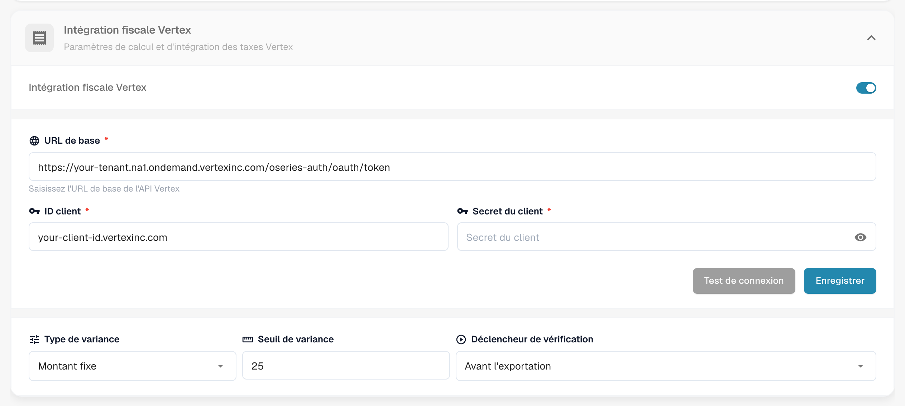
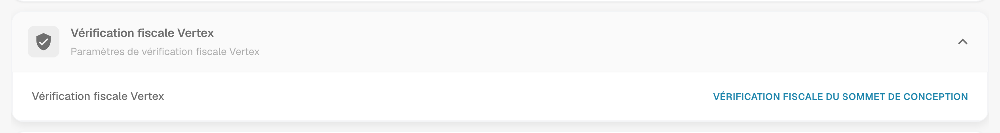
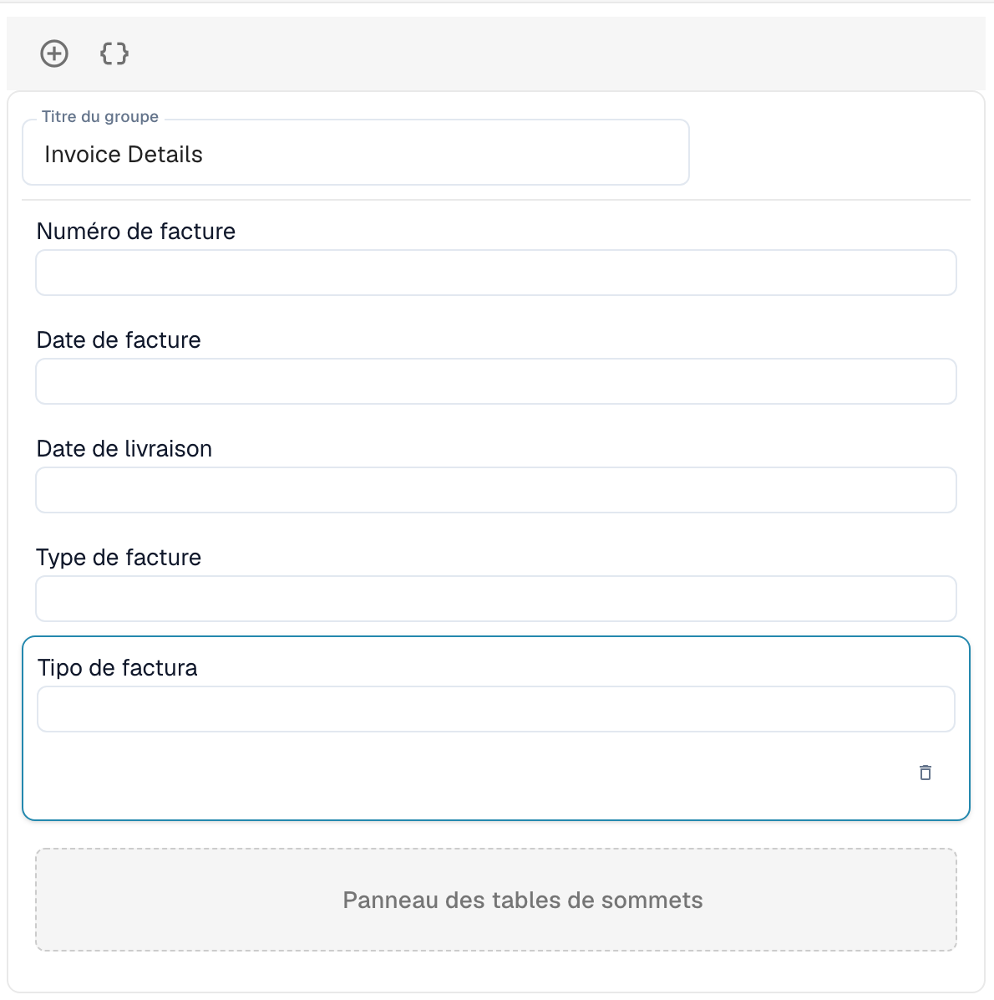

# Vérification fiscale Vertex

La vérification fiscale Vertex compare la taxe qu'un fournisseur a facturée sur une facture avec la taxe que Vertex calcule pour les mêmes lignes. DocBits demande le calcul à Vertex, affiche les deux montants à l'utilisateur et bloque le document lorsque la taxe du fournisseur est trop élevée.

## Comment ça fonctionne

1. Le document atteint le point de déclenchement. Vous le choisissez dans les paramètres du module : **Avant l'exportation** (par défaut) ou **Avant approbation**.
2. DocBits envoie les lignes de la facture à Vertex et reçoit la taxe calculée.
3. DocBits réécrit le résultat dans le document : le **Montant de la taxe Vertex** et le **Taux d'imposition Vertex** par ligne, ainsi que les totaux d'en-tête **Taxe du vendeur** (la taxe facturée sur la facture), **Taxe Vertex**, le sous-total et la **Variance**.
4. DocBits compare la taxe du fournisseur avec la taxe Vertex :

| Situation | Résultat |
| --------- | -------- |
| La taxe du fournisseur dépasse la taxe Vertex de **plus que le seuil de variance** | Le document est rejeté. Son statut devient **Refus de la taxe Vertex**. |
| La taxe du fournisseur est plus élevée, mais **dans le seuil** | Le document est accepté. |
| La taxe du fournisseur est égale à la taxe Vertex | Le document est accepté. |
| La taxe du fournisseur est **inférieure** à la taxe Vertex | Le document est accepté et le montant manquant est provisionné. |

Le message de résultat indique les montants, par exemple : *Rejected: vendor tax $380.00 exceeds Vertex calculated tax $140.00 by $240.00 (171.4%), above configured threshold of $25.00.*

Les utilisateurs ouvrent le résultat depuis l'icône Vertex dans la ligne du document sur le tableau de bord. L'écran **Vérification fiscale Vertex** affiche une bannière (**Échec de la vérification** avec le message, ou **Vérification réussie**), les champs de la mise en page que vous avez conçue et les tables Vertex avec la taxe par ligne.


La vérification ne s'exécute que pour les types de document qui ont une configuration d'exportation de type **Sommet**. Sans cette configuration, le document continue sans vérification.


## Configurer l'intégration

Ouvrez **Paramètres** → **Module** → **Commande et financement** et allez à la carte **Intégration fiscale Vertex**. La page contient aussi les paramètres de correspondance des BC et de comptabilisation automatique.

<figure><figcaption>
La carte Intégration fiscale Vertex. Les valeurs du locataire et du client sont remplacées par des espaces réservés dans cette capture d'écran.
</figcaption></figure>

1. Activez **Intégration fiscale Vertex**. La fonctionnalité nécessite l'abonnement Vertex Tax.
2. Saisissez l'**URL de base** de votre point de terminaison de jeton Vertex, votre **ID client** et votre **Secret du client**.
3. Cliquez sur **Test de connexion**, puis sur **Sauvegarder**.
4. Définissez la tolérance et le déclencheur :
   * **Type de variance :** **Montant fixe** ou **Pourcentage**.
   * **Seuil de variance :** L'écart qui est encore accepté. La valeur par défaut est un montant fixe de 25. En mode pourcentage, saisissez la valeur sous forme décimale, par exemple 0,05 pour 5 %.
   * **Déclencheur de vérification :** **Avant l'exportation** ou **Avant approbation**. Avec **Avant approbation**, la vérification s'exécute pendant le traitement du document, avant son envoi à l'approbation. Si la vérification elle-même échoue, le document obtient le statut **Erreur d'exportation**.

Ajoutez ensuite une configuration d'exportation de type **Sommet** pour le type de document (**Paramètres** → **Exportation**). Elle utilise un fichier de mappage TOML.

## Concevoir le formulaire de vérification

Les champs que les utilisateurs voient sur l'écran de vérification sont conçus par type de document.

1. Ouvrez **Paramètres** → **Paramètres globaux** → **Types de documents**, sélectionnez le type de document et cliquez sur **Plus de paramètres**.
2. Ouvrez la carte **Vérification fiscale Vertex** et cliquez sur **Vérification fiscale du sommet de conception**.

<figure><figcaption>
La carte Vérification fiscale Vertex.
</figcaption></figure>

Le Module de création de mise en page s'ouvre avec le type de mise en page **Vérification fiscale Vertex**. Faites glisser des groupes et des champs dans le formulaire, par exemple **Détails de la facture** avec le numéro de facture, la date et la date de livraison. Le **Panneau des tables de sommets** affiche la comparaison des taxes et les lignes d'articles avec la taxe Vertex par ligne. Il fait partie de la mise en page.

<figure><figcaption>
Une mise en page Vérification fiscale Vertex avec le groupe Détails de la facture et le Panneau des tables de sommets.
</figcaption></figure>

Pour le fonctionnement du Module de création de mise en page, voir le [Gestionnaire de mises en page](../layout-manager/README.md).
