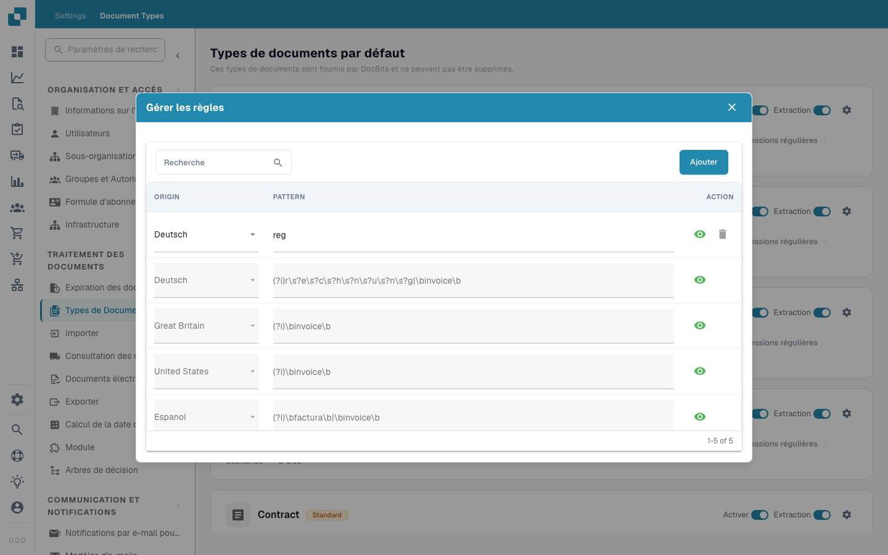

# Regex

<figure><figcaption></figcaption></figure>

Dans Docbits, les paramètres Regex permettent aux administrateurs de définir des modèles personnalisés que le système utilise pour trouver et extraire des données à partir de documents. Cette fonctionnalité est particulièrement utile dans les situations où les données doivent être extraites à partir de texte non structuré ou lorsque les données suivent un format prévisible qui peut être capturé à l'aide de modèles regex.

#### Fonctionnalités clés et options

1. **Gestion des Regex**:

* **Ajouter**: Vous permet de créer un nouveau modèle regex pour un type de document spécifique.
* **Enregistrer les modifications**: Enregistre les modifications apportées aux configurations regex existantes.
* **Modèle**: Ici, vous pouvez définir le modèle regex qui correspond au format de données spécifique requis.
* **Origine**: Est l'origine du document - Par exemple, vous pouvez définir un regex différent en Allemagne


