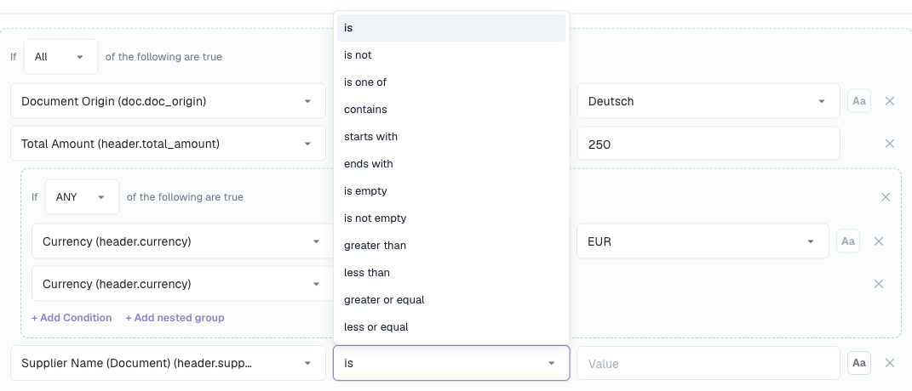

# Conditions de règle (S'applique quand)

## Vue d'ensemble

Chaque règle des fonctions de règles de DocBits comporte une section **S'applique quand**. Elle décide **pour quels documents (et, pour les règles de tableau, pour quelles lignes) la règle fait quoi que ce soit**. Le véritable travail de la règle — déclencher une erreur de validation, modifier une valeur, choisir une mise en page — n'a lieu que lorsque la condition est vraie.

Le même générateur de conditions est utilisé dans les trois fonctions de règles :

| Fonction | Libellé dans le générateur | Lorsque la condition est vraie… | Lorsqu'elle est fausse… | Lorsqu'elle est laissée vide… |
| --- | --- | --- | --- | --- |
| [Règles de validation personnalisées](custom-validation-rules.md) | Étape 2 **S'applique quand** | la vérification de l'étape 3 s'exécute | la règle est ignorée — ni erreur, ni avertissement | la vérification s'exécute sur chaque document |
| [Règles de transformation](transformation-rules.md) | Étape 2 **Quand elle s'exécute** → **Seulement lorsque…** | le pipeline modifie la valeur | la valeur reste telle quelle | choisissez **Toujours** : la règle s'exécute sur chaque document |
| [Règles de sélection de mise en page](layout-manager/layout-selection-rules.md) | Étape 2 **S'applique quand** | le document obtient la mise en page de cette règle (la première correspondance l'emporte) | DocBits essaie la règle suivante | la règle correspond à tous les documents à sa priorité |

Apprenez-le une fois ici et vous pourrez l'utiliser partout.


Une condition décide uniquement **si** une règle s'applique. Elle ne modifie jamais de données et n'affiche jamais de message d'elle-même. « Le numéro de TVA du fournisseur doit être renseigné » est la **vérification** d'une règle de validation ; « uniquement pour les factures allemandes » en est la **condition**.


## Lire une condition

Une condition se lit comme une phrase. Le générateur ci-dessous dit :

> **Si TOUTES** les conditions suivantes sont vraies : l'Origine du document **est** Deutsch, le Montant total est **supérieur à** 250, et (**N'IMPORTE LAQUELLE** des conditions : la Devise **est** EUR, la Devise **est vide**).

<figure><figcaption>
Deux conditions combinées avec ALL, plus un groupe imbriqué combiné avec ANY
</figcaption></figure>

Avec cette condition, la règle s'applique à :

| Document | Origine | Montant total | Devise | S'applique ? | Pourquoi |
| --- | --- | --- | --- | --- | --- |
| A | DE | 469.18 | EUR | **oui** | les trois parties sont vraies |
| B | DE | 469.18 | *(vide)* | **oui** | le groupe ANY est vrai car la devise est vide |
| C | DE | 120.00 | EUR | non | 120 n'est pas supérieur à 250 |
| D | DE | 469.18 | USD | non | aucune des lignes du groupe ANY n'est vraie |
| E | AT | 469.18 | EUR | non | l'origine n'est pas DE |

## Les éléments de base

### Lignes de condition

Chaque ligne comporte quatre parties :

| Partie | Ce que c'est |
| --- | --- |
| **Champ** | La valeur vérifiée : un attribut du document, un champ d'en-tête, une colonne de tableau ou un chemin JSON. Voir [Champs utilisables](#champs-utilisables). |
| **Opérateur** | La manière de comparer la valeur — *est*, *contient*, *supérieur à*, *est vide* … Voir [Opérateurs](#operateurs). |
| **Valeur** | Ce avec quoi le champ est comparé. Masquée pour *est vide* / *n'est pas vide*. Pour les champs à liste de valeurs fixe (origine, statut, devise…), la valeur se choisit dans une liste déroulante. |
| **Aa** | Ignorer la casse. Disponible uniquement pour les comparaisons de texte. Lorsque l'option est activée, `gmbh` correspond à `GmbH`. |

Cliquez sur **✕** pour supprimer une ligne.

### ALL et ANY

Le sélecteur au début d'un groupe détermine comment ses lignes sont combinées :

* **Toutes** les conditions suivantes sont vraies — chaque ligne doit être vraie (ET).
* **N'importe laquelle** des conditions suivantes est vraie — au moins une ligne doit être vraie (OU).

### Groupes imbriqués

Cliquez sur **+ Ajouter un groupe imbriqué** pour placer un groupe dans un groupe. Un groupe imbriqué compte comme une seule ligne de son groupe parent, ce qui permet de mélanger ET et OU :

* *ALL* : l'origine est DE, **ANY** (la devise est EUR, la devise est vide)
* *ANY* : le fournisseur est 10040, **ALL** (le fournisseur est 20723, le montant total est supérieur à 1000)

Les groupes peuvent être imbriqués aussi profondément que nécessaire. Restez lisible : deux niveaux suffisent pour presque toutes les règles métier.

### Une condition vide

Si vous n'ajoutez aucune ligne, la règle n'a pas de condition et **s'applique toujours** (pour les règles de mise en page : elle correspond à tous les documents à sa priorité). C'est le bon choix pour les règles qui doivent s'exécuter partout, comme « supprimer les espaces du numéro de facture » ou « la quantité doit être positive ».

## Champs utilisables

Ouvrez la liste déroulante des champs pour voir tous les champs, regroupés selon leur provenance. Saisissez du texte pour filtrer la liste.

<figure><figcaption>
Le sélecteur de champs : d'abord les attributs du document, puis les champs d'en-tête du type de document
</figcaption></figure>

### Attributs du document (`doc.`)

Informations que DocBits connaît sur le document lui-même, indépendamment des champs extraits :

| Champ dans le sélecteur | Clé | Exemples de valeurs | Utilisation typique |
| --- | --- | --- | --- |
| **Origine du document** | `doc.doc_origin` | `DE`, `AT`, `US` (affichés comme Deutsch, Austria, United States) | règles et mises en page propres à un pays |
| **Méthode d'extraction** | `doc.extraction_method` | `ELECTRONIC_DOCUMENT`, `FELLOW_KV2`, `MANUAL` | traiter les factures électroniques (XRechnung, ZUGFeRD) différemment des PDF numérisés |
| **Statut du document** | `doc.status` | Ready for validation, Pending Approval, Pending second approval … | mises en page par étape de workflow, règles qui ne s'appliquent qu'avant l'approbation |
| **Sous-type de document** | `doc.sub_doc_type` | vos sous-types, par ex. avoir | règles pour un seul sous-type |

### Champs d'en-tête (`header.`)

Chaque champ du type de document, par exemple **Numéro de facture** (`header.invoice_id`), **ID fournisseur** (`header.supplier_id`), **Montant total** (`header.total_amount`), **Devise** (`header.currency`), **Numéro de TVA du fournisseur** (`header.supplier_tax_id`), **Bon de commande** (`header.purchase_order`). Le sélecteur affiche le libellé et, entre parenthèses, la clé technique. La valeur utilisée est la valeur actuelle du champ — y compris les corrections apportées par un utilisateur.

### Colonnes de tableau (`row.`)

Colonnes de la ligne de tableau courante, par exemple `row.QUANTITY` ou `row.ITEM_NUMBER`. Elles apparaissent dans le sélecteur sous **Colonnes de tableau** uniquement dans les règles qui s'exécutent **une fois par ligne** :

* les règles de validation de niveau **Ligne de tableau**
* les règles de transformation de portée **Colonne de tableau**

Dans ces règles, la condition est vérifiée **pour chaque ligne séparément**. Une ligne qui ne correspond pas est ignorée ; les autres lignes sont tout de même traitées.

<figure><figcaption>
Une condition par ligne : seules les lignes qui ont un numéro d'article sont vérifiées
</figcaption></figure>

Les règles qui s'exécutent une fois par document (règles d'en-tête, règles de tableau entier, règles de mise en page) ne peuvent pas utiliser les champs `row.` — il n'y a pas de ligne unique qu'elles pourraient examiner.

### Chemin JSON personnalisé (Avancé)

En bas du sélecteur, **Avancé → Chemin JSON personnalisé…** transforme le champ en zone de texte libre marquée `$path`. Il lit une valeur n'importe où dans les données extraites du document, même si ce n'est pas un champ du type de document.

<figure><figcaption>
Une condition de chemin JSON sur le canal d'import du document
</figcaption></figure>

* Le chemin commence par `$` et utilise `.nom` pour les clés et `[0]` pour les positions dans une liste, par exemple `$.metadata.import_channel` ou `$.shipping.addresses[0].country`.
* Il doit se terminer sur une valeur unique. Un chemin qui se termine sur une liste ou un objet est considéré comme vide.
* Les lignes de chemin JSON proposent les opérateurs *est*, *n'est pas*, *correspond à*, *est vide* et *n'est pas vide*.

Utilisez les chemins JSON avec parcimonie. Ils dépendent de la structure interne des données extraites ; un champ du type de document est plus facile à comprendre et à maintenir.

### Où chaque type de champ peut être utilisé

| | Validation : champ d'en-tête | Validation : ligne de tableau | Validation : tableau entier | Transformation : en-tête / routage / lignes de tableau | Transformation : colonne de tableau | Sélection de mise en page |
| --- | --- | --- | --- | --- | --- | --- |
| attributs du document `doc.` | ✓ | ✓ | ✓ | ✓ | ✓ | ✓ |
| champs d'en-tête `header.` | ✓ | ✓ | ✓ | ✓ | ✓ | ✓ |
| colonnes de tableau `row.` | – | ✓ | – | – | ✓ | – |
| chemin JSON `$` | ✓ | ✓ | ✓ | ✓ | ✓ | ✓ |

## Opérateurs

<figure><figcaption>
Les opérateurs proposés pour un champ texte
</figcaption></figure>

| Opérateur | Vrai lorsque… | Valeur | Exemple |
| --- | --- | --- | --- |
| **est** | le champ est égal à la valeur | une valeur | ID fournisseur **est** `20723` |
| **n'est pas** | le champ n'est pas égal à la valeur | une valeur | Devise **n'est pas** `EUR` |
| **fait partie de** | le champ est égal à l'une des valeurs d'une liste | valeurs séparées par des virgules | ID fournisseur **fait partie de** `10040, 10041, 20723` |
| **contient** | la valeur apparaît n'importe où dans le champ | texte | Nom du fournisseur **contient** `GmbH` |
| **commence par** | le champ commence par la valeur | texte | Numéro de facture **commence par** `GS-` |
| **se termine par** | le champ se termine par la valeur | texte | Bon de commande **se termine par** `-IT` |
| **correspond à** | une expression régulière trouve une correspondance dans le champ | expression régulière | Numéro de facture **correspond à** `^INV-\d{6}$` |
| **est vide** | le champ n'a pas de valeur (absente, ou uniquement des espaces) | – | Bon de commande **est vide** |
| **n'est pas vide** | le champ a une valeur | – | Bon de commande **n'est pas vide** |
| **supérieur à** / **inférieur à** | le champ est un nombre supérieur / inférieur à la valeur | nombre | Montant total **supérieur à** `10000` |
| **supérieur ou égal à** / **inférieur ou égal à** | idem, valeur elle-même incluse | nombre | Montant total **inférieur ou égal à** `250` |

### Opérateurs proposés selon le champ

La liste s'adapte au type du champ :

| Type de champ | Opérateurs |
| --- | --- |
| Texte | tous les opérateurs |
| Nombre et montant (Montant total, Quantité …) | est, n'est pas, supérieur à, inférieur à, supérieur ou égal à, inférieur ou égal à, est vide, n'est pas vide |
| Champs à liste fixe (Origine du document, Statut, Devise …) | est, n'est pas, fait partie de, est vide, n'est pas vide |
| Date (Date de facture, Date d'échéance …) | est, n'est pas, est vide, n'est pas vide |
| Oui/Non | est, n'est pas, est vide, n'est pas vide |
| Chemin JSON personnalisé | est, n'est pas, correspond à, est vide, n'est pas vide |


**Les dates ne peuvent pas être comparées avec *avant* ou *après* dans une condition.** « Date d'échéance postérieure à la date de facture » ou « date de facture datant de plus de 90 jours » relève de la **vérification** d'une règle de validation (**Comparer des champs**), pas de *S'applique quand*.


## Comment les valeurs sont comparées

Connaître ces règles évite la plupart des surprises :

1. **Les nombres sont comparés comme des nombres.** Si les deux côtés ressemblent à des nombres, `250`, `250.00` et `250,00` sont égaux. Les montants formatés selon les paramètres régionaux, comme `1.234,56`, sont compris.
2. **Tout le reste est comparé comme du texte, après suppression des espaces au début et à la fin.** `" EUR "` équivaut à `EUR`.
3. **La casse compte**, sauf si **Aa** (ignorer la casse) est activé.
4. **Le vide est un cas particulier.** Un champ absent ou vide :
   * est vrai pour **est vide** et **n'est pas**,
   * est faux pour **est**, **fait partie de**, **contient**, **commence par**, **se termine par**, **correspond à** et toutes les comparaisons numériques.


En raison de la règle 4, *Devise **n'est pas** EUR* est aussi vrai pour les documents **sans** devise. Si ce n'est pas ce que vous voulez, ajoutez une deuxième ligne *Devise **n'est pas vide***.



En raison de la règle 1, les valeurs qui ressemblent à des nombres sont comparées numériquement même lorsqu'il s'agit de codes : `007` **est** `7` est vrai. Pour les codes dont les zéros de tête comptent, utilisez **correspond à** avec un motif tel que `^007$`.


## Exemples

**Uniquement les documents allemands** — `Origine du document` **est** `Deutsch`.

**Uniquement les factures électroniques** — `Méthode d'extraction` **est** `ELECTRONIC_DOCUMENT`. Utilisez **n'est pas** pour les exclure, par exemple pour une règle qui corrige les erreurs d'OCR.

**Un groupe de fournisseurs** — `ID fournisseur` **fait partie de** `10040, 10041, 20723`.


Pour les champs dont la valeur se choisit dans une liste déroulante (origine, statut, devise), **fait partie de** ne permet de choisir qu'une seule entrée. Pour en accepter plusieurs, créez un groupe **ANY** avec une ligne **est** par valeur.


**Factures de montant élevé d'un fournisseur** — **Toutes** : `ID fournisseur` **est** `20723`, `Montant total` **supérieur à** `10000`.

**Factures sans bon de commande** — `Bon de commande` **est vide**. Une condition typique pour une règle « centre de coûts obligatoire ».

**Tout sauf les avoirs** — `Type de facture` **n'est pas** `credit_note` (utilisez les valeurs que votre organisation enregistre dans le champ).

**Factures reçues par e-mail** — Chemin JSON personnalisé `$.metadata.import_channel` **est** `EMAIL`.

**Lignes d'articles uniquement** (règles de ligne de tableau / colonne de tableau) — `row.ITEM_NUMBER` **n'est pas vide**. Les lignes de frais de port ou de remise sans numéro d'article sont ignorées.

**Seconde étape d'approbation** (règles de mise en page sur l'écran Approbation) — `Statut du document` **est** `Pending second approval`.

**Devise EUR ou manquante** — **Toutes** : `Origine du document` **est** `Deutsch`, **ANY** (`Devise` **est** `EUR`, `Devise` **est vide**). C'est la condition présentée en haut de cette page.

## Tester et déboguer une condition

Chaque fonction permet d'essayer une condition avant de s'y fier :

* **Règles de validation** — **Tester la règle** exécute la règle sur un document réel. « *Règle ignorée — portée non satisfaite* » signifie que la condition était fausse pour ce document. Voir [Tester la règle](custom-validation-rules.md#test-rule).
* **Règles de transformation** — l'**Aperçu en direct** propose des **Valeurs de condition** : saisissez une valeur pour chaque champ de la condition et vous verrez « *Les conditions correspondent — la règle s'exécute* » ou « *Les conditions ne correspondent pas — la règle est ignorée* ».
* **Règles de sélection de mise en page** — le panneau **Aperçu en direct · /resolve** montre quelle règle correspond pour un exemple de document.

### Lire la trace de la condition dans les journaux

Activez **Journaliser l'exécution** dans une règle. Chaque évaluation est alors écrite dans **Types de documents → (type de document) → Journaux**. Ouvrez une entrée : sous **Détails du journal**, chaque ligne de condition est listée avec la valeur attendue par la règle, la valeur réellement présente dans le document et le résultat de la ligne.

<figure><figcaption>
L'entrée de journal explique pourquoi la règle a été ignorée : la règle attendait <code>abcd</code>, le document contenait <code>911892112</code>
</figcaption></figure>

Les journaux peuvent être recherchés par **clé de règle**, **ID de règle** ou **document**, et filtrés par type de règle, résultat et date. Désactivez de nouveau **Journaliser l'exécution** lorsque vous avez terminé — l'option écrit une entrée par évaluation, et les règles s'exécutent à chaque enregistrement.

## Erreurs courantes

| Symptôme | Cause | Solution |
| --- | --- | --- |
| La règle ne s'applique jamais | La valeur diffère par la casse ou l'orthographe (`Gmbh` au lieu de `GmbH`) | Activez **Aa**, ou copiez la valeur exactement depuis le document |
| La règle s'applique à des documents sans le champ | **n'est pas** est vrai pour les champs vides | Ajoutez *champ* **n'est pas vide** |
| *supérieur à* ne correspond jamais | Le champ n'est pas un nombre, ou c'est une date | Utilisez un champ numérique ; comparez les dates dans une vérification de validation |
| La règle s'applique à trop de documents | Les lignes ont été combinées avec **ANY** au lieu de **ALL** | Vérifiez le sélecteur de chaque groupe |
| Les colonnes de tableau manquent dans le sélecteur | La règle s'exécute une fois par document | Utilisez le niveau **Ligne de tableau** (validation) ou la portée **Colonne de tableau** (transformation) |
| La condition fonctionnait dans l'aperçu mais pas sur le document | L'aperçu utilisait les valeurs que vous aviez saisies | Testez avec **Tester la règle** sur un document réel, ou consultez la trace dans les journaux |
