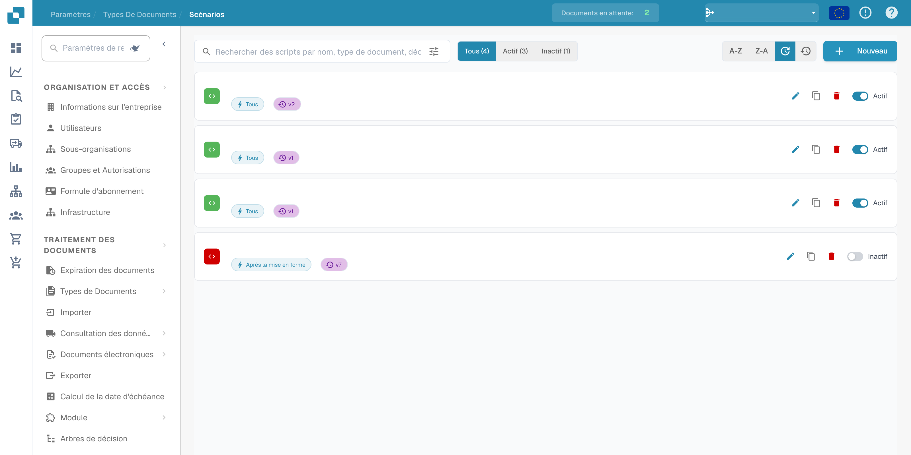
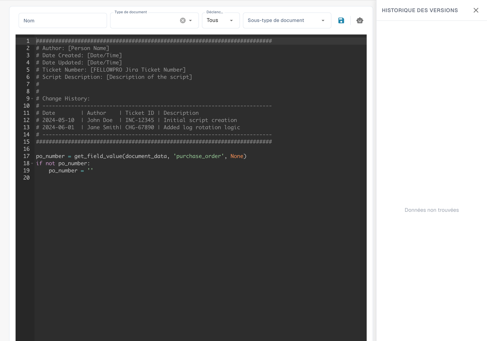

# Script

<figure><figcaption>
Liste des scripts avec les noms et dates masqués.
</figcaption></figure>


DocBits Explication des scripts de document : automatisez la logique personnalisée dans votre flux de travail de documents


#### Aperçu

Les scripts dans Docbits sont généralement écrits dans un langage de script pris en charge par le système Python. Ils sont déclenchés pendant le flux de traitement des documents pour appliquer une logique métier complexe ou garantir l'intégrité et l'exactitude des données avant que les données ne soient traitées ou stockées davantage.

#### Fonctionnalités Clés et Options

1. **Gestion des Scripts**:

* **Nom**: Chaque script reçoit un nom unique pour l'identification.
* **Type de Document**: Associe le script à un type de document spécifique, déterminant sur quels documents le script sera appliqué.
* **Déclenchement Sur**: Définit quand le script est déclenché (par exemple, lors du téléchargement du document, avant l'exportation des données, après la validation des données).
* **Statut Actif/Inactif**: Permet aux administrateurs d'activer ou de désactiver les scripts sans les supprimer, offrant ainsi une flexibilité dans les tests et le déploiement.

2. **Éditeur de Script**:

* Fournit une interface où les scripts peuvent être écrits et édités. L'éditeur prend généralement en charge la coloration syntaxique, la mise en évidence des erreurs et d'autres fonctionnalités pour aider au développement du script.
* **Exemple de Script**: Les scripts peuvent inclure des opérations telles que la boucle à travers les lignes de facture pour valider les totaux ou supprimer les entrées qui ne répondent pas à certains critères.

<figure><figcaption>
Éditeur de scripts avec un exemple technique en Python.
</figcaption></figure>


