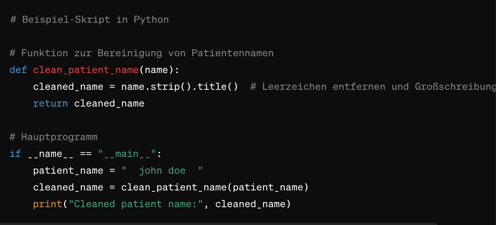
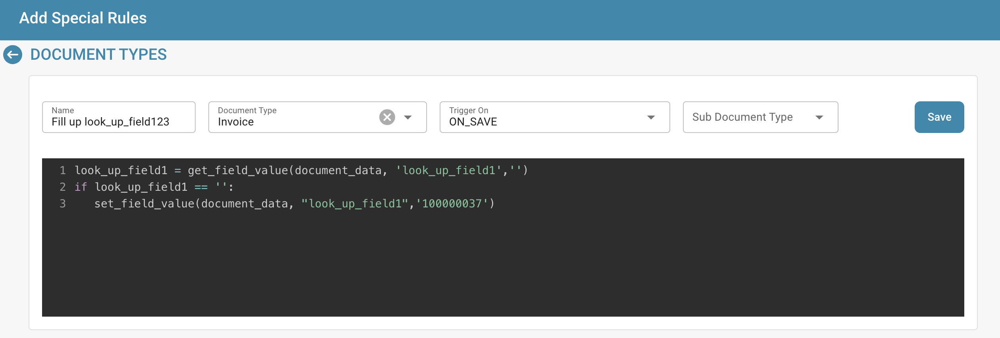

# Créer et modifier des scripts


DocBits Document Scripts Explained: Automate Custom Logic in Your Document Workflow


## Pour créer un nouveau script dans DocBits, suivez ces instructions détaillées :

**Choisissez le langage de script :**

Tout d'abord, vous devez choisir le langage de script que vous souhaitez utiliser. DocBits prend généralement en charge les langages de script courants tels que Python, JavaScript ou SQL. Le choix du langage dépend des besoins de votre projet et de vos propres compétences.

**Ouvrez l'environnement de développement de scripts :**

Connectez-vous à DocBits et accédez à l'environnement de développement de scripts. Il se trouve dans la zone d'administration.

<figure><figcaption></figcaption></figure>

**Créez un nouveau script :**

Cliquez sur le bouton « + New » pour ouvrir un nouvel éditeur de script.

<figure><figcaption></figcaption></figure>

**Écrivez le code :**

Utilisez l'éditeur pour écrire le code de votre script. Commencez par la syntaxe de base du langage de script choisi.

Par exemple, si vous utilisez Python, votre script pourrait ressembler à ceci :

## 1. Exemple de script en Python

<figure><figcaption></figcaption></figure>

## Fonction pour nettoyer les noms de patients

def clean\_patient\_name(name): cleaned\_name = name.strip().title() # Supprimer les espaces et appliquer la mise en majuscules

return cleaned\_name

## Programme principal

if **name** == "**main**": patient\_name = " john doe " cleaned\_name = clean\_patient\_name(patient\_name) print("Cleaned patient name:", cleaned\_name)

## 2. Exemple de script

<figure><figcaption></figcaption></figure>

**Testez le script :**

Vérifiez le code à la recherche d'erreurs et testez-le dans un environnement de test. Assurez-vous que le script produit les résultats attendus et fonctionne correctement.

<figure><figcaption></figcaption></figure>

**Enregistrez le script :**

Enregistrez le script dans DocBits et donnez-lui un nom explicite qui décrit son objectif.

<figure><figcaption></figcaption></figure>

**Associez le script aux types de documents :**

Une étape importante consiste à associer le script aux types de documents appropriés. Cela détermine quand et comment le script est appliqué. Cela peut généralement se faire via une interface de configuration dans DocBits, où vous pouvez affecter le script à un type de document précis et indiquer dans quelles conditions il doit être appliqué.

<figure><figcaption></figcaption></figure>

**Vérifiez et publiez :**

Après avoir créé, testé et associé le script, vérifiez-le à nouveau à la recherche d'erreurs et d'incohérences. Si tout est en ordre, vous pouvez publier le script dans l'environnement de production de DocBits.

<figure><figcaption></figcaption></figure>

<figure><figcaption></figcaption></figure>

Grâce à ces étapes, vous pouvez créer, tester et mettre en œuvre avec succès un nouveau script dans DocBits afin d'automatiser les processus et d'améliorer l'efficacité de la documentation médicale.
