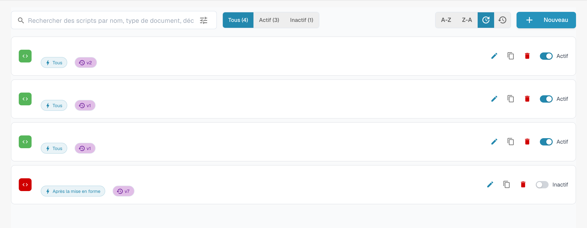

# Activer et gérer les scripts

## Tutoriel vidéo : gérer les scripts


Gérer les scripts d'un type de document


La vidéo montre la liste des scripts avec filtre et tri, l'activation et la désactivation, la copie, l'historique des versions et la suppression avec confirmation.

Ouvrez le type de document et sa gestion des scripts. La liste présente les scripts et commandes d’édition, de duplication et d’état. Les noms sont masqués dans cet exemple.

<figure><figcaption>
Gestion des scripts et commandes d’édition ; les noms sont masqués.
</figcaption></figure>

Filtrez par état ou recherchez le script prévu avant de l’ouvrir. Vérifiez le type de document, l’événement d’exécution et le code avant tout enregistrement.

Les commandes disponibles dépendent des permissions. Testez les modifications prévues avec des documents représentatifs avant de les utiliser dans un workflow réel.
