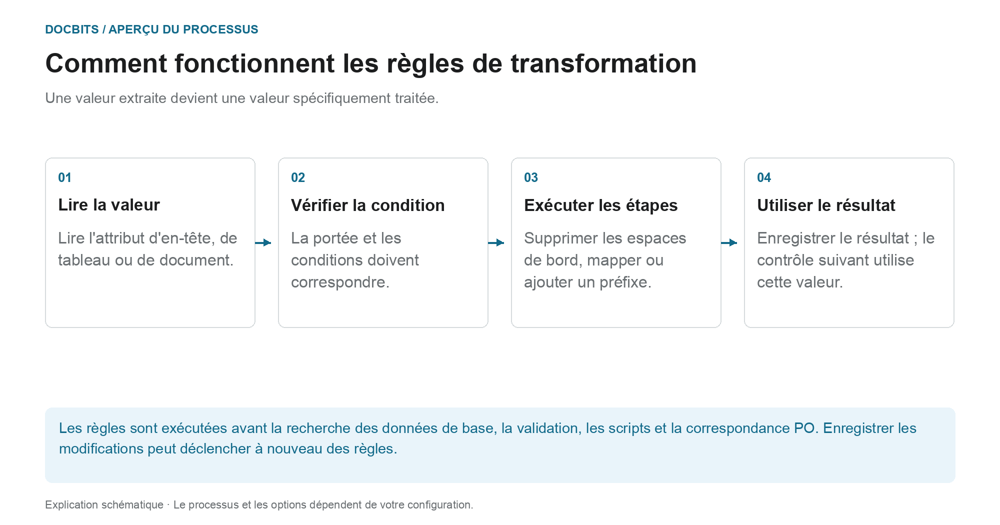
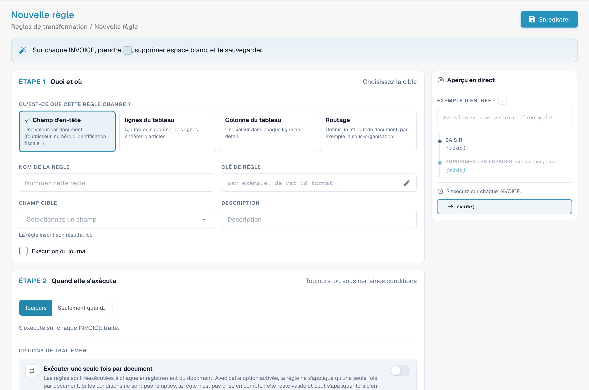
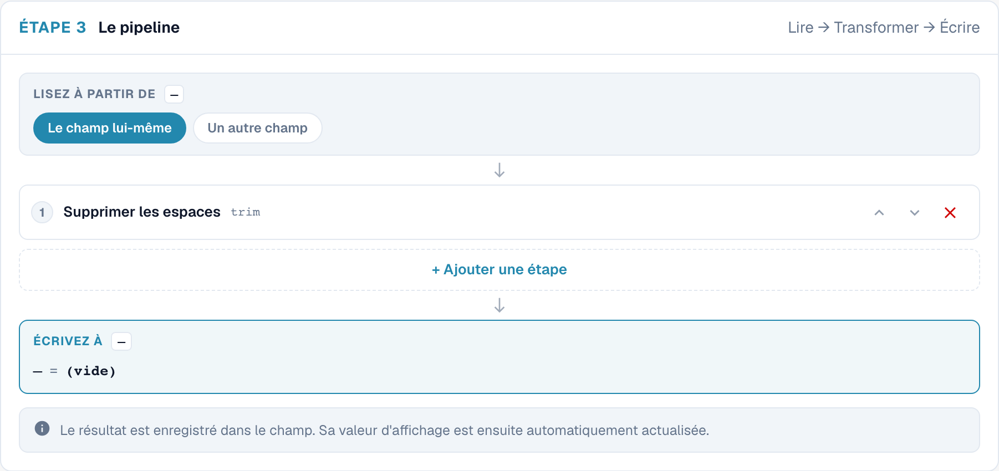
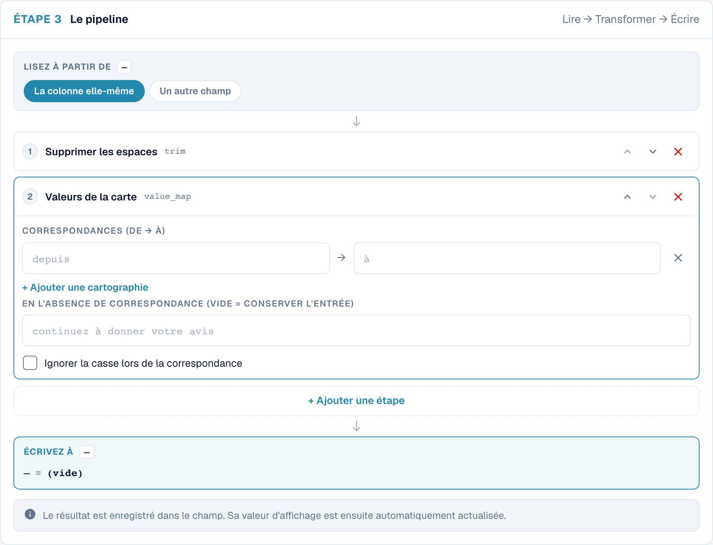
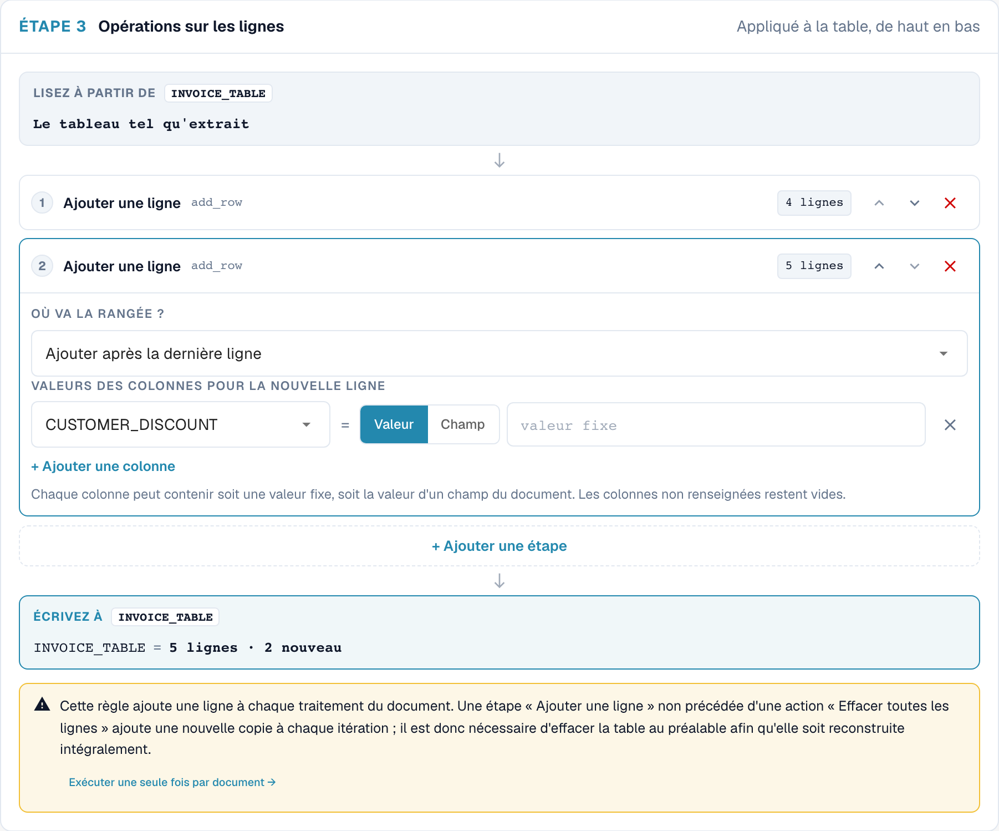
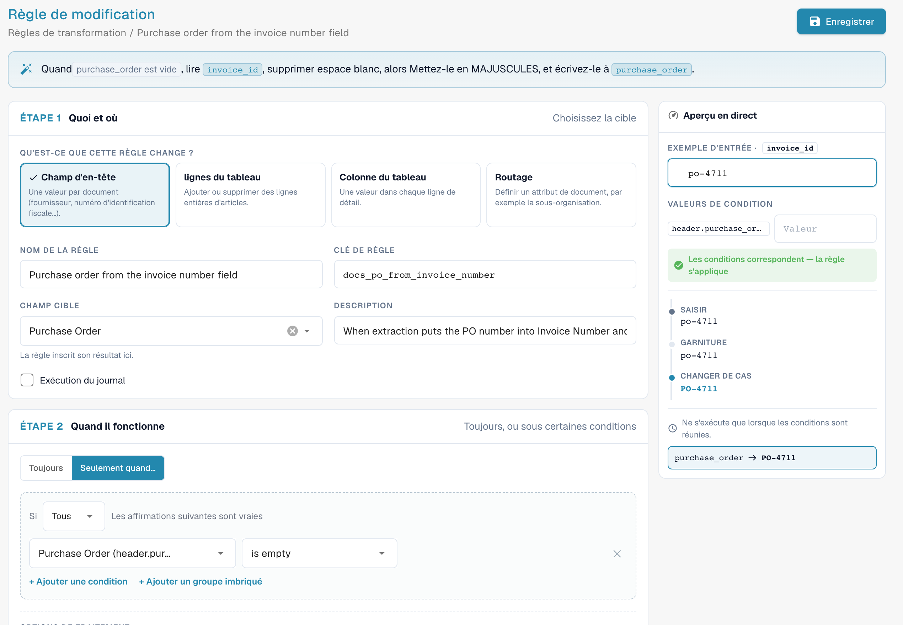
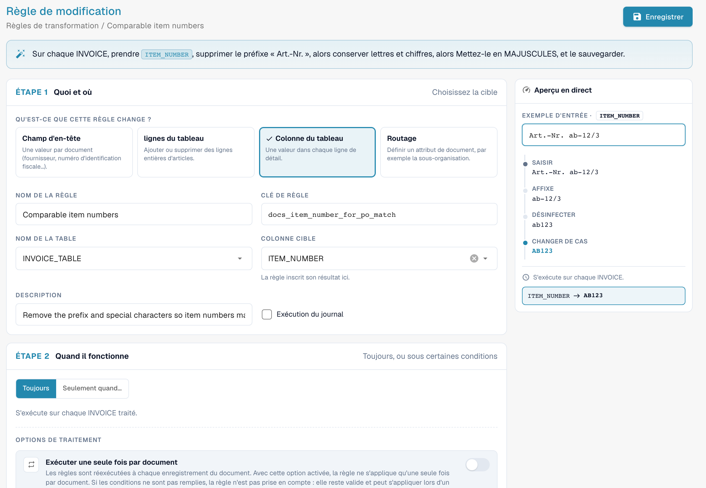

# Règles de transformation

## De la valeur extraite à la vérification en aval

<figure><figcaption>
Une valeur extraite devient une valeur spécifiquement traitée. Le diagramme est schématique ; les paramètres actifs de votre organisation déterminent le comportement réel.
</figcaption></figure>

Une transformation modifie les données existantes ; il n'exécute plus OCR. Il lit une entrée, vérifie son état, exécute les étapes configurées et réécrit le résultat. Si la condition n'est pas remplie, la règle est ignorée.

**Exemple :** Une cellule de tableau contient `STK`. Un mappage de valeurs qui s'applique au fournisseur écrit `PCE`. La correspondance PO en aval utilise ensuite le code d'unité normalisé. Testez également une valeur déjà normalisée et une valeur à laquelle la règle ne doit pas s'appliquer.

1. **Déclencheur :** Lors du traitement du document, les règles s'exécutent après l'extraction. Ils peuvent également être réexécutés lorsque les données d'extraction modifiées sont enregistrées.
2. **Ordre :** Au cours d'une exécution, les étendues sont traitées dans cet ordre : **Champ d'en-tête → Routage → Lignes du tableau → Colonne du tableau**. Dans chaque portée, la priorité et la clé déterminent l'ordre.
3. **Effet :** Une règle de tableau peut modifier ou supprimer des lignes de facture. Cela peut modifier le nombre de lignes et les conditions préalables au rapprochement des bons de commande. Le remplacement de lignes qui ont déjà été mises en correspondance peut supprimer une affectation existante.
4. **Contrôle :** Comparez l'entrée, l'aperçu et le résultat enregistré. Lorsque la journalisation des exécutions est activée, la trace des conditions indique pourquoi une règle a été appliquée ou ignorée.

**Vérifiez les répétitions :** Une règle ne doit pas modifier sa valeur déjà préparée à chaque fois qu'elle est enregistrée. Utilisez des étapes idempotentes appropriées, une source inchangée ou l'exécution unique prévue. Les détails et les exemples suivent ci-dessous ; [Règles de correspondance PO](more-settings/purchase-order/purchase-order-matching-rules.md) explique le mappage en aval.



## Vue d'ensemble

**Déclencheur :** Lors du traitement du document, les règles s'exécutent après l'extraction. Ils peuvent également être réexécutés lorsque les données d'extraction modifiées sont enregistrées.

* un **champ d'en-tête** (numéro de facture, devise, numéro d'identification fiscale du fournisseur …),
* une **colonne** dans chaque ligne d'un tableau (unité, numéro d'article, base de prix …),
* les **lignes** d'un tableau (les vider, ajouter une ligne),
* un **attribut du document** — aujourd'hui la sous-organisation à laquelle il appartient (**Routage**).

Chaque règle **lit** une valeur, la fait passer par un court **pipeline** d'étapes et **réécrit** le résultat. Les règles s'exécutent **avant** la validation, les scripts et le rapprochement des bons de commande (PO matching), de sorte que tout ce qui suit voit déjà les valeurs corrigées.

Les règles de transformation remplacent la plupart des petits scripts que les organisations écrivaient pour « toujours supprimer les espaces de ce champ », « mapper les codes d'unité de ce fournisseur », « ajouter le préfixe attendu par notre ERP » ou « regrouper les lignes de ce fournisseur en une seule ligne de total » — avec un formulaire, un aperçu en direct et sans code.

### Problèmes qu'elles résolvent

| Besoin | Règle |
| --- | --- |
| Un fournisseur imprime le numéro de facture sans le préfixe `INV-` attendu par notre ERP | Champ d'en-tête *Invoice Number*, uniquement pour ce fournisseur : Trim → UPPERCASE → Affix : ajouter le préfixe `INV-` |
| Des fournisseurs envoient des codes d'unité allemands (`STK`, `Std`), l'ERP attend des codes UN/ECE (`PCE`, `HUR`) | Colonne du tableau *UNIT* : Map values `STK → PCE`, `KG → KGM`, `Std → HUR` |
| Les numéros d'article arrivent avec un préfixe tel que `Art.-Nr. 4711` | Colonne du tableau *ITEM_NUMBER* : Affix : supprimer le préfixe `Art.-Nr. ` |
| Les numéros d'identification fiscale contiennent des espaces et des points | Champ d'en-tête *Supplier Tax ID* : Sanitise, ne garder que l'alphanumérique |
| Un fournisseur est rapproché sur le total, pas sur les lignes | Lignes du tableau : Clear all rows → Add a row avec le montant net |
| Tous les documents de certains fournisseurs appartiennent à une sous-organisation | Routage : définir la sous-organisation lorsque *Supplier ID is one of …* |
| Les dates doivent être écrites dans un format fixe dans un champ de texte libre | Champ d'en-tête : Reformat date `%d.%m.%Y` |
| Le numéro de bon de commande se trouve dans le mauvais champ (par exemple dans *Invoice Number*) | Champ d'en-tête *Purchase Order* : lire depuis *Invoice Number*, uniquement lorsque *Purchase Order is empty* |
| Le numéro de bon de commande comporte des zéros en tête ou un préfixe que le bon de commande n'a pas | Champ d'en-tête *Purchase Order* : Trim `0` à gauche, ou Affix : supprimer le préfixe |
| Les numéros d'article diffèrent des lignes du bon de commande par la casse, les espaces ou les préfixes | Colonne du tableau *ITEM_NUMBER* : Affix : supprimer le préfixe → Sanitise → UPPERCASE |

## Activer les règles de transformation

Les règles de transformation sont activées **par type de document** par un **administrateur de l'organisation**.

1. Allez dans **Paramètres → Paramètres généraux → Types de documents**.
2. Cliquez sur l'icône **Paramètres** (engrenage) de la carte du type de document.
3. Ouvrez **Règles de transformation** et activez le commutateur. Cliquez sur **Gérer les règles de transformation** pour ouvrir la liste.

<figure><figcaption>
Le commutateur Transformation Rules dans les paramètres supplémentaires d'un type de document
</figcaption></figure>

La carte du type de document affiche désormais un lien **Règles de transformation**, ainsi qu'un lien **Journaux** pour les journaux d'exécution.

## La liste des règles

La liste affiche toutes les règles du type de document dans l'ordre d'exécution, chacune avec un résumé en une phrase (« When invoice_id is abcd, take invoice_id, make it UPPERCASE, and save it back. »), sa portée (**En-tête**, **Tableau**, **Colonne**, **Routage**), le nombre d'étapes, sa source et si **Exécution du journal** est activé. Filtrez par portée et par **Active / Inactive**, recherchez, et utilisez le menu **⋮** pour dupliquer ou supprimer une règle.

Les règles proviennent de trois sources, comme pour les règles de validation : les règles **Valeurs par défaut du système** livrées avec DocBits (cliquez sur **Personnaliser** pour obtenir une copie modifiable), les règles système **Personnalisé** (**Réinitialiser par défaut** rétablit l'original) et les règles **Coutume** que vous avez créées.

## Créer une règle

Cliquez sur **Nouvelle règle**. L'éditeur comporte trois étapes à gauche et un **Aperçu en direct** à droite. En haut, il résume la règle en une phrase pendant que vous la construisez.

<figure><figcaption>
Portées de transformation : champ d’en-tête, lignes, colonne et routage.
</figcaption></figure>

### Étape 1 — Quoi et où

**Qu'est-ce que cette règle change ?** — la portée :

| Portée | Modifie | Cible | S'exécute |
| --- | --- | --- | --- |
| **Champ d'en-tête** | une valeur par document | un champ d'en-tête, p. ex. *Numéro de facture* | une fois par document |
| **lignes du tableau** | des lignes entières du tableau — les vider ou en ajouter | un tableau, p. ex. `INVOICE_TABLE` | une fois par document |
| **Colonne du tableau** | une valeur dans chaque ligne du tableau | un tableau et une colonne, p. ex. `INVOICE_TABLE` / `UNIT` | une fois par ligne |
| **Routage** | un attribut du document — aujourd'hui la sous-organisation | *sous-organisation* | une fois par document |

Saisissez ensuite le **Nom de la règle** (la **Clé de règle** en est générée), choisissez le **Champ cible** / **Nom de la table** / **Colonne cible**, et éventuellement une **Description**. **Exécution du journal** écrit une entrée de journal à chaque application — utile pendant que vous ajustez une règle.

### Étape 2 — Quand il fonctionne

* **Toujours** — la règle s'exécute sur chaque document du type.
* **Seulement quand…** — la règle ne s'exécute que si une condition est vraie, par exemple *Supplier ID is HP0000278*. Pour les règles **Colonne du tableau**, la condition peut utiliser les colonnes de la ligne courante et est vérifiée ligne par ligne. Consultez [Rule Conditions (Applies when)](rule-conditions-applies-when.md) pour tous les champs, opérateurs et exemples.

Deux options contrôlent la fréquence d'application de la règle :

| Option | Effet |
| --- | --- |
| **Exécuter une seule fois par document** | Normalement, les règles s'exécutent de nouveau à chaque enregistrement. Avec cette option, la règle s'applique **au plus une fois** à un document, puis en a terminé avec lui. Un passage dans lequel les conditions ne correspondent pas ne compte pas, la règle peut donc encore s'appliquer lors d'un enregistrement ultérieur. Nécessaire pour les étapes qui modifieraient de nouveau la valeur à chaque enregistrement (voir [Idempotence](#execution-unique-et-idempotence)) et pour les règles de tableau qui ne doivent pas reconstruire les lignes une nouvelle fois. |
| **Exécuter après la population de recherche (avant la correspondance PO)** | *(versions récentes)* Exécute la règle dans un passage supplémentaire une fois les données de recherche (par exemple les données de base fournisseur) renseignées, et avant le rapprochement des bons de commande. À utiliser lorsque la règle a besoin d'une valeur fournie par une recherche. La règle s'exécute aussi aux étapes habituelles ; une règle « run once » avec cette option attend ce passage au lieu de s'exécuter juste après l'extraction. |

### Étape 3 — The pipeline

<figure><figcaption>
Étapes d’une règle de transformation.
</figcaption></figure>

* **Lisez à partir de** — **le champ (ou la colonne) lui-même**, ou **un autre champ**. Lire depuis un autre champ permet de renseigner un champ à partir d'un autre, par exemple copier le numéro de bon de commande depuis un champ de texte libre.
* **Mesures** — la valeur traverse les étapes **de haut en bas** ; la sortie d'une étape est l'entrée de la suivante. Ajoutez des étapes avec **+ Add a step**, réorganisez-les avec les flèches, supprimez-les avec **✕**. Chaque étape affiche à sa droite la valeur intermédiaire de l'échantillon.
* **Écrivez à** — la cible de l'étape 1. DocBits écrit la valeur stockée et actualise ensuite automatiquement la valeur affichée.

### Les étapes

<figure><figcaption>
Toutes les étapes, regroupées par fonction
</figcaption></figure>

| Étape | Paramètres | Exemple entrée → sortie |
| --- | --- | --- |
| **Changer la casse** | UPPERCASE, minuscule, casse du titre, mettre d'abord en majuscule | `inv-4711` → `INV-4711` |
| **Supprimer les espaces** | côté (both, left, right) ; caractères (vide = espaces) | `  4711 ` → `4711` ; avec les caractères `0` et le côté left : `004711` → `4711` |
| **Tampon** | longueur, caractère de remplissage, côté | longueur 10, `0`, left : `4711` → `0000004711` |
| **Tronquer** | longueur maximale | 10 : `ABCDEFGHIJKL` → `ABCDEFGHIJ` |
| **Affixe** | ajouter un préfixe, ajouter un suffixe, supprimer un préfixe, supprimer un suffixe ; texte | ajouter le préfixe `INV-` : `4711` → `INV-4711` ; supprimer le préfixe `Art.-Nr. ` : `Art.-Nr. 4711` → `4711` |
| **Nettoyer** | ne garder que (alphanumeric, letters, digits, alphanumeric + space) ou supprimer les caractères indiqués | garder alphanumeric : `DE 123.456.789` → `DE123456789` |
| **Prenez une tranche** | début, longueur ou fin | début 0, longueur 4 : `2026-09-29` → `2026` |
| **Extrait** | motif, groupe de capture | motif `PO[- ]?(\d+)`, groupe 1 : `Order PO-45001234` → `45001234` |
| **Rechercher et remplacer** | motif, remplacer par, nombre (0 = tout) | motif `\s+`, remplacer par ` ` : `ACME    GmbH` → `ACME GmbH` |
| **Valeurs de la carte** | correspondances (de → vers), valeur en l'absence de correspondance (vide = conserver l'entrée), ignorer la casse | `STK → PCE` : `stk` → `PCE` |
| **Date de reformatage** | motif de sortie (`%d.%m.%Y`, `%m/%d/%Y`, `%Y-%m-%d`, `%d %b %Y`) | `%d.%m.%Y` : `2026-09-29` → `29.09.2026` |
| **numéro de format** | locale (de_DE, en_US, en_GB, fr_FR), décimales min. et max. | de_DE, 2 décimales : `1234.5` → `1.234,50` |
| **valeur fixe** | la valeur | écrit toujours la valeur, quel que soit le contenu du champ |
| **Clair** | – | vide le champ |

Les règles **lignes du tableau** utilisent deux autres étapes, qui travaillent sur des lignes et non sur des valeurs :

| Étape | Effet |
| --- | --- |
| **Effacer toutes les lignes** | supprime toutes les lignes extraites. Les lignes ajoutées par une étape ultérieure sont conservées. |
| **Ajouter une ligne** | ajoute une ligne **après la dernière ligne** ou **avant la première ligne**. Pour chaque colonne, choisissez **Valeur** (une valeur fixe) ou **Champ** (la valeur d'un champ d'en-tête). Les colonnes que vous omettez restent vides. |


**Date de reformatage** attend la date telle que DocBits la stocke en interne (`YYYY-MM-DD`). Appliquez-la au champ lui-même, pas à un texte qui contient déjà une date formatée.


### Aperçu en direct

L'aperçu en direct exécute la règle sur un échantillon pendant que vous la construisez :

* **Exemple d'entrée** — saisissez une valeur telle qu'elle proviendrait du document. Pour les règles de tableau, indiquez le nombre de lignes extraites (**Tableau d'exemple**) et les valeurs des champs que lisent les nouvelles lignes (**Valeurs de la source de lignes**).
* **Valeurs de condition** — pour les règles avec condition, saisissez les valeurs des champs de la condition. L'aperçu affiche **Les conditions correspondent — la règle s'applique** ou **Les conditions ne correspondent pas — la règle est ignorée**.
* En dessous, vous voyez la valeur après **chaque étape** et le résultat final qui serait écrit (« invoice_id → INV-230620-03A », ou « unchanged »).

Rien n'est enregistré pendant que vous utilisez l'aperçu. Cliquez sur **Enregistrer** pour enregistrer la règle.

## Exemples

### Nettoyer le numéro de facture d'un fournisseur

Champ d'en-tête **Numéro de la facture** · uniquement lorsque *Supplier ID is HP0000278* · Trim → Change case UPPERCASE → Affix ajouter le préfixe `INV-`.
Exemple d'entrée `  230620-03a ` → `INV-230620-03A`. Voir la capture d'écran du pipeline ci-dessus.

### Mapper les codes d'unité

Colonne du tableau **INVOICE_TABLE / UNIT** · toujours · Trim → Map values `STK → PCE`, `KG → KGM`, `Std → HUR`, **Ignorer la casse lors de la correspondance** activé, valeur sans correspondance vide (conserver l'entrée).

<figure><figcaption>
Correspondance de valeurs pour une colonne de tableau.
</figcaption></figure>

### Une ligne de total pour un fournisseur rapproché sur le total

Lignes du tableau **INVOICE_TABLE** · uniquement lorsque *Supplier ID is HP0000278* · Clear all rows → Add a row avec `POSITION` = valeur `001`, `QUANTITY` = valeur `1`, `NET_AMOUNT` = champ *Total Net Amount*.

<figure><figcaption>
Étape de transformation non enregistrée pour ajouter une ligne de tableau.
</figcaption></figure>

L'ordre est important : **Effacer toutes les lignes** doit venir **avant** **Ajouter une ligne**. L'éditeur vous avertit dans le cas contraire (« Clear all rows runs after Add a row … »), et il vous avertit aussi si une étape **Ajouter une ligne** n'est pas précédée de **Effacer toutes les lignes**, car la règle ajouterait alors une nouvelle copie de la ligne à chaque enregistrement. Associez cette règle à une règle de rapprochement des bons de commande sur le total, active pour les documents à une seule ligne.

### Renseigner le bon de commande à partir du champ numéro de facture

Champ d'en-tête **Bon de commande** · uniquement lorsque *Purchase Order is empty* · **Lisez à partir de** *Invoice Number* → Trim → Change case UPPERCASE.

<figure><figcaption>
La règle et son aperçu en direct : <code>po-4711</code> devient <code>PO-4711</code> dans <code>purchase_order</code>. Exemple de règle sur un type de document de test.
</figcaption></figure>

Certains fournisseurs impriment le numéro de commande à l'endroit où l'extraction attend le numéro de facture. **Numéro de la facture** contient alors le numéro de bon de commande et **Bon de commande** est vide, si bien que le moteur de rapprochement n'a rien à rapprocher. Cette règle copie la valeur avant le début du rapprochement. Lors d'un test sur un système de développement, un document présentant exactement ce problème est passé de *non rapproché* à *entièrement rapproché* (2 lignes sur 2) lorsqu'il a été enregistré avec la règle. La règle ne s'exécute que tant que **Bon de commande** est vide : elle n'écrase donc jamais un numéro extrait correctement.

### Rendre les numéros d'article comparables pour le rapprochement des bons de commande

Colonne du tableau **INVOICE_TABLE / ITEM_NUMBER** · toujours · Affix : supprimer le préfixe `Art.-Nr. ` → Sanitise : garder alphanumeric → Change case UPPERCASE.

<figure><figcaption>
L'aperçu en direct montre chaque étape : <code>Art.-Nr. ab-12/3</code> devient <code>AB123</code>
</figcaption></figure>

Si la facture indique `Art.-Nr. ab-12/3` et que le bon de commande contient `AB123`, les lignes ne correspondent pas. La règle ramène la valeur de la facture à la forme utilisée dans le bon de commande. Vérifiez la forme qu'utilisent vos bons de commande et adaptez les étapes.

### Autres exemples

| Objectif | Portée | Condition | Étapes |
| --- | --- | --- | --- |
| Supprimer les espaces et les points du numéro d'identification fiscale | Champ d'en-tête *Supplier Tax ID* | toujours | Sanitise : keep alphanumeric |
| Supprimer le préfixe d'article | Colonne *ITEM_NUMBER* | toujours | Affix : strip prefix `Art.-Nr. ` |
| Numéros de fournisseur à 10 chiffres | Champ d'en-tête *Supplier ID* | toujours | Trim → Pad longueur 10 avec `0`, left |
| Extraire le numéro de bon de commande d'un texte de référence | Champ d'en-tête *Purchase Order*, lu depuis un autre champ | uniquement lorsque *Purchase Order is empty* | Extract `PO[- ]?(\d+)`, groupe 1 |
| Toujours utiliser une seule devise pour un fournisseur | Champ d'en-tête *Currency* | uniquement lorsque *Supplier ID is 10040* | Fix value `CHF` |
| Supprimer une valeur mal extraite | Champ d'en-tête *Discount Term* | uniquement lorsque *Supplier ID is 20723* | Clear |
| Base de prix par unité | Colonne *UNIT_PRICE_PER* | uniquement lorsque *row.UNIT_PRICE_PER is empty* | Fix value `1` |
| Router des fournisseurs vers une sous-organisation | Routage | *Supplier ID is one of* `10040, 10041` | affecter une sous-organisation fixe |
| Supprimer les zéros en tête du numéro de bon de commande | Champ d'en-tête *Purchase Order* | toujours | Trim caractères `0`, côté left |
| Ne garder que les chiffres du numéro de bon de commande | Champ d'en-tête *Purchase Order* | toujours | Sanitise : keep digits only (`PO-45001234` → `45001234`) |
| Raccourcir une référence de bon de commande trop longue | Champ d'en-tête *Purchase Order* | uniquement lorsque *Supplier ID is 20723* | Truncate à 10 caractères |
| Ajouter au numéro de bon de commande le préfixe attendu par votre ERP | Champ d'en-tête *Purchase Order* | uniquement lorsque *Supplier ID is 10040* | Affix : add prefix `4500` |
| Écrire les montants comme votre ERP les lit | Champ d'en-tête *Total Amount* | toujours | Format number, locale `de_DE`, 2 décimales |
| Supprimer les espaces à l'intérieur des numéros d'article | Colonne *ITEM_NUMBER* | toujours | Sanitise : strip les caractères ` ` (espace) |
| Mettre les numéros d'article en majuscules | Colonne *ITEM_NUMBER* | toujours | Change case UPPERCASE |
| Envoyer les bons de commande d'un site vers une sous-organisation | Routage | *Purchase Order starts with* `4500` | affecter une sous-organisation fixe |

## Règles de routage (sous-organisation)

Une règle **Routage** ne modifie pas un champ. Elle appose un attribut sur le document lorsque ses conditions correspondent — aujourd'hui la **sous-organisation**. Choisissez **Attribuer une sous-organisation fixe** et sélectionnez-la dans la liste, ou **Carte à partir d'un champ** pour associer les valeurs d'un champ extrait à des sous-organisations. Le document appartient alors à cette sous-organisation, avec ses utilisateurs, ses autorisations et ses paramètres. Une valeur qui n'est pas une sous-organisation valide n'est jamais écrite.

## Quand les règles s'exécutent

* **Pendant le traitement**, après l'extraction et avant la recherche dans les données de base, la validation, les scripts et le rapprochement des bons de commande.
* À **chaque enregistrement** du document dans lequel les données extraites ont changé. Les règles sans **Exécuter une seule fois par document** sont appliquées de nouveau à chaque fois.
* Au sein d'un même passage, les règles s'exécutent portée par portée dans cet ordre : **Champ d'en-tête → Routage → lignes du tableau → Colonne du tableau**. Une règle de colonne s'applique donc aussi aux lignes qu'une règle de tableau vient d'ajouter. Au sein d'une portée, les règles s'exécutent par priorité, puis par clé.

### Exécution unique et idempotence

La plupart des étapes donnent le même résultat lorsqu'elles s'exécutent sur leur propre sortie — supprimer les espaces d'une valeur déjà nettoyée, mapper de nouveau `PCE`, ajouter un préfixe déjà présent. Ces règles peuvent s'exécuter sans risque à chaque enregistrement.

**Prenez une tranche**, **Extrait** et **Rechercher et remplacer** sont différentes : exécutées de nouveau sur leur propre résultat, elles continuent de le modifier (une tranche prend les quatre premiers caractères des quatre premiers caractères …). DocBits ne vous permet donc pas d'enregistrer une règle qui applique ces étapes à son propre champ cible. Deux solutions :

* activez **Exécuter une seule fois par document**, ou
* lisez depuis un autre champ (**Lisez à partir de**), afin que l'entrée reste inchangée.

## Règles de transformation et rapprochement des bons de commande

Les règles s'exécutent **avant** le rapprochement des bons de commande ; elles peuvent donc préparer exactement ce que lit le moteur de rapprochement :

| Le moteur de rapprochement lit | Une règle peut | Exemple |
| --- | --- | --- |
| Le numéro de bon de commande dans l'en-tête | le copier depuis un autre champ, l'extraire d'un texte, supprimer les préfixes et les zéros en tête | [Renseigner le bon de commande à partir du champ numéro de facture](#renseigner-le-bon-de-commande-a-partir-du-champ-numero-de-facture) |
| Les numéros d'article des lignes | supprimer les préfixes, retirer les caractères spéciaux, uniformiser la casse | [Rendre les numéros d'article comparables](#rendre-les-numeros-darticle-comparables-pour-le-rapprochement-des-bons-de-commande) |
| Les codes d'unité | mapper les codes du fournisseur vers les vôtres | [Mapper les codes d'unité](#mapper-les-codes-dunite) |
| Le nombre de lignes | regrouper les lignes en une seule ligne de total | [Une ligne de total](#une-ligne-de-total-pour-un-fournisseur-rapproche-sur-le-total) |

Les règles de tableau et de colonne modifient ce que voit le moteur de rapprochement :

* Une règle de tableau qui **reconstruit** des lignes (par exemple supprimer toutes les lignes et ajouter une ligne de total) conserve un rapprochement de bon de commande existant tant qu'elle produit **à nouveau les mêmes lignes** — les valeurs sont comparées selon leur sens, donc `1.0` et `1.00` sont la même ligne. Les lignes gardent leur identité et le rapprochement survit à chaque enregistrement.
* Si une règle **remplace ou supprime des lignes qui avaient été rapprochées**, le rapprochement ne peut pas être conservé. Le document enregistre alors quelle règle l'a abandonné, l'écran Purchase Order Matching l'affiche comme motif (« _The PO match could not be saved: the transformation rule "…" rebuilt the table_ ») et les administrateurs obtiennent un lien vers la règle. L'**historique de rapprochement** du document affiche une étape _Transformation rules_ avant la première étape de rapprochement, avec les règles exécutées.
* Le nombre de lignes après application des règles est ce que comptent les [conditions d'activation](more-settings/purchase-order/purchase-order-matching-rules.md#conditions-dactivation) des règles de rapprochement. Une règle qui condense une facture en **une seule** ligne n'a de sens qu'associée à une règle de rapprochement sur le total active pour les documents à une ligne (`[[count(table_lines)]] >= 1`).

## Journaux

Avec **Exécution du journal** activé, chaque application de la règle est écrite dans **Types de documents → (type de document) → Journaux**, avec le résultat (applied, no change, skipped), le document et — pour les règles ignorées — la trace de condition qui explique pourquoi. Voir [Lire la trace de condition](rule-conditions-applies-when.md#lire-la-trace-de-la-condition-dans-les-journaux).

## Bonnes pratiques

* **Un seul objectif par règle.** « Nettoyer le numéro de facture » et « Mapper les codes d'unité » sont deux règles, pas une.
* **Construisez avec l'aperçu en direct**, en utilisant de vraies valeurs copiées depuis des documents, y compris les cas inhabituels (espaces, minuscules, préfixes).
* **Limitez les règles propres à un fournisseur avec une condition** au lieu de les laisser s'exécuter sur tout.
* **Privilégiez les étapes idempotentes.** N'utilisez l'exécution unique que là où vous en avez besoin.
* **Surveillez le rapprochement des bons de commande** après l'ajout de règles de tableau ; vérifiez l'historique de rapprochement de quelques documents.
* **Désactivez Exécution du journal** une fois que la règle fonctionne.

## Dépannage

| Symptôme | Points à vérifier |
| --- | --- |
| La règle n'a rien modifié | Est-elle active, et la fonctionnalité est-elle activée pour le type de document ? La condition est-elle vraie pour ce document (valeur exacte, espaces et casse compris) ? Une règle **run once** a-t-elle déjà été appliquée au document ? Consultez la trace dans le journal. |
| La valeur change de nouveau à chaque enregistrement | Le pipeline contient Take a slice, Extract ou Find & replace. Activez **Exécuter une seule fois par document**, ou lisez depuis un autre champ. |
| Un tableau reçoit une ligne de plus à chaque enregistrement | Une étape **Ajouter une ligne** sans **Effacer toutes les lignes** avant elle. Ajoutez d'abord l'étape de suppression, ou activez l'exécution unique. |
| Le rapprochement du bon de commande est perdu après l'enregistrement | Une règle de tableau a remplacé les lignes rapprochées. Le motif indiqué sur le document nomme la règle ; faites en sorte que la règle reproduise les mêmes lignes, ou réglez-la sur l'exécution unique. |
| Une règle de rapprochement ne s'exécute jamais après la transformation | La règle a modifié le nombre de lignes ; adaptez la condition d'activation de la règle de rapprochement. |
| La règle a besoin d'une valeur issue des données de base fournisseur, mais elle est encore vide | Activez **Exécuter après la population de recherche (avant la correspondance PO)**. |
| Une date n'est pas reformatée | Reformat date attend `YYYY-MM-DD` en entrée. |

## Pages associées

* [Rule Conditions (Applies when)](rule-conditions-applies-when.md) — les conditions en détail
* [Custom Validation Rules](custom-validation-rules.md) — vérifier les valeurs transformées
* [Layout Selection Rules](layout-manager/layout-selection-rules.md) — choisir la mise en page utilisée par un document
* [Règles de correspondance des bons de commande](more-settings/purchase-order/purchase-order-matching-rules.md)

[Règles de transformation : aperçu pratique complet](transformation-rules/complete-practical-guide.md)
