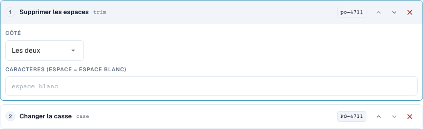
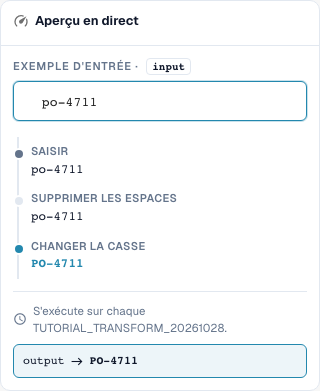
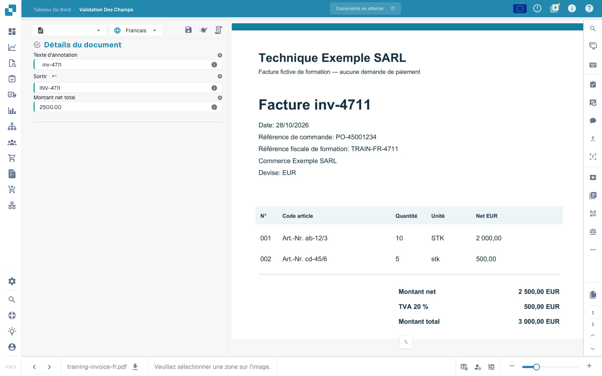

# Principes de base, périmètres d'application et tests sécurisés

[Retour à l'aperçu complet de la pratique](complete-practical-guide.md)

Champ d'en-tête · Cible Résultat · Source Texte original · Suppression des espaces → Majuscules → Préfixe INV-.

## Libellés visibles dans l’éditeur

Certains libellés de l’interface actuelle sont traduits de manière imprécise. Le tableau reprend le texte réellement affiché pour retrouver la bonne étape ; les explications fonctionnelles utilisent les termes techniques. Les captures montrent l’interface sans modification.

| Opération | Libellé affiché |
| --- | --- |
| trim | Supprimer les espaces |
| case | Changer la casse |

## Procédure dans l'éditeur

1. Dans le type de document de formation isolé, créer une nouvelle règle pour un **champ d'en-tête**. Choisir comme cible `output` et comme source distincte `header.input` ; les noms de champs réels de votre organisation peuvent différer.
2. Ajouter les étapes **Suppression des espaces**, côté : les deux, caractère vide, puis **Modifier la casse**, mode upper. L'ordre doit être Suppression des espaces → Majuscules.
3. Saisir la valeur de test `  inv-4711  `. La dernière valeur de prévisualisation doit être `INV-4711` ; les valeurs intermédiaires affichent d'abord `inv-4711`.
4. Activer la règle exclusivement pour le périmètre de formation et enregistrer. Rouvrir l'entrée et vérifier la source, la cible et les deux étapes.
5. Enregistrer le document d'exercice, le recharger et vérifier les deux champs : la source contient toujours les espaces d'origine, la sortie est `INV-4711`. Enregistrer à nouveau et répéter la même vérification.

<figure><figcaption>
Configuration des étapes. Interface réelle en français (France). L'aperçu ne modifie pas les documents stockés.
</figcaption></figure>


Configuration des étapes. Interface réelle en français (France). L'aperçu ne modifie pas les documents stockés.


<figure><figcaption>
Aperçu en direct avec valeurs de formation. Interface réelle en français (France). L'aperçu ne modifie pas les documents stockés.
</figcaption></figure>


Aperçu en direct avec valeurs de formation. Interface réelle en français (France). L'aperçu ne modifie pas les documents stockés.


## 1. Périmètre d'application

Une transformation modifie des données déjà extraites. Elle ne remplace pas la reconnaissance de texte. Dans l'éditeur, je choisis d'abord le périmètre d'application. Un champ d'en-tête est traité une fois par document. Une colonne de tableau est traitée pour chaque ligne. Les règles de tableau modifient des postes entiers. Le routage assigne le document à une sous-organisation. Ces quatre tâches ont des objectifs différents et des étapes différentes. Je crée mes exemples dans un type de document de test dédié, afin qu'aucune facture de production ne soit modifiée.

## 2. Source et traitement

Ensuite, je choisis le champ cible. La source peut être ce champ lui-même ou un autre champ. Les étapes s'exécutent de haut en bas. Chaque valeur intermédiaire devient l'entrée de l'étape suivante. Mon exemple lit un numéro de facture, supprime les espaces extérieurs et écrit en majuscules. Une lettre minuscule devient une majuscule. À l'aide d'une condition, je limite la règle au fournisseur approprié. Pour une colonne de tableau, la condition peut en outre vérifier les valeurs de la ligne actuelle. Plusieurs conditions peuvent être combinées avec Et, Ou et des groupes.

## 3. Vérifier l'effet

La prévisualisation en direct n'enregistre encore rien. Je vérifie une valeur appropriée, un cas contraire et un résultat déjà corrigé. Ensuite, j'enregistre la règle, je la rouvre et je contrôle les paramètres enregistrés. Pour l'effet réel sur le document, j'ai besoin en plus d'un document de test, d'une opération d'enregistrement et du résultat rechargé. Une prévisualisation ne prouve ni un export effectué ni un rapprochement de commande réussi. Les journaux d'exécution m'aident à distinguer les conditions appliquées des conditions ignorées. Dans les prochains épisodes, nous examinerons les transformations individuelles et leurs limites.

## Exemples vérifiés et cas contraires

Ces valeurs ont été vérifiées côté serveur en tant que test à sec. Un tel test ne modifie pas les documents enregistrés.

| Cas | Entrée | Résultat serveur |
| --- | --- | --- |
| copy | `  po-4711  ` | `PO-4711` |

## Validation

Vérifiez un cas approprié, un cas contraire, une valeur vide et un résultat déjà traité. Répétez l'opération d'enregistrement du document. Vérifiez en outre le rapprochement PO et la réception ERP, s'ils relèvent de l'objectif métier.

## Effet enregistré sur le document d'exercice

<figure><figcaption>
La valeur originale préparée est conservée ; la sortie affiche INV-4711. Deux opérations d'enregistrement natives, un rechargement et une requête serveur distincte confirment le résultat stable. Cela prouve l'effet de la règle sur des valeurs de test préparées, et non la précision d'une extraction automatique.
</figcaption></figure>


La valeur originale préparée est conservée ; la sortie affiche INV-4711. Deux opérations d'enregistrement natives, un rechargement et une requête serveur distincte confirment le résultat stable. Cela prouve l'effet de la règle sur des valeurs de test préparées, et non la précision d'une extraction automatique.


## Tutoriel vidéo


Configuration, exemples pratiques et contre-exemples.


[Ouvrir la vidéo avec sous-titres français et chapitres](https://docbits-videos.fra1.cdn.digitaloceanspaces.com/settings-assistant/transformation-rules-01-foundations-preview-admin/v1/fr.html). Cette version de révision attend la validation métier et une écoute complète.
