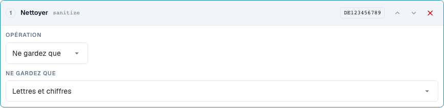
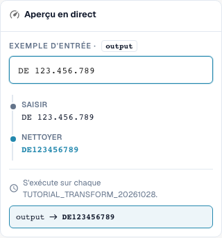

# Nettoyer le texte : casse, suppression des caractères en bordure et caractères

[Retour à l'aperçu complet de la pratique](complete-practical-guide.md)

Champ d'en-tête · Résultat cible · Tester les étapes individuellement : case, trim, sanitize.

## Libellés visibles dans l’éditeur

Certains libellés de l’interface actuelle sont traduits de manière imprécise. Le tableau reprend le texte réellement affiché pour retrouver la bonne étape ; les explications fonctionnelles utilisent les termes techniques. Les captures montrent l’interface sans modification.

| Opération | Libellé affiché |
| --- | --- |
| case | Changer la casse |
| trim | Supprimer les espaces |
| sanitize | Nettoyer |

## Procédure dans l'éditeur

1. Créer une seule étape **Modifier la casse** pour le champ d'en-tête de formation. Vérifier les modes upper, lower, title et capitalize successivement avec les exemples du tableau.
2. Commencer une nouvelle pipeline par **Supprimer les caractères en bordure (trim)** pour le numéro de facture. Régler le côté sur les deux et laisser le champ de caractères vide pour supprimer l'espace extérieur ; `47 11` doit conserver son espace interne.
3. En tant que contre-épreuve séparée lors de la suppression des caractères en bordure, régler le côté sur gauche et le caractère sur `0` : `004711` devient `4711`, `000` devient vide. Ne pas appliquer cette étape sans vérification pour de vrais identifiants.
4. Pour un numéro de taxe, utiliser **Nettoyer les caractères** en conservant alphanumérique. `DE 123.456.789` doit donner `DE123456789`. Vérifier les autres modes de conservation avec `DE-123` et `ACME GmbH!` respectivement.
5. Pour capitalize, comparer explicitement la prévisualisation et le serveur : pour `aCME GMBH` vérifié, ces résultats sont différents. Le résultat côté serveur est `Acme gmbh` ; une représentation navigateur appropriée seule ne suffit pas.

<figure><figcaption>
Configuration des étapes. Interface réelle en français (France). L'aperçu ne modifie pas les documents stockés.
</figcaption></figure>


Configuration des étapes. Interface réelle en français (France). L'aperçu ne modifie pas les documents stockés.


<figure><figcaption>
Aperçu en direct avec valeurs de formation. Interface réelle en français (France). L'aperçu ne modifie pas les documents stockés.
</figcaption></figure>


Aperçu en direct avec valeurs de formation. Interface réelle en français (France). L'aperçu ne modifie pas les documents stockés.


## 1. Casse

La mise en majuscules uniformise par exemple un numéro de facture. La mise en minuscules peut uniformiser une clé de comparaison technique. Title Case et la mise en majuscules du premier caractère peuvent également modifier le reste du mot. C'est pourquoi une abréviation d'entreprise peut devenir une autre graphie. Pour les noms propres, je n'utilise ces variantes qu'avec une consigne métier claire. Pour le mode Capitalise first, il existe un écart à l'état vérifié : l'aperçu du navigateur conserve le reste de la graphie, tandis que le serveur met le reste en minuscules. Je ne me fie donc pas ici uniquement à la prévisualisation, mais compare explicitement la valeur côté serveur.

## 2. Suppression des caractères en bordure (trim)

Le trim supprime les caractères en bordure. Les deux côtés suppriment les espaces extérieurs, mais pas un espace au milieu d'un numéro. Gauche avec le caractère zéro supprime tous les zéros non significatifs. Une valeur qui ne contient que des zéros devient vide par ce biais. Droite agit de manière correspondante à la fin. Le champ Caractère est un ensemble de caractères individuels et non un préfixe complet. C'est pourquoi je supprime un préfixe d'article fixe avec Affix. Le remplissage et la coupure sont traités dans l'épisode suivant.

## 3. Nettoyage des caractères

Lors du nettoyage, je peux conserver uniquement des lettres et des chiffres, uniquement des lettres, uniquement des chiffres ou également des espaces. Un numéro de taxe allemand avec des espaces et des points devient ainsi une clé continue. Pour un numéro d'article, les tirets peuvent toutefois être importants sur le plan métier. La suppression de tels caractères doit correspondre à la graphie dans le système cible. La suppression alternative de caractères fonctionne avec une classe de caractères régulière. Un tiret nécessite une attention particulière dans ce contexte. Pour mon exemple, je vérifie donc la valeur réelle côté serveur en plus de la prévisualisation. Les valeurs déjà nettoyées et les entrées vides doivent faire partie de chaque test.

## Exemples vérifiés et cas négatifs

Ces valeurs ont été vérifiées côté serveur en tant que test à blanc. Un tel test ne modifie pas les documents enregistrés.

| Cas | Entrée | Résultat serveur |
| --- | --- | --- |
| case-upper | `inv-4711` | `INV-4711` |
| case-upper | `INV-4711` | `INV-4711` |
| case-lower | `INFO@BEISPIEL.DE` | `info@beispiel.de` |
| case-title | `acme gmbh` | `Acme Gmbh` |
| case-capitalize | `aCME GMBH` | `Acme gmbh` |
| trim | `  4711  ` | `4711` |
| trim | `47 11` | `47 11` |
| trim-zero | `004711` | `4711` |
| trim-zero | `000` | `` |
| sanitize | `DE 123.456.789` | `DE123456789` |
| sanitize-alpha | `DE-123` | `DE` |
| sanitize-numeric | `DE-123` | `123` |
| sanitize-space | `ACME GmbH!` | `ACME GmbH` |
| sanitize-strip | `ab-12/3.` | `ab123` |

## Validation

Vérifiez un cas approprié, un cas négatif, une valeur vide et un résultat déjà traité. Répétez l'opération d'enregistrement du document. Vérifiez également le rapprochement PO et l'réception ERP s'ils relèvent de l'objectif métier.

## Tutoriel vidéo


Configuration, exemples pratiques et contre-exemples.


[Ouvrir la vidéo avec sous-titres français et chapitres](https://docbits-videos.fra1.cdn.digitaloceanspaces.com/settings-assistant/transformation-rules-02-text-cleaning-preview-admin/v1/fr.html). Cette version de révision attend la validation métier et une écoute complète.
