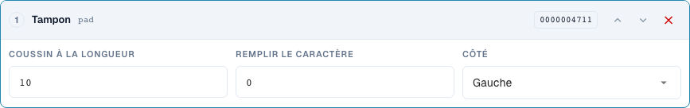
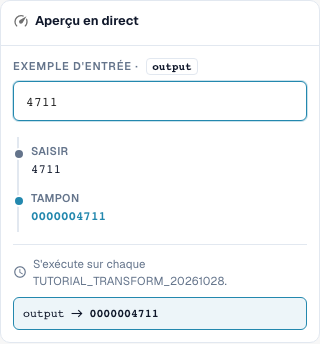

# Mise en forme des numéros : remplissage, troncature, préfixe et suffixe

> Limite connue de l’aperçu (vérifiée le 29 octobre 2026, version 11.15.2) : lors de l’ajout du préfixe `INV-`, l’aperçu transforme à tort `INV-4711` en `INV-INV-4711`. Le test indépendant du serveur conserve `INV-4711`. Vérifiez aussi les exécutions répétées par un test serveur ; un aperçu correct ne prouve pas à lui seul l’exécution complète lors de l’enregistrement.

[Retour à l'aperçu pratique complet](complete-practical-guide.md)

Champ d'en-tête · pad : longueur 10, caractère 0, gauche ; truncate : longueur 10 ; affix : opération exacte de préfixe/suffixe.

## Libellés visibles dans l’éditeur

Certains libellés de l’interface actuelle sont traduits de manière imprécise. Le tableau reprend le texte réellement affiché pour retrouver la bonne étape ; les explications fonctionnelles utilisent les termes techniques. Les captures montrent l’interface sans modification.

| Opération | Libellé affiché |
| --- | --- |
| pad | Tampon |
| truncate | Tronquer |
| affix | Affixe |

## Procédure dans l'éditeur

1. Sélectionnez l'étape de remplissage pour le nombre. Définissez la longueur minimale à 10, le caractère de remplissage `0`, et le côté gauche. `4711` doit devenir `0000004711`.
2. Vérifier avec une saisie déjà longue de onze caractères : le remplissage ne doit rien couper. Tester les complétions à droite séparément avec longueur 6, caractère `_` et saisie `ABC`.
3. Dans une règle distincte, configurer **Troncature** avec une longueur maximale de 10. `ABCDEFGHIJKL` devient `ABCDEFGHIJ`, `ABC` est conservé. Vérifier si différentes saisies peuvent aboutir au même identifiant après troncature.
4. Tester **Affix** avec ajout de préfixe `INV-`. Ensuite, vérifier `INV-4711` comme saisie : le préfixe exact déjà présent ne doit pas être ajouté à nouveau.
5. Configurer séparément les autres variantes d'Affix : ajout de suffixe `-DE`, suppression de préfixe `Art.-Nr. ` et suppression de suffixe ` EUR`. Lors de la suppression, tester également une extrémité non correspondante et une casse différente.
6. Réutiliser la sortie comme entrée. Lors de la suppression d'affixes présents plusieurs fois, un second passage peut modifier davantage.

<figure><figcaption>
Configuration des étapes. Interface réelle en français (France). L'aperçu ne modifie pas les documents stockés.
</figcaption></figure>


Configuration des étapes. Interface réelle en français (France). L'aperçu ne modifie pas les documents stockés.


<figure><figcaption>
Aperçu en direct avec valeurs de formation. Interface réelle en français (France). L'aperçu ne modifie pas les documents stockés.
</figcaption></figure>


Aperçu en direct avec valeurs de formation. Interface réelle en français (France). L'aperçu ne modifie pas les documents stockés.


## 1. Longueur

Le remplissage complète à gauche ou à droite avec un seul caractère de remplissage jusqu'à la longueur minimale. Avec dix positions et un zéro à gauche, un numéro de quatre chiffres devient un identifiant de dix chiffres. Un numéro déjà plus long reste plus long. Le remplissage n'est donc pas une vérification de longueur. La troncature, quant à elle, ne conserve que les premiers caractères jusqu'à la longueur maximale choisie. Cette information est perdue. Avant une utilisation ERP, je vérifie si différents numéros pourraient devenir identiques après troncature. Les valeurs courtes restent inchangées.

## 2. Préfixe et suffixe

Les résultats suivants des opérations sur les affixes décrivent l’exécution vérifiée côté serveur.

Affix propose quatre variantes : ajouter un préfixe, ajouter un suffixe, supprimer un préfixe et supprimer un suffixe. Un préfixe ajouté ne l'est pas une seconde fois si la valeur commence déjà exactement par celui-ci. Il en va de même pour un suffixe. La suppression, en revanche, vérifie strictement le début ou la fin. Une casse différente n'est pas automatiquement équivalente. Si le texte se trouve au milieu de la valeur, il est conservé. Pour des occurrences quelconques, j'utilise Rechercher et remplacer.

## 3. Réapplication

Même un pipeline simple nécessite un test de répétition. Si je supprime un préfixe d'une valeur ayant un double préfixe, il en reste un après le premier passage. Au passage suivant, celui-ci disparaîtrait également. C'est pourquoi je vérifie la règle entière et non pas chaque étape isolément. Le pipeline typique des numéros de facture est : suppression des espaces, mise en majuscules, ajout de préfixe. Je teste un numéro brut, un numéro déjà finalisé et un fournisseur différent. La condition garantit que seul le cas convenu est modifié.

## Exemples vérifiés et cas limites

Ces valeurs ont été vérifiées côté serveur lors d'un test à blanc. Un tel test ne modifie aucun document enregistré.

| Cas | Entrée | Résultat serveur |
| --- | --- | --- |
| pad | `4711` | `0000004711` |
| pad | `12345678901` | `12345678901` |
| pad-right | `ABC` | `ABC___` |
| truncate | `ABCDEFGHIJKL` | `ABCDEFGHIJ` |
| truncate | `ABC` | `ABC` |
| prefix-add | `4711` | `INV-4711` |
| prefix-add | `INV-4711` | `INV-4711` |
| suffix-add | `4711` | `4711-DE` |
| suffix-add | `4711-DE` | `4711-DE` |
| prefix-strip | `Art.-Nr. 4711` | `4711` |
| prefix-strip | `ART.-NR. 4711` | `ART.-NR. 4711` |
| prefix-strip | `Art.-Nr. Art.-Nr. 4711` | `Art.-Nr. 4711` |
| suffix-strip | `123 EUR` | `123` |
| suffix-strip | `123 EUR netto` | `123 EUR netto` |

## Validation

Vérifiez un cas approprié, un cas contraire, une valeur vide et un résultat déjà traité. Répétez l'opération de sauvegarde du document. Vérifiez également le rapprochement PO et la réception ERP si elles relèvent de l'objectif métier.

## Tutoriel vidéo


Configuration, exemples pratiques et contre-exemples.


[Ouvrir la vidéo avec sous-titres français et chapitres](https://docbits-videos.fra1.cdn.digitaloceanspaces.com/settings-assistant/transformation-rules-03-numbers-and-affixes-preview-admin/v1/fr.html). Cette version de révision attend la validation métier et une écoute complète.
