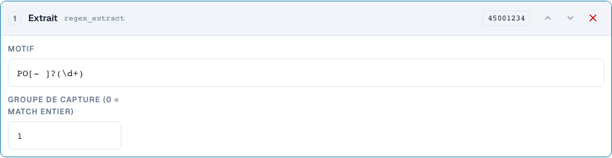
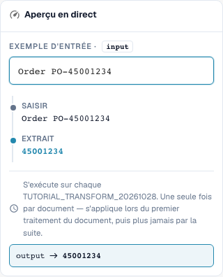

# Sous-chaînes et motifs : Découper, Extraire, Remplacer

[Retour à l'aperçu complet de la pratique](complete-practical-guide.md)

Champ d'en-tête · Source header.input · Cible output · regex_extract: PO[- ]?(\d+), Groupe 1. Source et cible restent séparés.

## Libellés visibles dans l’éditeur

Certains libellés de l’interface actuelle sont traduits de manière imprécise. Le tableau reprend le texte réellement affiché pour retrouver la bonne étape ; les explications fonctionnelles utilisent les termes techniques. Les captures montrent l’interface sans modification.

| Opération | Libellé affiché |
| --- | --- |
| substring | Prenez une tranche |
| regex_extract | Extrait |
| regex_replace | Rechercher et remplacer |

## Procédure dans l'éditeur

1. Pour les trois étapes, choisir une cible comme `output` et une **source originale séparée** comme `header.input`. Même « Une seule fois par document » n'autorise pas une auto-source.
2. Pour **Sous-chaîne**, régler d'abord Début 0 et Longueur 4 : `2026-10-28` donne `2026`. Ensuite, vérifier Début 3 et Fin 7 avec `DE-4711-X` ; la fin n'est pas incluse.
3. Comme variante propre, tester Début −4 sans longueur/fin : `INV-4711` donne `4711`. Une entrée plus courte est un contre-exemple nécessaire.
4. Pour **Extraire**, utiliser le motif `PO[- ]?(\d+)` et le groupe de capture 1. `Order PO-45001234` donne `45001234` ; `Invoice 4711` donne vide. Le groupe 0 fournit quant à lui l'ensemble de la correspondance.
5. Pour **Rechercher et remplacer**, configurer le motif `\s+`, le remplacement un espace et le nombre 0. `ACME    GmbH` doit donner `ACME GmbH`. Ensuite, vérifier le motif `-`, le remplacement `/`, le nombre 1 avec `AB-CD-EF` : seul le premier tiret est remplacé.
6. Tester les motifs concrets également côté serveur. Un motif réussi dans le navigateur seul ne garantit pas, pour des expressions complexes, un traitement serveur identique.

<figure><figcaption>
Configuration des étapes. Interface réelle en français (France). L'aperçu ne modifie pas les documents stockés.
</figcaption></figure>


Configuration des étapes. Interface réelle en français (France). L'aperçu ne modifie pas les documents stockés.


<figure><figcaption>
Aperçu en direct avec valeurs de formation. Interface réelle en français (France). L'aperçu ne modifie pas les documents stockés.
</figcaption></figure>


Aperçu en direct avec valeurs de formation. Interface réelle en français (France). L'aperçu ne modifie pas les documents stockés.


## 1. Sous-chaîne

Une sous-chaîne est définie par un début et une longueur, ou par un début et une fin. Le premier index est zéro. La fin n'appartient plus au résultat. Un début négatif compte depuis le bord droit. Pour les quatre derniers caractères, j'utilise un début de moins quatre et aucune fin. Je choisis une source différente de la cible. Ainsi, chaque exécution relit le texte original. Le serveur refuse ces étapes sur le champ cible propre, car la valeur serait sinon modifiée à chaque nouveau traitement. L'exécution unique ne remplace pas ici cette source séparée.

## 2. Extraire

Extraire recherche la première correspondance d'une expression régulière. Mon motif reconnaît les lettres P et O, éventuellement un tiret ou un espace, puis des chiffres. Le groupe un fournit uniquement les chiffres, le groupe zéro l'ensemble de la correspondance. Sans correspondance, une chaîne vide est retournée. Je mets donc une condition appropriée ou vérifie délibérément si une valeur cible vide est souhaitée dans ce cas. Plusieurs numéros de commande dans un texte ne deviennent pas automatiquement plusieurs résultats.

## 3. Remplacer

Rechercher et remplacer traite les correspondances d'un motif. Avec un nombre de zéro, toutes les correspondances sont remplacées. Un remplace uniquement la première correspondance. Je peux remplacer des espaces multiples par un seul espace. Là aussi, j'utilise une source originale séparée. L'aperçu dans le navigateur et le traitement sur le serveur peuvent utiliser des règles différentes pour des expressions régulières complexes. C'est pourquoi je teste d'abord des motifs simples et compare ensuite la valeur serveur réelle. Un cas approprié, aucune correspondance et plusieurs correspondances constituent ma vérification minimale.

## Exemples vérifiés et contre-exemple

Ces valeurs ont été vérifiées côté serveur comme test à blanc. Un tel test ne modifie aucun document enregistré.

| Cas | Entrée | Résultat serveur |
| --- | --- | --- |
| substring | `2026-10-28` | `2026` |
| substring | `AB` | `AB` |
| substring-end | `DE-4711-X` | `4711` |
| substring-negative | `INV-4711` | `4711` |
| regex-extract | `Order PO-45001234` | `45001234` |
| regex-extract | `Invoice 4711` | `` |
| regex-replace | `ACME    GmbH` | `ACME GmbH` |
| regex-count | `AB-CD-EF` | `AB/CD-EF` |

## Réception

Vérifiez un cas approprié, un contre-exemple, une valeur vide et un résultat déjà traité. Répétez l'opération d'enregistrement du document. Vérifiez également la correspondance PO et la réception ERP si elles relèvent de l'objectif métier.

## Tutoriel vidéo


Configuration, exemples pratiques et contre-exemples.


[Ouvrir la vidéo avec sous-titres français et chapitres](https://docbits-videos.fra1.cdn.digitaloceanspaces.com/settings-assistant/transformation-rules-04-substrings-and-patterns-preview-admin/v1/fr.html). Cette version de révision attend la validation métier et une écoute complète.
