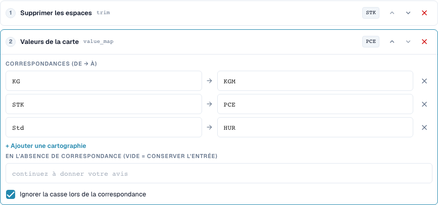
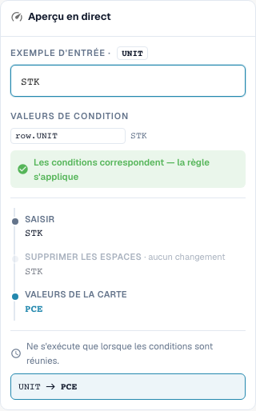

# Correspondances de valeurs et règles par ligne de tableau

[Retour à l'aperçu complet de la pratique](complete-practical-guide.md)

Colonne de tableau UNIT · suppression des caractères en bordure (trim) → value_map: STK→PCE, KG→KGM, Std→HUR · Ignorer la casse.

## Libellés visibles dans l’éditeur

Certains libellés de l’interface actuelle sont traduits de manière imprécise. Le tableau reprend le texte réellement affiché pour retrouver la bonne étape ; les explications fonctionnelles utilisent les termes techniques. Les captures montrent l’interface sans modification.

| Opération | Libellé affiché |
| --- | --- |
| trim | Supprimer les espaces |
| value_map | Valeurs de la carte |

## Procédure dans l'éditeur

1. Sélectionner la **colonne de tableau** comme portée, la table `INVOICE_TABLE` et la colonne cible `UNIT`. Chaque ligne de tableau est traitée individuellement ici.
2. Placer le **trimming** avant **attribuer les valeurs**. Saisir les paires `STK→PCE`, `KG→KGM` et `Std→HUR` et activer ignorer la casse.
3. Laisser le champ pour le remplacement sans correspondance vide, afin que les codes inconnus soient conservés. `stk` doit donner `PCE`, `BOX` doit rester `BOX`.
4. Vérifier un aperçu avec une condition de ligne correspondante et avec une condition non correspondante. La condition ne doit pas capturer involontairement les autres lignes.
5. Pour un véritable test multi-lignes, préparer les valeurs initiales `STK`, `STK`, `BOX`. Dans le test serveur vérifié, il en résulte `PCE`, `PCE`, `BOX` ; la quantité et le prix restent à vérifier séparément sur le plan métier.
6. Vérifier à nouveau chaque code cible comme entrée. Un remplacement forfaitaire comme `C62` et des correspondances chaînées peuvent masquer des valeurs inconnues ou être modifiées davantage lors des passages ultérieurs.

<figure><figcaption>
Configuration des étapes. Interface réelle en français (France). L'aperçu ne modifie pas les documents stockés.
</figcaption></figure>


Configuration des étapes. Interface réelle en français (France). L'aperçu ne modifie pas les documents stockés.


<figure><figcaption>
Aperçu en direct avec valeurs de formation. Interface réelle en français (France). L'aperçu ne modifie pas les documents stockés.
</figcaption></figure>


Aperçu en direct avec valeurs de formation. Interface réelle en français (France). L'aperçu ne modifie pas les documents stockés.


## 1. Paires de valeurs

Une correspondance de valeurs traduit des valeurs d'entrée entières. Mon exemple attribue le code P C E à l'unité pièce, le code K G M au kilogramme et le code H U R aux heures. Je saisis les codes fournisseurs réels et les codes cibles attendus sous forme de paires. Avec la casse ignorée, un code écrit en minuscules est également reconnu. Cela ne supprime pas encore les espaces. C'est pourquoi je place une étape de trimming avant la correspondance. Je teste explicitement un code inconnu.

## 2. Sans correspondance

Un champ vide pour la valeur sans correspondance signifie : conserver l'entrée. Cela ne signifie pas : supprimer l'entrée. Une valeur de remplacement saisie de manière fixe remplace en revanche chaque code inconnu. Cela peut masquer des erreurs. Pour des unités métier différentes, je n'attribuerais aucun code de remplacement forfaitaire. Une correspondance n'est pas non plus automatiquement répétable dans toutes les combinaisons. Si la sortie d'une paire est simultanément l'entrée d'une autre paire, un passage ultérieur peut continuer à attribuer. Je teste donc également chaque code cible comme nouvelle entrée.

## 3. Par ligne de tableau

Pour les tableaux, je choisis la table concrète et la colonne cible. Le pipeline s'exécute alors pour chaque ligne. Une condition peut lier le code d'unité de la ligne actuelle à une caractéristique fournisseur de l'en-tête. Dans l'exemple, deux lignes correspondantes sont modifiées, tandis qu'un code d'unité inconnu est conservé. Cela ne modifie pas les quantités ou les prix par une conversion d'unité. Renommer une chaîne de caractères n'est pas une conversion mathématique. Je vérifie la réconciliation de commande réelle et l'export séparément de la transformation.

## Exemples vérifiés et cas limites

Ces valeurs ont été vérifiées côté serveur comme test à blanc. Un tel test ne modifie aucun document enregistré.

| Cas | Entrée | Résultat serveur |
| --- | --- | --- |
| map | `stk` | `PCE` |
| map | `PCE` | `PCE` |
| map | `BOX` | `BOX` |
| map-fallback | `BOX` | `C62` |
| item-pipeline | `Art.-Nr. ab-12/3` | `AB123` |

## Validation

Vérifiez un cas correspondant, un cas limite, une valeur vide et un résultat déjà traité. Répétez l'opération d'enregistrement du document. Vérifiez également la réconciliation PO et la réception ERP si elles font partie de l'objectif métier.

## Tutoriel vidéo


Configuration, exemples pratiques et contre-exemples.


[Ouvrir la vidéo avec sous-titres français et chapitres](https://docbits-videos.fra1.cdn.digitaloceanspaces.com/settings-assistant/transformation-rules-05-value-mapping-preview-admin/v1/fr.html). Cette version de révision attend la validation métier et une écoute complète.
