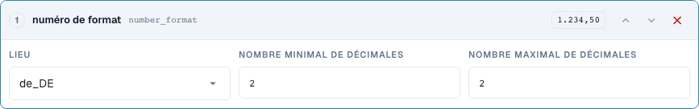
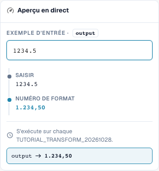

# Formater correctement les dates et les nombres

[Retour à l'aperçu complet de la pratique](complete-practical-guide.md)

Cible de texte · date_format: %d.%m.%Y; number_format: de_DE, min. 2, max. 2 décimales.

## Libellés visibles dans l’éditeur

Certains libellés de l’interface actuelle sont traduits de manière imprécise. Le tableau reprend le texte réellement affiché pour retrouver la bonne étape ; les explications fonctionnelles utilisent les termes techniques. Les captures montrent l’interface sans modification.

| Opération | Libellé affiché |
| --- | --- |
| date_format | Date de reformatage |
| number_format | numéro de format |

## Procédure dans l'éditeur

1. Pour un premier essai bien lisible, utiliser une **cible de texte** et l'étape **Formater la date**. Régler le modèle de sortie `%d.%m.%Y` et l'entrée `2026-10-28` ; `28.10.2026` est attendu.
2. Comparer les variantes `%m/%d/%Y`, `%Y-%m-%d` et `%d %b %Y` avec la même entrée univoque. Les modèles ne constituent pas une reconnaissance fiable de n'importe quel format de date.
3. Vérifier avec `kein Datum` et une entrée ambiguë. Pour un véritable champ d'en-tête DATE, contrôler séparément la valeur ISO stockée et l'affichage visible.
4. Dans une règle distincte **Formater le nombre**, choisir la locale `de_DE`, le nombre minimal et maximal de décimaux chacun à 2. L'entrée serveur `1234.5` doit donner `1234,50`.
5. Vérifier la même entrée avec `en_US` : résultat serveur `1234.50`. Le séparateur de milliers de l'aperçu navigateur vérifié n'est pas écrit côté serveur.
6. Vérifier zéro, un montant négatif et des décimales supplémentaires. Ensuite, retraiter la sortie et contrôler la valeur réellement stockée.

<figure><figcaption>
Configuration des étapes. Interface réelle en français (France). L'aperçu ne modifie pas les documents stockés.
</figcaption></figure>


Configuration des étapes. Interface réelle en français (France). L'aperçu ne modifie pas les documents stockés.


<figure><figcaption>
Aperçu en direct avec valeurs de formation. Interface réelle en français (France). L'aperçu ne modifie pas les documents stockés. Le séparateur de milliers visible appartient à l'aperçu du navigateur ; le résultat serveur vérifié est 1234,50.
</figcaption></figure>


Aperçu en direct avec valeurs de formation. Interface réelle en français (France). L'aperçu ne modifie pas les documents stockés. Le séparateur de milliers visible appartient à l'aperçu du navigateur ; le résultat serveur vérifié est 1234,50.


## 1. Date et type de données

Reformater la date écrit une date selon le modèle choisi. Une date ISO univoque est une bonne entrée de test. Le jour, le mois et l'année peuvent par exemple être affichés avec des points. Pour un véritable champ d'en-tête de date, la valeur interne peut rester au format ISO tandis que l'affichage change. Un champ de texte ou une cellule de tableau peut en revanche contenir le texte formaté. C'est pourquoi je compare non seulement le champ visible, mais aussi la valeur stockée et l'utilisation ultérieure.

## 2. Données illisibles et ambiguës

Une date illisible n'est pas simplement inventée. Dans mon test serveur, le texte reste inchangé et le résultat indique la raison. Les indications ambiguës comme jour et mois avec de petits nombres nécessitent un contexte univoquement convenu. Une date formatée ne doit pas être lue comme un autre jour lors de la prochaine sauvegarde. Je vérifie donc un deuxième passage. Cette transformation ne peut pas créer une date fiable à partir d'un texte quelconque sans date valide.

## 3. Format de nombre

Formater les nombres utilise une locale et un nombre minimal ainsi que maximal de décimales. Cela modifie l'affichage et éventuellement l'arrondi, mais pas un taux de change ni une unité de quantité. Pour mon entrée mille deux cent trente-quatre virgule cinq, le serveur actuel avec deux décimales fournit une écriture allemande avec virgule ou une écriture anglaise avec point. Un séparateur de milliers n'est pas contenu dans le résultat serveur vérifié. Je ne retiens donc pas une présentation navigateur plus élégante comme preuve pour l'export. Zéro, les montants négatifs, les décimales supplémentaires et la valeur de résultat stockée nécessitent des tests propres.

## Exemples vérifiés et cas limites

Ces valeurs ont été vérifiées côté serveur comme test à sec. Un tel test ne modifie pas les documents stockés.

| Cas | Entrée | Résultat serveur |
| --- | --- | --- |
| date | `2026-10-28` | `28.10.2026` |
| date | `kein Datum` | `kein Datum` |
| number-de | `1234.5` | `1234,50` |
| number-us | `1234.5` | `1234.50` |

## Validation

Vérifiez un cas approprié, un cas limite, une valeur vide et un résultat déjà traité. Répétez l'opération de sauvegarde du document. Vérifiez en outre la réconciliation bon de commande et la réception ERP si elles appartiennent à l'objectif métier.

Dans l'état vérifié, l'aperçu des nombres et le serveur diffèrent pour les séparateurs de milliers. Le tableau indique la valeur serveur réelle.

## Tutoriel vidéo


Configuration, exemples pratiques et contre-exemples.


[Ouvrir la vidéo avec sous-titres français et chapitres](https://docbits-videos.fra1.cdn.digitaloceanspaces.com/settings-assistant/transformation-rules-06-dates-and-numbers-preview-admin/v1/fr.html). Cette version de révision attend la validation métier et une écoute complète.
