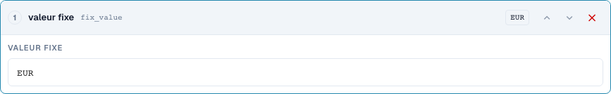
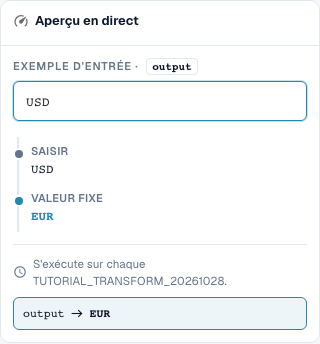
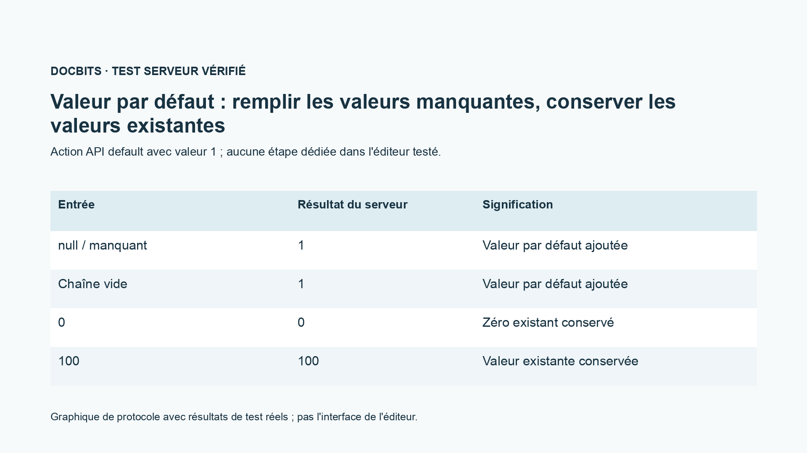

# Transfert de champs, valeurs fixes, vidage et valeurs par défaut

[Retour à l'aperçu complet de la pratique](complete-practical-guide.md)

Résultat visé · Source Texte original pour le transfert de champ ; valeur fixe uniquement sous condition stricte ; vidage testé séparément.

## Libellés visibles dans l’éditeur

Certains libellés de l’interface actuelle sont traduits de manière imprécise. Le tableau reprend le texte réellement affiché pour retrouver la bonne étape ; les explications fonctionnelles utilisent les termes techniques. Les captures montrent l’interface sans modification.

| Opération | Libellé affiché |
| --- | --- |
| trim | Supprimer les espaces |
| case | Changer la casse |
| fix_value | valeur fixe |
| clear | Supprimer |

## Procédure dans l'éditeur

1. Pour un **transfert de champ**, choisir un autre champ source que le champ cible. Dans le cadre de l'exercice, la cible est `output`, la source `header.input`.
2. Configurer les étapes Supprimer les caractères en bordure (trim) → Mise en majuscules et tester `  po-4711  `. La sortie sera `PO-4711` ; la source originale ne doit pas être vidée au cours de l'opération.
3. Pour un numéro de commande productif, utiliser une condition supplémentaire qui ne s'applique que lorsque la cible est vide. Tester une valeur cible correcte déjà existante comme cas contraire.
4. Dans une règle propre, créer une **valeur fixe** avec `EUR`. Une saisie `USD` sera également écrasée ; il ne s'agit pas d'une conversion de devise.
5. **Vider** séparément avec `Altwert`. La sortie est la chaîne de caractères vide. Prendre en compte la différence métier entre un vidage intentionnel et une valeur de sortie manquante.
6. Tester l'étape d'interface `default` uniquement via le contrat API prévu ; dans le menu d'étape normal vérifié, il n'existe pas d'entrée dédiée. Le graphique de protocole montre : manquant et vide sont complétés, `0` et `100` sont conservés.

<figure><figcaption>
Configuration des étapes. Interface réelle en français (France). L'aperçu ne modifie pas les documents stockés.
</figcaption></figure>


Configuration des étapes. Interface réelle en français (France). L'aperçu ne modifie pas les documents stockés.


<figure><figcaption>
Aperçu en direct avec valeurs de formation. Interface réelle en français (France). L'aperçu ne modifie pas les documents stockés.
</figcaption></figure>


Aperçu en direct avec valeurs de formation. Interface réelle en français (France). L'aperçu ne modifie pas les documents stockés.


## 1. Transfert de champ

Pour un transfert de champ, je choisis d'abord le champ cible, puis une autre source. Si le numéro de commande se trouve dans le mauvais champ, je peux le lire depuis ce champ, en supprimer les caractères en bordure (trim) et l'enregistrer dans le bon champ cible. Une condition Cible est vide protège un numéro de commande déjà existant. La source reste intacte. Il s'agit d'une copie avec traitement et non d'un déplacement. Je vérifie une cible vide, une cible déjà remplie et une source vide.

## 2. Valeur fixe et vidage

Une valeur fixe ignore le contenu précédent. Si je définis la devise sur Euro, la règle écrase également une autre devise déjà existante. Pour cela, j'ai besoin d'une condition métier stricte. Vider écrit une chaîne de caractères vide dans le champ cible. Il ne s'agit pas d'une suppression du champ entier ou du document. Dans l'aperçu, je vérifie surtout le cas contraire, afin que la règle ne supprime pas de valeurs valides. Seule l'enregistrement de la règle ne prouve pas encore une modification d'un document.

## 3. Valeurs par défaut

L'interface serveur prend en charge en outre une action de valeur par défaut. Elle complète une valeur uniquement en cas de saisie manquante ou vide. Un zéro existant reste zéro. Cette action n'est pas présente comme étape propre dans la sélection d'étapes vérifiée de l'éditeur normal. Dans l'éditeur, je peux souvent représenter le cas de défaut souhaité avec la condition Cible est vide et une valeur fixe. Je présente cette distinction de manière transparente et ne prétends pas qu'il existe un point de menu supplémentaire. Une valeur par défaut est toujours une décision métier, notamment pour la base de prix, la quantité ou la devise.

## Exemples vérifiés et cas contraires

Ces valeurs ont été vérifiées côté serveur sous forme de test à blanc. Un tel test ne modifie aucun document enregistré.

| Cas | Entrée | Résultat serveur |
| --- | --- | --- |
| fixed | `USD` | `EUR` |
| fixed | `null` | `EUR` |
| clear | `Altwert` | `` |
| clear | `` | `` |
| default-api | `null` | `1` |
| default-api | `` | `1` |
| default-api | `0` | `0` |
| default-api | `100` | `100` |
| copy | `  po-4711  ` | `PO-4711` |

## Validation

Vérifiez un cas approprié, un cas contraire, une valeur vide et un résultat déjà traité. Répétez l'opération d'enregistrement du document. Vérifiez en outre la réconciliation bon de commande et la réception ERP si elles relèvent de l'objectif métier.

<figure><figcaption>
Résultats réels de test serveur et persistance présentés sous forme de graphique de protocole. Ce n'est pas une interface d'éditeur recréée.
</figcaption></figure>


Résultats réels de test serveur et persistance présentés sous forme de graphique de protocole. Ce n'est pas une interface d'éditeur recréée.


## Tutoriel vidéo


Configuration, exemples pratiques et contre-exemples.


[Ouvrir la vidéo avec sous-titres français et chapitres](https://docbits-videos.fra1.cdn.digitaloceanspaces.com/settings-assistant/transformation-rules-07-field-copy-and-defaults-preview-admin/v1/fr.html). Cette version de révision attend la validation métier et une écoute complète.
