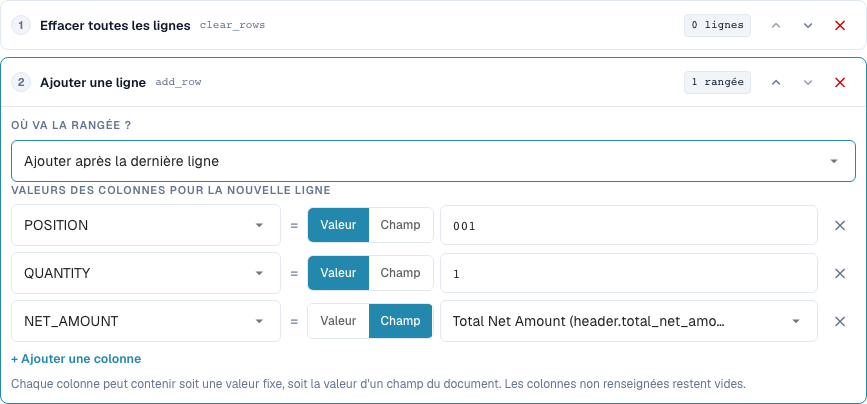
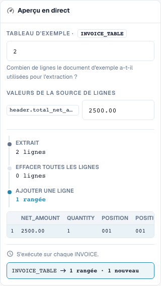

# Reconstruction des lignes de tableau

[Retour à l'aperçu complet de la pratique](complete-practical-guide.md)

Tableau INVOICE_TABLE · clear_rows → add_row à la fin · POSITION=001, QUANTITY=1, NET_AMOUNT issu de header.total_net_amount.

## Libellés visibles dans l’éditeur

Certains libellés de l’interface actuelle sont traduits de manière imprécise. Le tableau reprend le texte réellement affiché pour retrouver la bonne étape ; les explications fonctionnelles utilisent les termes techniques. Les captures montrent l’interface sans modification.

| Opération | Libellé affiché |
| --- | --- |
| clear_rows | Effacer toutes les lignes |
| add_row | Ajouter une ligne |

## Procédure dans l'éditeur

1. Choisir le périmètre d'application **Lignes de tableau** et le tableau concret `INVOICE_TABLE`. Une condition fournisseur appropriée limite la reconstruction complète.
2. D'abord configurer **Supprimer toutes les lignes**, puis **Ajouter une ligne**. Pour la nouvelle ligne, définir des valeurs fixes `POSITION=001`, `QUANTITY=1` et pour `NET_AMOUNT` la source `header.total_net_amount`.
3. Tester avec le montant d'en-tête `2500.00` et deux lignes existantes : il reste exactement la nouvelle ligne totale définie. Vérifier également un montant d'en-tête manquant avant que la règle ne devienne active.
4. Lors de l'ajout, comparer la position avant la première ligne et après la dernière ligne. Pour cette vérification de position, supprimer la suppression précédente ou la tester séparément, sinon il n'existe aucune ligne existante comme référence.
5. Vérifier intentionnellement l'ordre inversé des étapes **Ajouter → Supprimer** comme cas contraire : le résultat est vide. Rétablir ensuite l'ordre prévu.
6. Vérifier la double sauvegarde. L'ajout sans suppression préalable peut multiplier les lignes ; une reconstruction peut supprimer irrémédiablement des positions fournisseur du résultat de travail sur le plan métier. Valider la concordance commande séparément.

<figure><figcaption>
Configuration des étapes. Interface réelle en français (France). L'aperçu ne modifie pas les documents stockés.
</figcaption></figure>


Configuration des étapes. Interface réelle en français (France). L'aperçu ne modifie pas les documents stockés.


<figure><figcaption>
Aperçu en direct avec valeurs de formation. Interface réelle en français (France). L'aperçu ne modifie pas les documents stockés.
</figcaption></figure>


Aperçu en direct avec valeurs de formation. Interface réelle en français (France). L'aperçu ne modifie pas les documents stockés.


## 1. Construction des lignes

Supprimer toutes les lignes élimine les lignes existantes du tableau sélectionné. Ajouter une ligne construit ensuite une nouvelle ligne. Pour chaque colonne, je choisis soit une valeur fixe, soit la valeur d'un champ d'en-tête. Dans mon exemple, il en résulte une position totale avec une quantité de un et un montant net issu de l'en-tête de facture. Les colonnes non renseignées restent vides. La nouvelle ligne peut se situer au début ou à la fin. Il ne s'agit pas d'un regroupement ou d'une sommation automatique de positions existantes sélectionnées.

## 2. Ordre des étapes

L'ordre est décisif. Supprimer puis ajouter donne la nouvelle ligne souhaitée. Ajouter puis supprimer élimine également la ligne qui vient d'être créée. Sans suppression préalable, une nouvelle exécution ajouterait encore une ligne. Pour cela, la règle exige une exécution unique appropriée. Un aperçu avec un nombre de lignes vérifie la structure, mais ne remplace pas encore un test avec un tableau réellement extrait. Je contrôle les valeurs des colonnes et le nombre de lignes après la sauvegarde.

## 3. Vérification séparée de la concordance commande

Une règle de tableau s'exécute avant les règles de colonne. Une règle de colonne en aval peut donc également nettoyer les lignes nouvellement ajoutées. La reconstruction de positions peut modifier les identifiants de lignes existants et les attributions de commandes. Pour une facture qui est volontairement rapprochée sur le montant total, j'ai besoin en plus de la règle de concordance commande appropriée. La transformation seule ne confirme pas un rapprochement complet. Je ne teste cela qu'avec un document isolé et vérifie après une nouvelle sauvegarde le nombre de lignes et le statut de rapprochement séparément.

## Validation

Vérifiez un cas approprié, un cas contraire, une valeur vide et un résultat déjà traité. Répétez l'opération de sauvegarde du document. Vérifiez en outre le rapprochement bon de commande et la réception ERP s'ils relèvent de l'objectif métier.

## Tutoriel vidéo


Configuration, exemples pratiques et contre-exemples.


[Ouvrir la vidéo avec sous-titres français et chapitres](https://docbits-videos.fra1.cdn.digitaloceanspaces.com/settings-assistant/transformation-rules-08-table-rows-preview-admin/v1/fr.html). Cette version de révision attend la validation métier et une écoute complète.
