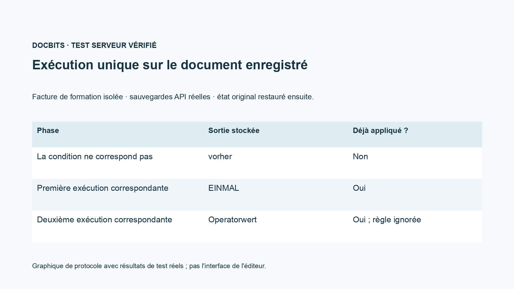
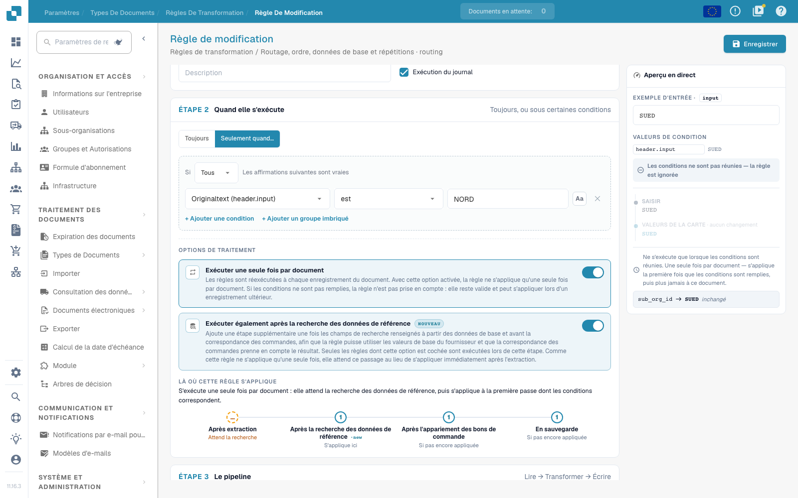

# Routage, ordre, données de base et exécutions uniques

[Retour à l'aperçu complet de la pratique](complete-practical-guide.md)

Routage · Organisation cible · utiliser une cible existante ; vérifier séparément les conditions, les phases d'exécution et la répétition.

Dans l'enregistrement vidéo, le nom et l'identifiant interne de la cible de routage existante sont masqués. Pour votre propre configuration, la cible doit provenir de la sélection réelle des sous-organisations disponibles.

## Procédure dans l'éditeur

1. Pour le **Routage**, choisir l'attribut de document proposé `sub_org_id`. Utiliser exclusivement une sous-organisation réellement existante comme cible fixe ou comme résultat d'une correspondance de valeurs.
2. Ajouter une condition fournisseur ou d'identification appropriée. Dans l'exercice, `NORD` doit satisfaire la condition et `SUED` doit la sauter. L'enregistrement montre uniquement l'aperçu et ne déplace aucun document productif.
3. Comparer l'affichage des phases avec le déroulement Champ d'en-tête → Routage → Lignes de tableau → Colonne de tableau. La priorité et la clé de règle ne s'appliquent qu'à l'intérieur d'un même domaine.
4. Activer **Exécuter également après la recherche de données de base** et prendre en compte la phase supplémentaire avant la réconciliation de commande. Une source qui provient initialement des données de base nécessite un passage approprié.
5. **Une seule fois par document** : d'abord tester avec une condition non satisfaite, puis exécuter une première fois de manière satisfaisante. Dans le cas de formation vérifié, le premier passage sauté ne consomme pas l'application.
6. Après la première application satisfaisante, insérer une valeur d'opérateur et sauvegarder à nouveau. Le test doit montrer que la règle unique ne remplace pas cette valeur une nouvelle fois ; contrôler la condition, le résultat, la phase et la preuve d'application dans le journal.

## 1. Sous-organisation

Le routage écrit actuellement la sous-organisation du document. Je peux définir une cible fixe parmi les choix disponibles ou mapper une valeur source vers une sous-organisation. Une condition fournisseur appropriée limite l'attribution. Il ne s'agit ni d'une autorisation utilisateur ni d'une décision de libération. Je n'utilise que des sous-organisations existantes valides et je vérifie le cas contraire. Dans cette séquence, l'exemple de routage reste un aperçu ; il ne déplace aucun document productif.

## 2. Phases d'exécution

Les domaines de validité s'exécutent dans l'ordre : champ d'en-tête, routage, lignes de tableau et colonne de tableau. À l'intérieur d'un domaine, la priorité et la clé de règle s'appliquent. Une source d'en-tête nettoyée peut donc déjà être lue par le routage. Avec l'exécution supplémentaire après la recherche de données de base, une règle peut utiliser des valeurs qui ne sont complétées que depuis les données de base. Cette option ajoute un passage avant la réconciliation de commande. Elle ne déplace pas toutes les autres exécutions à cet endroit.

## 3. Règles uniques et preuve

Exécuter une seule fois par document limite une règle réellement appliquée. Une condition non satisfaite ne consomme pas encore cette exécution. Combinée avec l'option de recherche, la règle attend lors du premier passage d'extraction la phase ultérieure. Pour les sous-chaînes et les expressions régulières, la source séparée reste néanmoins requise. Je vérifie une application initiale, un cas non satisfaisant et une sauvegarde ultérieure. Dans le journal, je recherche la condition, le résultat et la phase d'exécution. Seul un document rechargé atteste de l'effet sauvegardé. Une entrée ERP et une réconciliation de commande nécessitent chacune leur propre preuve.

## Réception

Vérifiez un cas satisfaisant, un cas contraire, une valeur vide et un résultat déjà traité. Répétez l'opération de sauvegarde du document. Vérifiez également la réconciliation PO et la réception ERP si elles relèvent de l'objectif métier.

<figure><figcaption>
Résultats réels de test serveur et persistance présentés sous forme de graphique de protocole. Ce n'est pas une interface d'éditeur recréée.
</figcaption></figure>


Résultats réels de test serveur et persistance présentés sous forme de graphique de protocole. Ce n'est pas une interface d'éditeur recréée.


Dans le test d'intégration sauvegardé, une condition non satisfaisante n'a pas consommé l'exécution unique. Lors du premier enregistrement satisfaisant, EINMAL a été écrit. Lors du second enregistrement satisfaisant, la valeur d'opérateur préparée a été conservée, et la preuve d'application sauvegardée est restée définie. Le document de test a ensuite été restauré. Le test serveur à sec peut toujours calculer un résultat hypothétique ; vérifiez donc également son indication `already_applied` et le document réellement sauvegardé.

<figure><figcaption>
Exécution unique et la phase de recherche supplémentaire dans l'éditeur réel. La condition d'exemple non correspondante est ignorée ; les identifiants de cible de routage interne sont masqués. Ces options sont un aperçu non enregistré.
</figcaption></figure>


Exécution unique et la phase de recherche supplémentaire dans l'éditeur réel. La condition d'exemple non correspondante est ignorée ; les identifiants de cible de routage interne sont masqués. Ces options sont un aperçu non enregistré.


## Tutoriel vidéo


Configuration, exemples pratiques et contre-exemples.


[Ouvrir la vidéo avec sous-titres français et chapitres](https://docbits-videos.fra1.cdn.digitaloceanspaces.com/settings-assistant/transformation-rules-09-routing-and-execution-preview-admin/v1/fr.html). Cette version de révision attend la validation métier et une écoute complète.
