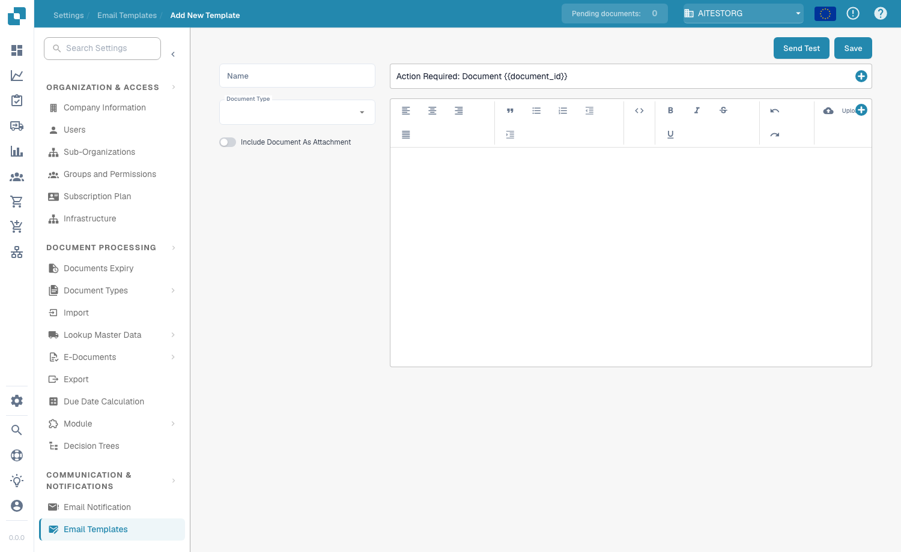

# Modèles d'e-mails

## **Aperçu**

Les modèles d'e-mails vous permettent de personnaliser les e-mails automatisés envoyés par DocBits — par exemple les rappels d'approbation ou les notifications d'erreur. Un modèle définit l'objet et le corps du message, et peut inclure des champs dynamiques (par exemple `{{InvoiceNumber}}`), des images et une mise en forme en texte enrichi.

## **Accès aux modèles d'e-mails**

Accédez à **Settings → Communication & Notifications → Email Templates**. La liste affiche chaque modèle avec son **Name**, son **Subject**, son **Document Type**, sa date de **Last Modified** et ses **Actions** (modifier ou supprimer).

<figure><figcaption>
La liste des modèles d'e-mails
</figcaption></figure>

## **Création d'un modèle**

1. Cliquez sur **+ New** en haut à droite.
2. Remplissez les champs :
   * **Name** — un identifiant descriptif (par exemple « Document Error Notification »).
   * **Document Type** — le type de document auquel le modèle s'applique (par exemple `INVOICE`).
   * **Include Document As Attachment** — activez ce commutateur pour joindre le document source à l'e-mail.
   * **Subject** — l'objet de l'e-mail. Cliquez sur le bouton **+** à côté du champ pour insérer un champ dynamique, ou saisissez directement `{{FieldID}}`.
3. Rédigez le corps dans l'éditeur de texte enrichi — mettez le texte en forme (gras, italique, listes, alignement), insérez des images avec **Upload**, modifiez le HTML brut avec le bouton `<>`, et utilisez le bouton **+** pour insérer des champs dynamiques.
4. Cliquez sur **Save**.

<figure><figcaption>
L'éditeur de modèle — nom, type de document, commutateur de pièce jointe, objet et corps en texte enrichi
</figcaption></figure>

## **Champs dynamiques**

Les champs dynamiques sont remplacés par les données du document lors de l'envoi de l'e-mail. Insérez-les avec le bouton **+**, ou saisissez-les manuellement avec des doubles accolades :

* `{{invoice_id}}` — le numéro de facture
* `{{supplier_name}}` — le nom du fournisseur
* `{{total_amount}}` — le montant total
* `{{status}}` — le statut actuel du document

## **Envoi d'un e-mail de test**

Cliquez sur **Send Test** dans l'éditeur, saisissez une adresse dans **Receiver Email**, puis cliquez sur **Send**. DocBits envoie un aperçu du modèle afin que vous puissiez vérifier la mise en page et contrôler que les champs dynamiques sont correctement résolus avant d'enregistrer.

<figure><figcaption>
La boîte de dialogue Send Test
</figcaption></figure>

## **Utilisation des modèles dans les notifications**

Les modèles enregistrés peuvent être liés aux flux de travail de [**Email Notification**](email-notification/) — par exemple les rappels d'approbation ou les mises à jour de changement de statut.
